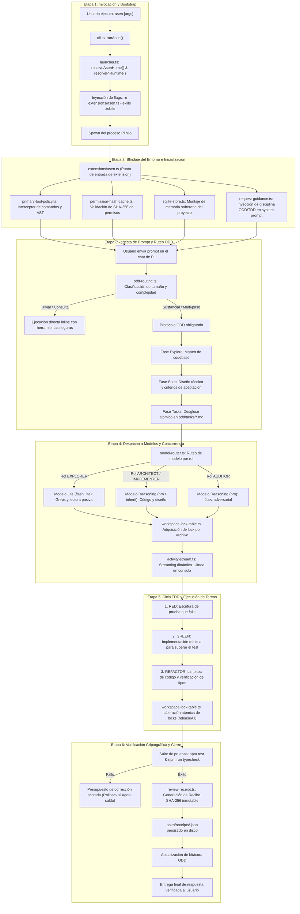

# ASEN — Arquitectura Integral del Motor y Flujo de Ejecución Extremo a Extremo

**Fecha:** 2026-11-14
**Propósito:** Desglose arquitectónico en profundidad del ciclo de vida completo de ASEN, desde que el desarrollador invoca el CLI en terminal, ingresa un prompt en Pi, hasta que los modelos de inteligencia artificial ejecutan código bajo las garantías de ODD y TDD.

---

## 1. Flujograma Integral del Flujo de Ejecución

---

## 2. Zoom por Etapas del Ciclo de Vida

### Etapa 1: Invocación, Parsing y Bootstrap
* **Qué sucede:** El usuario escribe `asen` en su terminal (o subcomandos como `asen startup`, `asen doctor`, `asen managed run`).
* **Módulos que intervienen:**
  * `src/cli.ts`: Entrypoint ejecutable de Node.js.
  * `src/runtime/launcher.ts`: Parser de argumentos híbridos (separa argumentos propios de ASEN de los argumentos nativos de Pi).
* **Mecánica interna:**
  1. `runAsen()` lee la configuración de usuario en `~/.asen/config.json`.
  2. Resuelve el home de ASEN (`resolveAsenHome`): determina dónde residen la memoria SQLite, los perfiles de sesión y los logs.
  3. Detecta el binario ejecutable de Pi (`resolvePiRuntime`): prioriza `@earendil-works/pi-coding-agent` empaquetado o el existente en PATH.
  4. Inyecta flags mandatorios: `--extension C:\Asen\extensions\asen.ts` y `--skill ./skills`.
  5. Spawnea el proceso interactivo de Pi conectando stdio de manera transparente.

### Etapa 2: Blindaje del Entorno e Inicialización de la Extensión
* **Qué sucede:** Pi levanta y carga la extensión `extensions/asen.ts`. El entorno queda blindado antes de aceptar cualquier instrucción del desarrollador.
* **Módulos que intervienen:**
  * `src/security/primary-tool-policy.ts`: Guardián de ejecución de herramientas.
  * `src/security/permission-hash-cache.ts`: Cache criptográfico de autorizaciones.
  * `src/memory/sqlite-store.ts`: Base de datos SQLite local para memoria persistente.
  * `src/runtime/request-guidance.ts`: Inyector de directivas en el system prompt.
* **Mecánica interna:**
  1. **Envoltura de Bash/CLI:** Se intercepta la herramienta de comandos de consola. Se parsea el árbol de sintaxis abstracta (AST) de cada comando para detectar operadores peligrosos (`rm -rf`, force push, drops).
  2. **Cache de Permisos (`P7`):** Se consulta si el comando ya fue aprobado mediante la clave `SHA256(canonicalCwd + "\0" + command + "\0" + branch)`. Si existe en caché y no es destructivo, se omite el diálogo de confirmación repetitivo.
  3. **Memoria Local:** Se abre la base de datos `memory.db` en `.asen/` con bloqueo exclusivo (`withExclusiveFileLock`).
  4. **System Guidance:** Se inyectan en el prompt del LLM las reglas de oro: metodología ODD, requerimiento TDD, y prohibición estricta de co-autoría de IA en commits.

### Etapa 3: Ingesta del Prompt, Ruteo ODD y Planificación
* **Qué sucede:** El desarrollador ingresa una solicitud en el chat (ej. *"Crea un endpoint de autenticación"*).
* **Módulos que intervienen:**
  * `src/flow/odd-routing.ts`: Evaluador de aplicabilidad y ruteo metodológico.
  * `src/flow/odd-task-tracking.ts`: Gestor de bitácoras de tareas en disco.
* **Mecánica interna:**
  1. El prompt es evaluado bajo el **Contrato de Ruteo ODD**:
     * Si es una pregunta de solo lectura o un cambio de 1 o 2 líneas, se autoriza la ruta *inline directa*.
     * Si implica cambios estructurales, nuevos archivos o lógica de negocio, se activa la ruta *sustancial ODD*.
  2. Se abre (o actualiza) un documento de tarea formal en `odd/tasks/<nombre-de-tarea>.md`.
  3. Se redactan especificaciones funcionales (`S1, S2, ...`) y un checklist atómico de tareas (`T1, T2, ...`) con rutas disjuntas de edición.

### Etapa 4: Despacho a Modelos por Rol, Concurrencia y Streaming
* **Qué sucede:** La tarea se delega para su resolución técnica. ASEN optimiza recursos y protege los archivos de colisiones.
* **Módulos que intervienen:**
  * `src/agents/model-router.ts`: Enrutador de tiers de LLM (`P4`).
  * `src/runtime/workspace-lock-table.ts`: Exclusión mutua de archivos (`P6`).
  * `src/runtime/activity-stream.ts`: Renderizador de actividad en consola (`P5`).
* **Mecánica interna:**
  1. **Ruteo de Modelos:**
     * Subagentes de exploración (lectura de directorios, greps, inspección de dependencias) reciben rol `AgentRole.EXPLORER` y se despachan al modelo ligero (`flash_lite`). Esto consume 70% menos tokens y responde a velocidad extrema.
     * Tareas de arquitectura, TDD y jueces reciben roles `ARCHITECT`, `IMPLEMENTER` o `AUDITOR` y se anclan al modelo de alto razonamiento (`pro`). La regla dura impide degradar escritores a modelos lite.
  2. **Adquisición de Locks Semánticos:** Antes de editar cualquier archivo, el subagente llama a `tryLock(path, agentId)`. Si otro agente paralelo está editando el archivo, el despachador desvía al agente a la siguiente tarea del checklist ODD para evitar conflictos de git.
  3. **Streaming Fail-Fast:** La terminal muestra en una sola línea dinámica ANSI (`\r\x1b[K`):
     `[explorer-1] ⚡ Leyendo src/auth/jwt.ts (Paso 2/4)...`
     Si el desarrollador detecta una alucinación temprana, interrumpe con `Esc` o `Ctrl+C` sin matar el orquestador.

### Etapa 5: Ciclo TDD (Test-Driven Development)
* **Qué sucede:** La implementación de código sigue estrictamente el ciclo científico de pruebas antes de código.
* **Mecánica interna:**
  1. **RED:** El implementador escribe primero un archivo de prueba (ej. `tests/jwt-auth.test.ts`) que falla demostrando la ausencia de la característica o la presencia del bug.
  2. **GREEN:** El agente escribe el código mínimo indispensable en `src/` hasta que la prueba pasa exitosamente.
  3. **REFACTOR:** Limpieza de código, verificación de tipado estricto (`exactOptionalPropertyTypes`) y formateo.
  4. **Liberación de Locks:** Al cerrar el ciclo de la unidad de trabajo, se invoca `releaseAll(agentId)` liberando todos los archivos bloqueados.

### Etapa 6: Verificación Criptográfica, Recibo Inmutable y Cierre
* **Qué sucede:** Se valida el trabajo completo y se sella la evidencia de auditoría.
* **Módulos que intervienen:**
  * `src/evidence/review-receipt.ts`: Generador y firmador de recibos (`P2`).
  * `src/runtime/command-registry.ts`: Catálogo unificado de comandos (`P1`).
* **Mecánica interna:**
  1. Se corre la suite de pruebas automatizadas y el typecheck.
  2. Si todo pasa, se congela el árbol git (`treeSha`) y se genera el recibo criptográfico:
     `.asen/receipts/<commit-sha>.json`
     Firmado con: `SHA256(treeSha + ":" + passed + ":" + verdict + ":" + commitSha)`.
  3. El recibo queda almacenado como prueba inmutable de que ese commit exacto superó las pruebas reales.
  4. Se actualiza el estado de las tareas en `odd/tasks/*.md` marcándolas como `done` con su enlace de evidencia.
  5. Se emite el resumen final al usuario en terminal.

---

## 3. Zoom en las 10 Piezas Clave del Motor (Módulo por Módulo)

| N° | Módulo Fuente | Rol en el Motor | Entradas y Salidas Clave | Garantía Arquitectónica |
| :--- | :--- | :--- | :--- | :--- |
| **1** | `src/cli.ts` | Lanzador del proceso y despachador CLI | **In:** `process.argv` **Out:** Exit code del proceso Pi | Punto de entrada único. Cero desincronización de flags. |
| **2** | `src/runtime/command-registry.ts` (`P1`) | Catálogo centralizado de comandos | **In:** `CommandDefinition` **Out:** Menú, paleta y ayuda | Detección de colisiones de nombres/alias; orden determinista. |
| **3** | `src/security/primary-tool-policy.ts` | Interceptor de seguridad y AST | **In:** Comandos de terminal **Out:** Autorización o bloqueo | *Fail-closed*: Bloquea comandos destructivos y enmascara secretos. |
| **4** | `src/security/permission-hash-cache.ts` (`P7`) | Memoria de aprobaciones por hash | **In:** `cwd`, `command`, `branch` **Out:** Booleano de autorización | Lista negra inmutable. Elimina fatiga de permisos sin riesgo. |
| **5** | `src/memory/sqlite-store.ts` | Almacén de memoria persistente | **In:** Entidades y observaciones **Out:** Registros SQLite indexados | Soberanía total: datos locales en `.asen/`, cero nubes forzadas. |
| **6** | `src/flow/odd-routing.ts` | Ruteo de metodología ODD | **In:** Prompt y diff de cambios **Out:** Decisión de fase ODD | Proporcionalidad: cambios chicos son rápidos, grandes son rigurosos. |
| **7** | `src/agents/model-router.ts` (`P4`) | Asignación de modelos por rol | **In:** `AgentRole` **Out:** `ModelTier` (`flash_lite`/`pro`) | Regla dura: escritores y jueces jamás se degradan a modelos lite. |
| **8** | `src/runtime/workspace-lock-table.ts` (`P6`) | Exclusión mutua de archivos | **In:** `filePath`, `agentId` **Out:** Booleano de adquisición | Concurrencia real sin colisiones de git ni archivos pisados. |
| **9** | `src/runtime/activity-stream.ts` (`P5`) | Observabilidad dinámica 1-línea | **In:** `ActivityEvent` **Out:** String ANSI en terminal | Principio *Fail-Fast*: cancelable con `Esc`/`Ctrl+C` en <3s. |
| **10** | `src/evidence/review-receipt.ts` (`P2`) | Certificación criptográfica | **In:** `commitSha`, `treeSha`, tests **Out:** `.asen/receipts/*.json` | Inmutabilidad matemática: auditoría verificable externamente. |

---

## 4. Matriz de Autoridad: La Diferencia Cardinal de ASEN

Un principio inviolable que gobierna todas las etapas del motor:

**Auditoría ≠ Publicación**

* **Auditar (Revisión):** Es una operación técnica automatizada. Evalúa si el código compila, si las pruebas pasan, si la arquitectura cumple los contratos y emite un recibo `ReviewReceipt` inmutable.
* **Publicar (Entrega / Push / Merge):** Es un acto de soberanía humana. Ninguna aprobación de revisión, por perfecta que sea, autoriza a ASEN a hacer push a una rama remota, publicar un paquete npm o fusionar un Pull Request sin una orden explícita y directa del desarrollador.

---

## 5. Resumen Ejecutivo del Flujo

1. **Entrás:** `asen` bootea en frío en <15ms con catálogo unificado y entorno blindado.
2. **Pedís:** Tu prompt se evalúa; si es sustancial, se activa el protocolo ODD con checklist atómico.
3. **Explorás:** Subagentes livianos leen el repositorio consumiendo 70% menos tokens.
4. **Construís:** Implementadores guiados por TDD escriben pruebas primero y código después, protegidos por locks de concurrencia y streaming dinámico.
5. **Cerrás:** Se ejecuta la verificación completa y se emite un recibo criptográfico SHA-256 inmutable que garantiza la calidad del software entregado.
