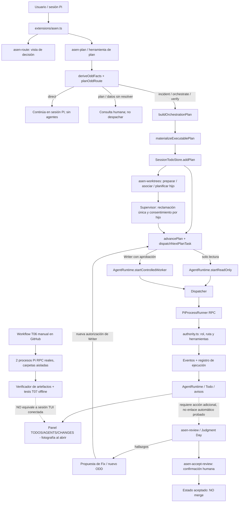

# ASEN — Auditoría técnica independiente del flujo real de agentes

**Repositorio:** [asenbanskaliev/ASEN](https://github.com/asenbanskaliev/ASEN)  
**PR:** [#61](https://github.com/asenbanskaliev/ASEN/pull/61) (borrador, sin fusionar en la comprobación)  
**Versión objeto de auditoría:** `eaed07883703461ee225d61540265b1e478217e2`  
**Referencia anterior:** `999518695d87d9f444cdd04982f29cfe60cc37aa`  
**Fecha de evidencia:** 16 de noviembre de 2026  
**Método:** exclusivamente lectura de archivos en GitHub, comparación de dos commits, resultados de CI, registro de ejecución manual y tres recibos descargados de esa ejecución. El archivo de investigación proporcionado es una *colección de hipótesis*, no prueba del código.

> **Decisión ejecutiva:** ASEN está **parcialmente integrado** y tiene barreras de seguridad reales. No está demostrado como un flujo autónomo, completo y estable de planificación → Workers Pi → verificación → dos revisiones → Fix → aceptación. No está listo para declarar equivalencia funcional total ni `globalFull:true`. Las críticas genéricas de ausencia absoluta de permisos, separación de jueces y pruebas negativas del informe adjunto son incorrectas o no están fundadas.

**Alcance:** la auditoría examina el código de los dos SHA, con lectura especialmente detallada de rutas de producción y de los módulos modificados. No se ejecuta un nuevo modelo ni una sesión Pi TUI. La ejecución real evaluada es la ya existente [#43971488772](https://github.com/asenbanskaliev/ASEN/actions/runs/43971488772); no se la presenta como una prueba reproducida en esta auditoría. No es una certificación de seguridad de todas las dependencias externas ni una inspección de todo el código de terceros.

## A. Resumen ejecutivo

**Comprobaciones de identidad:** GitHub reconoce ambos SHA. La comparación `9995186… → eaed078…` devuelve **13 commits por delante y 0 por detrás**, con **23 archivos afectados** en esta franja histórica (diferente del conjunto acumulado de la PR). El objeto de comparación es el SHA fijado, no futuros commits de la rama. En ese SHA, CI, Release Gate, Phase 0 Architecture y Pi 1.2 runtime evidence figuran como `success`; Pi Free Smoke como `skipped`. La PR continúa abierta en borrador.

**Ejecución real:** el [ensayo #43971488772](https://github.com/asenbanskaliev/ASEN/actions/runs/43971488772) obtuvo dos aprobaciones independientes y ejecutó dos procesos Pi RPC con NVIDIA en carpetas y sesiones distintas. El solapamiento declarado fue **3.071 ms**. La evidencia guardada indica:

| Evidencia del ensayo | Worker A | Worker B |
|---|---:|---:|
| Proceso y modelo observados | Sí | Sí |
| Solicitudes de escritura | 1 | **2** |
| Resultados `write` correctos | 1 | **2** |
| Registros de atribución | 1 | **2** |
| Archivo dentro del ámbito permitido | Sí | Sí |
| Sintaxis y comportamiento finales válidos | Sí | Sí |
| Evaluación del Worker | **PASS** | **FAIL** |

La prueba cerró `BLOCKED_OR_PARTIAL_NEEDS_REVIEW`; el verificador conjunto informó `t07RendererTestsPassed:true`, `uiConnectedToLivePiSessions:false`, `realPiTuiObserved:false`, `durableChildTodoAttributionVerified:false` y `globalFull:false`. **No confundir dos escrituras en la ruta autorizada con dos escrituras fuera de la ruta; el problema comprobado es la falta del límite de una única operación, no un escape de directorio.**

### Evidencia del fallo de escritura

- [`extensions/authority.ts`, líneas 63–83](https://github.com/asenbanskaliev/ASEN/blob/eaed07883703461ee225d61540265b1e478217e2/extensions/authority.ts#L63-L83): `tool_call` permite las herramientas `read/edit/write` según rol y ruta; la reserva de una sola escritura solo se aplica si se entrega `exactWriteReceipt` para esa ruta. El resto se registra después de `tool_result`.
- [`scripts/t06-nvidia-dual-writer-native.ts`, líneas 95–132](https://github.com/asenbanskaliev/ASEN/blob/eaed07883703461ee225d61540265b1e478217e2/scripts/t06-nvidia-dual-writer-native.ts#L95-L132): el `PiProcessRunner` del ensayo recibe `attributionFile` y solicita **una** escritura mediante texto al modelo, pero **no configura `exactWriteReceipt` ni un cupo de llamadas**. La petición en el texto no es una barrera.
- [`src/runtime/agents/t06-writer-evidence.ts`, líneas 37–62](https://github.com/asenbanskaliev/ASEN/blob/eaed07883703461ee225d61540265b1e478217e2/src/runtime/agents/t06-writer-evidence.ts#L37-L62): el validador detecta `starts.length>1` y **rechaza el ensayo una vez ocurridas las escrituras**.
- Los tres recibos guardados en [artefacto GitHub #14278881773](https://github.com/asenbanskaliev/ASEN/actions/runs/43971488772/artifacts/14278881773) confirman exactamente los contadores y el estado descritos. Es evidencia generada por el propio controlador, correlacionada con el trabajo fallido; **no es una segunda auditoría independiente del proveedor**.

## B. Comparación obligatoria de los 10 hallazgos del archivo adjunto

En la columna «antes» se valora el **código del SHA anterior**, no se inventa un fallo ejecutado entonces. Los archivos que se indican como idénticos se comprobaron mediante sus SHA de objeto Git. Se emplea «Pendiente» cuando falta un ensayo extremo específico.

| Nº / hallazgo del informe | SHA `9995186…` | SHA `eaed078…` | Veredicto y prioridad | Código comprobable |
|---|---|---|---|---|
| **1. Ningún control de permisos / shell o merge libre** | Falso como afirmación general: existían controles de rol y ámbito | Siguen vigentes; ningún `merge` automático demostrado | **Falso positivo** general; **media** para ampliar pruebas de configuración | [`dispatcher.ts` 120–153](https://github.com/asenbanskaliev/ASEN/blob/eaed07883703461ee225d61540265b1e478217e2/src/agents/dispatcher.ts#L120-L153), [`authority.ts` 25–38](https://github.com/asenbanskaliev/ASEN/blob/eaed07883703461ee225d61540265b1e478217e2/extensions/authority.ts#L25-L38). Los dos archivos son idénticos entre SHA. |
| **2. Respuestas Pi vacías aceptadas como éxito** | `extractPiArtifact` ya rechazaba texto vacío | Igual más una vía estricta opcional de recuperación de lectura | **Parcialmente corregido**, **media**. Aún falta comprobar todas las rutas reales | [`pi-artifact-runner.ts` 24–61](https://github.com/asenbanskaliev/ASEN/blob/eaed07883703461ee225d61540265b1e478217e2/src/agents/pi-artifact-runner.ts#L24-L61), [70–130](https://github.com/asenbanskaliev/ASEN/blob/eaed07883703461ee225d61540265b1e478217e2/src/agents/pi-artifact-runner.ts#L70-L130). |
| **3. Confundir `agent_end` y `agent_settled`** | Había opciones de cierre estricto; la vía tradicional usa `agent_end` | Retención de `agent_start` y lector estricto adicional en T08; extensión principal escucha `agent_settled` | **Parcialmente corregido**, **media**; no es defecto global universal | [`pi-process-runner.ts` 316–325](https://github.com/asenbanskaliev/ASEN/blob/eaed07883703461ee225d61540265b1e478217e2/src/agents/pi-process-runner.ts#L316-L325), [485–585](https://github.com/asenbanskaliev/ASEN/blob/eaed07883703461ee225d61540265b1e478217e2/src/agents/pi-process-runner.ts#L485-L585), [`asen.ts` 770–787](https://github.com/asenbanskaliev/ASEN/blob/eaed07883703461ee225d61540265b1e478217e2/extensions/asen.ts#L770-L787). |
| **4. Reintentos duplican escrituras y no existe protección** | Ya existían reservas de intentos y permisos limitados, **no** un cupo universal por llamada | El flujo de lotes se blinda más; ensayo T06 demuestra dos `write` correctos dentro de un Writer | **Confirmado parcialmente / riesgo alto**: no se ha demostrado duplicación por reintento automático, **sí** repetición dentro de una ejecución | [`authority.ts` 63–83](https://github.com/asenbanskaliev/ASEN/blob/eaed07883703461ee225d61540265b1e478217e2/extensions/authority.ts#L63-L83), [`parallel-parent-supervisor.ts` 182–204](https://github.com/asenbanskaliev/ASEN/blob/eaed07883703461ee225d61540265b1e478217e2/src/runtime/agents/parallel-parent-supervisor.ts#L182-L204). |
| **5. Dos revisores iguales admitidos** | `Judgment Day` exigía dos modelos distintos y ajenos al autor | Sin cambio en esa regla | **Falso positivo** para Judgment Day; **baja**, revisar otros proveedores si aplica | [`judgment-day.ts` 19–39](https://github.com/asenbanskaliev/ASEN/blob/eaed07883703461ee225d61540265b1e478217e2/src/review/judgment-day.ts#L19-L39), [`ordinary-review-controller.ts` 37–43](https://github.com/asenbanskaliev/ASEN/blob/eaed07883703461ee225d61540265b1e478217e2/src/review/ordinary-review-controller.ts#L37-L43). |
| **6. Nunca se comprueba modelo solicitado vs usado** | Existía observación de selección en runner y controles en ensayos concretos | T06 registra `requestedModel` y `observedModel`, pero el panel conserva `modelActual:"unknown"` | **Parcialmente corregido**, **media** | [`pi-process-runner.ts` 60–72](https://github.com/asenbanskaliev/ASEN/blob/eaed07883703461ee225d61540265b1e478217e2/src/agents/pi-process-runner.ts#L60-L72), [`t06-nvidia-dual-writer-native.ts` 112–160](https://github.com/asenbanskaliev/ASEN/blob/eaed07883703461ee225d61540265b1e478217e2/scripts/t06-nvidia-dual-writer-native.ts#L112-L160), [`agent-flow-overview.ts` 119–130](https://github.com/asenbanskaliev/ASEN/blob/eaed07883703461ee225d61540265b1e478217e2/src/runtime/ui/agent-flow-overview.ts#L119-L130). |
| **7. Judgment Day da permiso de escritura o merge a jueces** | Retorno explícito `deliveryAuthority:false`, `autoMerge:false`, `fixAgent:not-launched` | Igual | **Falso positivo** en esta ruta; **alta** solo si aparece otra vía de privilegios no analizada | [`judgment-day.ts` 48–55](https://github.com/asenbanskaliev/ASEN/blob/eaed07883703461ee225d61540265b1e478217e2/src/review/judgment-day.ts#L48-L55), [`odd-agent-review-flow.ts` 114–164](https://github.com/asenbanskaliev/ASEN/blob/eaed07883703461ee225d61540265b1e478217e2/src/review/odd-agent-review-flow.ts#L114-L164). |
| **8. Cancelaciones nunca alcanzan Pi** | `Dispatcher.cancel()` y señal al runner ya existían | Siguen; `PiProcessRunner` mata el árbol del proceso; no está demostrado el ciclo extremo con dos Workers activos y reinicio | **Falso positivo** en la negación absoluta; **pendiente de comprobar** integral, **alta** | [`dispatcher.ts` 75–95 y 155–163](https://github.com/asenbanskaliev/ASEN/blob/eaed07883703461ee225d61540265b1e478217e2/src/agents/dispatcher.ts#L75-L95), [`pi-process-runner.ts` 115–126](https://github.com/asenbanskaliev/ASEN/blob/eaed07883703461ee225d61540265b1e478217e2/src/agents/pi-process-runner.ts#L115-L126), [449–465](https://github.com/asenbanskaliev/ASEN/blob/eaed07883703461ee225d61540265b1e478217e2/src/agents/pi-process-runner.ts#L449-L465). |
| **9. Paneles y comandos desconectados** | Había registros efectivos de comandos y paneles | Nuevos estados `queued-observed` y `launch-unverified`; consulta de hijos solo al abrir panel. No seguimiento TUI real continuo | **Parcialmente corregido**, **media** | [`asen.ts` 1103–1153](https://github.com/asenbanskaliev/ASEN/blob/eaed07883703461ee225d61540265b1e478217e2/extensions/asen.ts#L1103-L1153), [`ide-panel.ts` 118–165](https://github.com/asenbanskaliev/ASEN/blob/eaed07883703461ee225d61540265b1e478217e2/src/runtime/ui/ide-panel.ts#L118-L165). |
| **10. Ausencia de pruebas negativas** | Ya existían múltiples pruebas de rechazo y permisos | Añadidas más pruebas T06/T07/T08; CI verde, pero el test real de Writers falló | **Falso positivo** en la afirmación absoluta; **alta** la brecha entre unitarias y prueba integrada | [`tests/pi-artifact-runner-recovery.test.ts`](https://github.com/asenbanskaliev/ASEN/blob/eaed07883703461ee225d61540265b1e478217e2/tests/pi-artifact-runner-recovery.test.ts), [`tests/parallel-worktree-todos.test.ts`](https://github.com/asenbanskaliev/ASEN/blob/eaed07883703461ee225d61540265b1e478217e2/tests/parallel-worktree-todos.test.ts), [`CI`](https://github.com/asenbanskaliev/ASEN/actions/runs/43970455232) frente a [prueba manual](https://github.com/asenbanskaliev/ASEN/actions/runs/43971488772). |

**Observación metodológica:** el informe proporcionado cita archivos como `src/orchestrator.ts`, `api/agents.ts`, `src/worker.ts`, `modelManager.ts` y `TaskCoordinator.ts` como ubicaciones aproximadas. Esas referencias no son evidencia de que esos archivos sean la implementación de ASEN. El orquestador real inspeccionado está en [`src/orchestration/orchestrator.ts`](https://github.com/asenbanskaliev/ASEN/blob/eaed07883703461ee225d61540265b1e478217e2/src/orchestration/orchestrator.ts), y la ejecución Pi en [`src/agents/pi-process-runner.ts`](https://github.com/asenbanskaliev/ASEN/blob/eaed07883703461ee225d61540265b1e478217e2/src/agents/pi-process-runner.ts). La matriz de T01–T10 de la fuente tampoco coincide con los nombres actuales de tareas ODD: **no se ha adoptado como inventario autoritativo**.

## C. Mapa del flujo funcional demostrado por el código

**Leyenda:** flecha continua = llamada o registro de código localizado; flecha punteada = frontera incompleta o no demostrada. El flujo GitHub T06 es **una prueba independiente del programa principal**: crea procesos Pi RPC reales, pero no demuestra por sí solo las transiciones de TODOS de la interfaz habitual. Ver [`extensions/asen.ts` 1062–1110, 1854–1894](https://github.com/asenbanskaliev/ASEN/blob/eaed07883703461ee225d61540265b1e478217e2/extensions/asen.ts#L1062-L1110), [`plan-dispatcher.ts` 100–187](https://github.com/asenbanskaliev/ASEN/blob/eaed07883703461ee225d61540265b1e478217e2/src/runtime/lifecycle/plan-dispatcher.ts#L100-L187), [`parallel-parent-supervisor.ts` 182–324](https://github.com/asenbanskaliev/ASEN/blob/eaed07883703461ee225d61540265b1e478217e2/src/runtime/agents/parallel-parent-supervisor.ts#L182-L324) y [`t06-t07-verify-trial.ts`](https://github.com/asenbanskaliev/ASEN/blob/eaed07883703461ee225d61540265b1e478217e2/scripts/t06-t07-verify-trial.ts).

**Decisión de riesgo:** [`src/flow/odd-routing.ts` 145–162](https://github.com/asenbanskaliev/ASEN/blob/eaed07883703461ee225d61540265b1e478217e2/src/flow/odd-routing.ts#L145-L162) separa `incident`, `verify`, `plan`, `orchestrate` y `direct`. La decisión ODD es estructural, no una autorización para escribir. En [`src/runtime/lifecycle/route-command.ts` 23–46](https://github.com/asenbanskaliev/ASEN/blob/eaed07883703461ee225d61540265b1e478217e2/src/runtime/lifecycle/route-command.ts#L23-L46), una instrucción sin el conjunto completo de datos ODD obtiene un diagnóstico conservador, no una planificación autorizada ni el lanzamiento de un Worker.

## D. Problemas nuevos descubiertos o delimitados más precisamente

| ID / prioridad | Estado | Hallazgo y efecto | Fuente |
|---|---|---|---|
| **N1 / alta** | **Confirmado** | El ensayo de **una sola escritura por Worker** está controlado por instrucción al modelo y validación posterior, sin cupo activo de llamadas en la ejecución T06. Worker B escribió dos veces y el sistema lo rechazó tarde. | [`t06-nvidia-dual-writer-native.ts` 102–132](https://github.com/asenbanskaliev/ASEN/blob/eaed07883703461ee225d61540265b1e478217e2/scripts/t06-nvidia-dual-writer-native.ts#L102-L132), [`authority.ts` 63–83](https://github.com/asenbanskaliev/ASEN/blob/eaed07883703461ee225d61540265b1e478217e2/extensions/authority.ts#L63-L83) y recibo real. |
| **N2 / alta** | **Confirmado** | El test conjunto permite probar Workers Pi reales y los **renderizadores T07 en el mismo run**, pero no su conexión de extremo a extremo con las sesiones y estados reales de ASEN. | [`t06-t07-trial-evidence.ts` 5–13, 75–85](https://github.com/asenbanskaliev/ASEN/blob/eaed07883703461ee225d61540265b1e478217e2/src/runtime/ui/t06-t07-trial-evidence.ts#L5-L13); su informe guarda explícitamente tres valores `false`. |
| **N3 / media** | **Confirmado** | El modal T07 recibe una **fotografía** (`snapshot`) y la reutiliza al dibujar. No se ha encontrado actualización de datos mientras ese modal permanece abierto. El estado puede quedarse obsoleto hasta volver a consultarlo. | [`asen.ts` 1108–1117](https://github.com/asenbanskaliev/ASEN/blob/eaed07883703461ee225d61540265b1e478217e2/extensions/asen.ts#L1108-L1117), [`native-work-panel.ts` 25–70](https://github.com/asenbanskaliev/ASEN/blob/eaed07883703461ee225d61540265b1e478217e2/src/runtime/ui/native-work-panel.ts#L25-L70). |
| **N4 / media** | **Confirmado** | El mensaje del plan afirma que la revisión y verificación seguirán «automáticamente». En la ruta de aceptación hay una **acción humana explícita** y en `agent_settled` se refresca/intercambian avisos, sin una llamada general a `advancePlan` para aprobarlos. El texto promete más de lo acreditado. | [`asen.ts` 1094–1098](https://github.com/asenbanskaliev/ASEN/blob/eaed07883703461ee225d61540265b1e478217e2/extensions/asen.ts#L1094-L1098), [781–787](https://github.com/asenbanskaliev/ASEN/blob/eaed07883703461ee225d61540265b1e478217e2/extensions/asen.ts#L781-L787), [1422–1453](https://github.com/asenbanskaliev/ASEN/blob/eaed07883703461ee225d61540265b1e478217e2/extensions/asen.ts#L1422-L1453). |
| **N5 / media** | **Confirmado, revisión de política pendiente** | `acceptIndependentReview` permite una aceptación humana con verificación **estructural** cuando no existe recibo firmado. Esto es deliberado y se muestra al usuario; no equivale a una verificación de ejecución de pruebas ni a un merge. Debe decidirse si basta para el criterio de cierre final. | [`review-acceptance.ts` 74–96, 108–156](https://github.com/asenbanskaliev/ASEN/blob/eaed07883703461ee225d61540265b1e478217e2/src/runtime/lifecycle/review-acceptance.ts#L74-L96). |
| **N6 / media** | **Pendiente de comprobar** | Los archivos de configuración de herramientas pueden **añadir nombres de herramientas** a la lista enviada a Pi. La extensión de autoridad rechaza después las que no sean `read/edit/write`, por lo que no se demuestra escape de permisos, pero falta probar el comportamiento real de herramientas añadidas/desconocidas y ausencia de publicidad engañosa de `bash`. | [`tool-overlay.ts` 59–79](https://github.com/asenbanskaliev/ASEN/blob/eaed07883703461ee225d61540265b1e478217e2/src/agents/tool-overlay.ts#L59-L79), [`pi-process-runner.ts` 284–288](https://github.com/asenbanskaliev/ASEN/blob/eaed07883703461ee225d61540265b1e478217e2/src/agents/pi-process-runner.ts#L284-L288), [`authority.ts` 25–38](https://github.com/asenbanskaliev/ASEN/blob/eaed07883703461ee225d61540265b1e478217e2/extensions/authority.ts#L25-L38). |
| **N7 / media** | **Parcial** | La mejora T08 de recuperación de intentos se ha añadido, pero `PiArtifactRunner` la activa **solo** si el adaptador recibe una opción específica, el proceso es de lectura estricta y está libre de herramientas. No se ha probado toda la recuperación del flujo normal ni de un Worker parcialmente escrito. | [`pi-artifact-runner.ts` 70–162](https://github.com/asenbanskaliev/ASEN/blob/eaed07883703461ee225d61540265b1e478217e2/src/agents/pi-artifact-runner.ts#L70-L162). |
| **N8 / media** | **Confirmado (limitación prudente)** | El supervisor guarda la intención **antes de lanzar** un lote. Tras un fallo de lectura, sesión o disco, detiene automáticamente el flujo con `partial-needs-review` y no hace reintentos inseguros. La continuidad requiere inspección humana; no puede calificarse como recuperación automática completa. | [`parallel-parent-supervisor.ts` 182–242, 286–322](https://github.com/asenbanskaliev/ASEN/blob/eaed07883703461ee225d61540265b1e478217e2/src/runtime/agents/parallel-parent-supervisor.ts#L182-L242). |

### Nota sobre permisos

La existencia de `normal`, `auto`, `yolo` y `super-yolo` para **la sesión primaria** no demuestra que un agente hijo herede esas autorizaciones. En la ruta auditada los agentes hijos pasan por `Dispatcher`, una autorización `apply`, ámbito exacto y la extensión `authority.ts`. Es necesario seguir probando límites de configuración, pero no es riguroso calificar el sistema como «sin control de permisos».

## E. Casuísticas aún sin aceptación real

1. Dos `write` sucesivos correctos sobre el mismo archivo por un solo Worker (**confirmado**, no solo hipotético).
2. Dos `write` simultáneos emitidos antes del primer `tool_result`, para medir si el bloqueo actúa **antes** del sistema de archivos.
3. Primer `write` exitoso seguido de interrupción/cierre brusco, reinicio del controlador y petición de repetir el mismo trabajo.
4. Primer `write` con error, segundo `write` automático, o cambio `write` → `edit` tras consumir un permiso.
5. Cambio de ruta a fichero vecino, ruta simbólica, cambio de Git HEAD entre autorización y ejecución.
6. Cancelación del Worker A mientras el B trabaja; sesiones correctas, árbol de procesos limpio y estado durable sin falsos `PASS`.
7. Pi devuelve texto vacío, `agent_end` intermedio, `agent_settled` tardío, error HTTP del proveedor o cambio de modelo.
8. Dos Workers terminan casi a la vez; aviso de finalización se pierde o se entrega tras cambiar de proyecto.
9. Panel abierto mientras un agente pasa de `queued` a `running` y `completed`: observar si se actualiza sin cerrar/reabrir.
10. Dictámenes A/B negativos o contradictorios, rechazo humano de Fix y nueva solicitud que intenta reutilizar un consentimiento antiguo.
11. Test de validación que falla con el código escrito pero recibe resultado de agente `ok:true`; prohibido marcar trabajo como aceptado.
12. Coste de proveedor desconocido, credencial caducada, límite de cuota y cadena de modelos alternativos; verificar que no se inicia un proveedor de coste no aceptado.

## F. Auditorías complementarias necesarias

| Auditoría | Qué debe demostrar | Por qué importa |
|---|---|---|
| **Riesgo y permisos por herramienta** | El segundo `tool_call(write)` es rechazado antes de escribir; rutas inválidas y `bash` denegados; ninguna escalada de roles | N1, N6 |
| **Ciclo Pi y cancelación** | Señal abort propagada, árbol terminado, ningún registro de éxito falso; orden de `agent_end/settled` real | Hallazgos 2, 3 y 8 |
| **Flujo ODD completo** | Solicitud natural → decisión → plan → Todo → Worker → prueba → review → decisión; toda transición trazable | La mayor brecha funcional |
| **Revisión independiente y Fix** | Jueces realmente distintos y sin herramientas; rechazo y nueva autorización sin reutilizar tokens | Cierre y seguridad |
| **Interfaz Pi real** | TODOS, AGENTS, CHANGES e INTEGRATIONS muestran dos sesiones hijas reales y cambios observados | T07 no se acredita con renderizadores offline |
| **Resistencia y reinicio** | Corte a mitad de la escritura, registros consistentes, continuidad manual segura, sin replay | N8 y duplicaciones |
| **Pruebas y CI** | Cada escenario peligroso tiene prueba negativa que falla antes de la corrección y pasa después; los ensayos manuales permanecen separados de CI automático | Evitar `green` engañoso |

## G. Plan de pruebas con criterios de aceptación

| Prueba | Resultado esperado | Criterio para darla por válida |
|---|---|---|
| **P1: dos llamadas `write` en mismo Worker de ensayo** | Primera única autorizada; segunda bloqueada por `tool_call` **antes** de ejecutar | 1 éxito, 1 denegación, 1 atribución; contenido del fichero corresponde solo a la primera operación; sin permiso nuevo |
| **P2: dos llamadas casi simultáneas** | Reserva de una sola plaza antes de ambas herramientas | Solo una operación permitida; ninguna carrera; si no hay certeza, estado bloqueado, no segunda escritura |
| **P3: Worker A y B reales** | Dos procesos Pi, dos permisos humanos, worktrees y sesiones diferentes, una escritura por Worker | Ambos Workers `PASS`, rutas exactas, salida y comportamiento validados, sin merge; proveedor/coste explicitados |
| **P4: cancelación de uno** | Otro no queda bloqueado ni recibe permisos nuevos | PID/árbol cancelado, estados `cancelled/interrupted` correctos, sin nueva escritura tras cancelar |
| **P5: caída tras herramienta** | No se reintenta la escritura sin revisión explícita | Diario conserva estado `incierto`, no `done`, no doble atribución |
| **P6: RPC errático/vacío** | No se acepta texto parcial como artefacto final | `agent_settled` único donde se exige; respuesta final no vacía; abortos y fallos bloqueados |
| **P7: modelo distinto** | Rechazo de evidencia, no `modelActual` inventado | Modelo solicitado y observado coinciden o se rechaza |
| **P8: recorrido de interfaz real** | Cambios de estado visibles desde una sesión Pi genuina | Dos tareas hijas identificadas por sesión, cambios y resultados, sin reabrir panel para fingir un refresco automático |
| **P9: veredictos y Fix** | Dos jueces distintos, fallo impide aceptación; Fix nuevo requiere autorización | Un rechazo no puede transformarse en aprobación; no hay merge ni ejecución no autorizada |
| **P10: CI y ensayo manual** | CI verde **y** P3/P8 superadas | Capturas/recibos verificables ligados al mismo SHA; tests no sustituyen evidencias de proveedor ni TUI |

**Política de pruebas:** usar proyectos temporales, sin secretos en argumentos ni logs, sin acceso a archivos ajenos. No ejecutar modelos de pago sin autorización separada. Un resultado `SKIPPED` o `BLOCKED` nunca cuenta como `PASS`.

## H. Plan de corrección agrupado por dependencias — **NO EJECUTADO**

**Tanda 0 — Consolidación de criterios:** fijar la semántica de permiso «un archivo» frente a «una llamada»; para el ensayo T06, declarar **máximo una llamada `write` aceptada por Worker**. Un Worker normal no debe sufrir accidentalmente ese límite si su trabajo precisa varias operaciones legítimas. Precisar estados `incierto`, `bloqueado`, `completado` y la política ante caídas.

**Tanda 1 — Control anterior a la escritura (bloqueo prioritario):** entregar al proceso Pi una capacidad específica de **cupo de una llamada** solo para el ensayo T06; reservar el cupo de manera atómica en el `tool_call` que ya conoce `agentId`, sesión, ruta y permiso. Denegar cualquier segunda llamada `write` o `edit` en ese ámbito; no confiar en una instrucción de lenguaje natural ni solo en los contadores de `tool_execution_end`. Si una primera operación queda incierta, bloquear el replay. Añadir P1, P2 y P5. Mantener la validación final existente como defensa adicional. **No basta cambiar el criterio de PASS de 1 a 2.**

**Tanda 2 — Revisión de Pi y cancelación:** completar trazas de eventos finales, fallo de proveedor, reinicio y detención de los dos hijos; mantener la recuperación de lectura separada de cualquier reintento Writer. Añadir P4 y P6/P7 sin consumir proveedores pagados.

**Tanda 3 — Unión T06/T07 productiva:** integrar observaciones autentificadas de `AgentRuntime` y Todo con las sesiones Pi hijas en una misma ejecución, y renovar el snapshot en UI cuando cambien registros realmente. No inventar modelos consumidos ni transformar un resultado de script externo en aceptación. Añadir P3 y P8.

**Tanda 4 — Cierre ODD, revisión y aceptación:** probar camino de incidente, verificador real, dictámenes conflictivos, aceptación humana y Fix separado; corregir el texto que promete revisión automática si no existe esa transición. Decidir explícitamente cuándo se permite `structural-fallback` frente a recibo de pruebas firmado. Añadir P9/P10 y nueva auditoría de cuatro dimensiones.

**Orden:** no volver a ejecutar el ensayo NVIDIA de pago hasta superar P1–P2 y recompilar el SHA nuevo. No modificar permisos de GitHub ni fusionar la PR como atajo para pasar la prueba.

## I. Cuatro dimensiones y conclusión

| Dimensión | Estado basado en las evidencias | Riesgo principal |
|---|---|---|
| **Risk — Seguridad** | Existen barreras de rol, ruta, consentimiento y separación de jueces. No hay una vía de `git merge` automático demostrada. | Cupo de operación T06 no impuesto antes del `write`; configuraciones de herramientas aún necesitan pruebas adversariales. |
| **Readability — Legibilidad** | Módulos con responsabilidades diferenciadas y controles explícitos, pero muchas rutas de CLI, simulaciones y proyectores. | Los avisos «automático» y el inventario del informe no se corresponden con todas las condiciones de ejecución. |
| **Reliability — Fiabilidad** | CI automático correcto; un Writer real y pruebas de panel superaron su parte. | Un segundo Writer real no superó el contrato de una escritura; el test no acredita el flujo extremo a extremo. |
| **Resilience — Resistencia** | AbortSignal, terminación de procesos, reclamos de intento único y revisión manual al perder certeza. | No hay prueba real integrada de caída y continuación de dos Writers sin repetir operaciones. |

**Respuesta final:** **No** está demostrado todavía que el flujo completo de agentes ASEN sea fiable en el sentido exigido por el plan. Está **operativo por partes**: orquestador y ODD conectados, trabajos Pi reales autorizados, rutas de worktrees, controles de permiso y presentaciones de estado. El ensayo existente prueba concurrencia real y también un defecto real en la limitación de escrituras. **T06 no está aceptado y T07 no tiene acreditación de interfaz Pi real conectada.** El CI correcto no cambia esa conclusión.

**Instrucción de ejecución de la auditoría:** se ha respetado el **modo exclusivamente lectura**. No se han creado commits, ramas, comentarios, PR, incidencias, nuevas pruebas en GitHub, llamadas de pago ni cambios de configuración. Este documento local es únicamente el informe resultante; **el arreglo del límite de escritura está especificado, pero NO implementado**.
