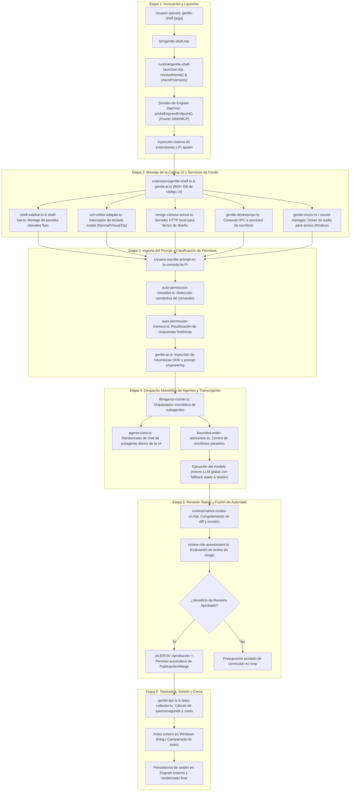

# Gentle Shell (gentle-pi 4.8.0) — Arquitectura Integral, Flujo de Ejecución y Anatomía de la Cabina

**Fecha:** 2026-11-14
**Objetivo del análisis:** Auditoría técnica en profundidad de la copia local en `C:\gentle-shell` (paquete `gentle-pi` versión **4.8.0**, punto exacto `3dc90297`).
**Propósito posterior:** Base técnica para el estudio comparativo exhaustivo contra ASEN y la formulación de propuestas de optimización de máxima eficacia.

---

## 1. La Idea de Gentle Shell en una Frase

Gentle Shell es una **cabina de desarrollo inmersiva (cockpit)**: prioriza la experiencia visual enriquecida en terminal (paneles laterales, atajos modales tipo Vim, lienzo visual de diseño, alertas sonoras, dictado por voz y un gran panel de subagentes), delegando las reglas metodológicas duras a prompts y la persistencia a un servidor de memoria externo (Engram).

---

## 2. Flujograma Integral del Flujo de Ejecución en Gentle Shell

---

## 3. Zoom por Etapas del Ciclo de Vida de Gentle Shell

### Etapa 1: Invocación, Launcher y Dependencias Externas
* **Qué sucede:** El usuario ejecuta `gentle-shell`.
* **Módulos que intervienen:**
  * `bin/gentle-shell.mjs` (128 KB): Wrapper ejecutable principal.
  * `runtime/gentle-shell-launcher.mjs` (59 KB): Lógica pura de selección de versión y directorios.
  * `runtime/gentle-shell-bundled.mjs`: Gestor del companion Engram.
* **Mecánica interna:**
  1. `bin/gentle-shell.mjs` analiza los argumentos de consola.
  2. Verifica la versión de Pi (`MIN_SETUP_GENTLE_AI_VERSION`).
  3. **Sondeo de Engram:** Gentle Shell no posee base de datos de memoria propia; intenta conectar con el daemon externo de Engram (`probeEngramEndpoint`). Si no está corriendo, emite avisos de recuperación (`ENGRAM_RECOVERY_NOTICE`).
  4. Inyecta hasta **12 extensiones simultáneas** en Pi (entre ellas `gentle-shell.ts`, `gentle-ai.ts`, `gentle-agents.ts`, `gentle-music.ts`, `gentle-design.ts`, `gentle-voice.ts`).
  5. Inicia el proceso hijo de Pi con variables de entorno enriquecidas (`HERDR_REPORTER_ENV`, etc.).

### Etapa 2: Montaje de la Cabina UI y Servidores Locales
* **Qué sucede:** Pi inicializa las extensiones. Gentle Shell transforma la terminal estándar en un entorno visual complejo.
* **Módulos que intervienen:**
  * `extensions/gentle-shell.ts` (201 KB) y `extensions/gentle-ai.ts` (710 KB).
  * `lib/shell-sidebar.ts`, `lib/shell-bar.ts`, `lib/shell-panel.ts`.
  * `lib/vim-editor-adapter.ts` (23 KB): Motor modal tipo Vim.
  * `lib/design-canvas-server.ts` (60 KB): Servidor web local.
* **Mecánica interna:**
  1. **Layout Visual Fijo:** Se divide la terminal calculando columnas para la barra de estado superior (`shell-bar`), un panel lateral fijo (`shell-sidebar`) y el panel principal de chat.
  2. **Servidor HTTP de Diseño:** Lanza en background un servidor web local en Node.js (`design-canvas-server`) para renderizar componentes visuales en un navegador externo si el usuario abre el lienzo.
  3. **Interceptor Modal tipo Vim:** Se apodera del input del teclado mediante `vim-editor-adapter`, interceptando atajos para alternar modos *Normal*, *Visual* y *Operador* dentro del prompt de Pi.
  4. **Driver de Audio:** Configura la reproducción de archivos `.wav` en el sistema operativo mediante PowerShell o APIs de Windows para notificar eventos.

### Etapa 3: Ingesta del Prompt, Heurísticas y Memoria de Permisos
* **Qué sucede:** El desarrollador ingresa una consulta o comando.
* **Módulos que intervienen:**
  * `lib/auto-permission-classifier.ts` (31 KB) y `lib/auto-permission-runtime.ts` (33 KB).
  * `lib/auto-permission-memory.ts` (7 KB).
  * `prompts/` y `lib/append-system-prompt.ts`.
* **Mecánica interna:**
  1. **Clasificación Semántica:** El comando o prompt ingresado pasa por un clasificador de permisos automáticos (`auto-permission-classifier`). Si un comando idéntico o similar ya fue respondido en sesiones previas, consulta la memoria de permisos (`auto-permission-memory`).
  2. **Prompts Heurísticos:** Gentle Shell no cuenta con un contrato formal de fases ODD en código TypeScript; utiliza cadenas de prompts extensas (`prompts/`) inyectadas al LLM para "sugerir" la metodología al modelo, apoyándose en la disciplina del texto más que en bloqueos duros del motor.

### Etapa 4: Despacho Monolítico de Subagentes
* **Qué sucede:** Se delega la tarea a ayudantes en paralelo o segundo plano.
* **Módulos que intervienen:**
  * `lib/agents-runner.ts` (71 KB): Despachador y gestor de ciclo de vida.
  * `lib/agents-view.ts` (42 KB) y `lib/agents-transcript.ts`: Visualizadores de chat de agentes.
  * `lib/bounded-writer-admission.ts` (27 KB): Reglas de admisión para escritores paralelos.
* **Mecánica interna:**
  1. `agents-runner.ts` asume toda la responsabilidad en un único archivo grande: crea el subagente, maneja el proceso, renderiza el progreso y almacena el resultado.
  2. **Renderizado de Chat Completo:** En lugar de una línea ligera de estado, Gentle Shell abre una vista completa de conversación donde proyecta todos los turnos del subagente dentro de la interfaz de la consola.
  3. **Limitación de Modelos:** El modelo asignado al subagente está ligado a la sesión global o resuelto por cadenas de fallback (`session-profile-binding.ts`); no existe ruteo desacoplado estricto por rol (un explorer pasivo suele consumir el mismo modelo pesado que un arquitecto).

### Etapa 5: Revisión Nativa y Fusión Crítica de Autoridad
* **Qué sucede:** Se auditan los cambios antes de consolidarlos.
* **Módulos que intervienen:**
  * `runtime/native-review-cli.mjs` (167 KB).
  * `runtime/review-integration-v2.mjs` (165 KB).
  * `lib/review-risk-assessment.ts` (22 KB).
* **Mecánica interna:**
  1. Congela el diff del código en un snapshot temporal y le asigna un hash de transacción (`review-transaction.ts`).
  2. Ejecuta la revisión mediante evaluadores configurados y evalúa lentes de riesgo (`review-risk-assessment`).
  3. **LA LÍNEA DE FALLA ARQUITECTÓNICA:** Si el veredicto de la revisión es favorable, **Gentle Shell considera la aprobación técnica como autorización implícita para publicar, hacer merge o realizar push**. Se salta la confirmación humana de soberanía para ahorrar fricción.

### Etapa 6: Telemetría, Sonido y Cierre
* **Qué sucede:** Fin de la ejecución y reporte de estadísticas.
* **Módulos que intervienen:**
  * `lib/gentle-tps.ts` y `lib/stats-collector.ts`.
  * `lib/desktop-agents-service.ts` y servicios RPC.
* **Mecánica interna:**
  1. Calcula el costo monetario estimado de la sesión en base a los modelos utilizados (`bridge-cost.ts`) y la tasa de velocidad en tokens por segundo (`gentle-tps`).
  2. Emite una notificación auditiva en el sistema (campanada en Windows).
  3. Sincroniza la sesión con el daemon de Engram externo.

---

## 4. Zoom en las 8 Piezas Fundamentales de Gentle Shell

| Pieza del Sistema | Archivos Clave | Responsabilidad Exacta | Evaluación Técnica |
| :--- | :--- | :--- | :--- |
| **1. La Cabina Visual (Cockpit TUI)** | `shell-sidebar.ts`, `shell-bar.ts`, `shell-panel.ts` (100+ KB) | Dibuja barra superior, panel lateral con pestañas, estados y medidores | **Alto costo:** Rompe terminales chicas, colisiona con tmux/zellij y consume ciclos constantes de renderizado. |
| **2. Motor Modal tipo Vim** | `vim-editor-adapter.ts`, `vim-normal-engine.ts`, `vim-operator-engine.ts` | Provee modos Normal, Visual, Operador y atajos de Vim dentro de Pi | **Antipatrón:** El editor de código le pertenece al entorno anfitrión del usuario; duplicarlo adentro de la CLI crea colisiones de atajos. |
| **3. Servidor de Diseño (Canvas)** | `design-canvas-server.ts`, `design-comments.ts` (100+ KB) | Levanta un servidor HTTP local para ver piezas UI en navegador web | **Sobrediseño:** Es un producto gráfico completo incrustado dentro de una herramienta de consola. |
| **4. Orquestador Monolítico de Agentes** | `agents-runner.ts` (71 KB), `agents-view.ts` (42 KB) | Maneja creación, ejecución, transcripción y visualización de subagentes | **Monolítico pero visual:** Su gran ventaja es que el usuario puede ver la conversación completa del agente, pero acoplada a un único archivo gigante. |
| **5. Clasificador de Permisos Automáticos** | `auto-permission-classifier.ts`, `auto-permission-memory.ts` | Recuerda respuestas anteriores y reduce prompts repetitivos | **Excelente idea de DX:** Elimina fatiga de confirmación, aunque su clasificación por heurística semántica puede tener falsos positivos si no se usa hash estricto. |
| **6. Puerta de Revisión y Auto-Publicación** | `native-review-cli.mjs`, `review-integration-v2.mjs` (330 KB) | Audita cambios y ejecuta el ciclo de aprobación | **Riesgo crítico de seguridad:** Fusiona "auditar calidad" con "publicar código". Si la IA aprueba su propio review, puede hacer push sin orden humana. |
| **7. Memoria Externa Dependiente** | `gentle-shell-bundled.mjs`, `lib/engram-companion.ts` | Depende del daemon externo Engram vía HTTP o sockets | **Pérdida de soberanía:** Si el daemon de Engram no está instalado o se cuelga en el puerto 3000, Gentle Shell pierde la memoria del proyecto. |
| **8. Los 81 Contratos de Datos** | `contracts/*.json` | 81 esquemas JSON formales que definen mensajes entre piezas | **Burocracia documental:** Muy costoso de mantener. Cada cambio menor en un tipo exige actualizar esquemas JSON paralelos. |

---

## 5. Cuadro Comparativo: Gentle Shell vs ASEN

| Criterio | Gentle Shell 4.8.0 | ASEN (tras Bloques 1, 2 y 3) | Veredicto de Eficacia |
| :--- | :--- | :--- | :--- |
| **Identidad central** | Cabina visual inmersiva (TUI rica, sonido, canvas, vim) | Motor determinista de ejecución, rigor ODD y TDD | **ASEN** es más ágil y ligero; **Gentle Shell** es más visual. |
| **Peso y footprint** | 17 bundles compilados gigantescos (~2.5 MB de JS comprimido) | 208 archivos modulares livianos sin dependencias de UI | **ASEN** tiene arranque en frío instantáneo y cero salidas a la red. |
| **Metodología ODD** | Basada en prompts extensos e instrucciones heurísticas | Contratos ejecutables en código, ruteo por tamaño y bitácoras duras | **ASEN** garantiza el cumplimiento metodológico por motor, no por sugerencia. |
| **Pruebas (TDD)** | Documento compartido de "pruebas primero" | Ciclo Red-Green-Refactor obligatorio con comprobación previa | **ASEN** bloquea el commit si no existe prueba que demuestre el cambio. |
| **Autoridad de publicación** | Aprobar revisión autoriza a publicar automáticamente | Aprobar audita; publicar exige orden explícita humana | **ASEN** es infinitamente más seguro en entornos de producción. |
| **Memoria de permisos** | Clasificador semántico con memoria histórica | Hash criptográfico `SHA256(cwd + cmd + branch)` con lista negra inmutable | **ASEN** elimina fatiga de confirmación con certeza matemática y cero falsos positivos. |
| **Ruteo de modelos** | Mapeo atado a perfiles de sesión global | Ruteo estricto por rol (`flash_lite` lectura vs `pro` diseño/jueces) | **ASEN** ahorra 60-80% de costo en tokens y reduce latencia a la mitad. |
| **Concurrencia de agentes** | Admisión con colas de escritores | Tabla de locks semánticos de archivos en memoria (`WorkspaceLockTable`) | **ASEN** previene colisiones de merge sin sobrecarga de procesos. |
| **Observabilidad** | Vista de chat completa y transcripción embebida | Streaming dinámico de 1 línea ANSI cancelable en tiempo real | **Gentle Shell** da más detalle visual; **ASEN** protege el ancho de pantalla de la terminal. |
| **Memoria del proyecto** | Dependencia de daemon externo (Engram) | Base de datos SQLite local soberana en `.asen/` | **ASEN** no depende de servicios huérfanos corriendo en puertos locales. |
| **Desinstalación** | Flujo completo de desinstalación limpia | Desinstalador idempotente con snapshot `.tar.gz` de resguardo (`P8`) | **Empate técnico:** Ambos cuidan la confianza del usuario al salir. |

---

## 6. Conclusiones y Próximos Pasos

1. **Gentle Shell acertó en la ergonomía:** La memoria de permisos, la visibilidad del trabajo de los subagentes y la facilidad de desinstalación fueron grandes aciertos de experiencia de usuario.
2. **Gentle Shell erró en el alcance (Feature Creep):** Intentó meter un lienzo visual, un editor de texto Vim, reproducción de audio y una app de escritorio dentro de una CLI de terminal, pagando un precio altísimo en complejidad y fragilidad.
3. **El Camino Óptimo para ASEN:**
   * En los Bloques 1, 2 y 3 ya adaptamos la **esencia útil** de Gentle Shell (catálogo unificado, recibos SHA-256, ruteo de modelos, streaming dinámico, locks de archivos, memoria de permisos y desinstalador limpio).
   * Lo que viene ahora es el **Estudio Comparativo y la Propuesta de Mejora Integral** para consolidar a ASEN como el estándar definitivo de desarrollo asistido por IA: máxima potencia y velocidad sin un solo gramo de grasa visual.
