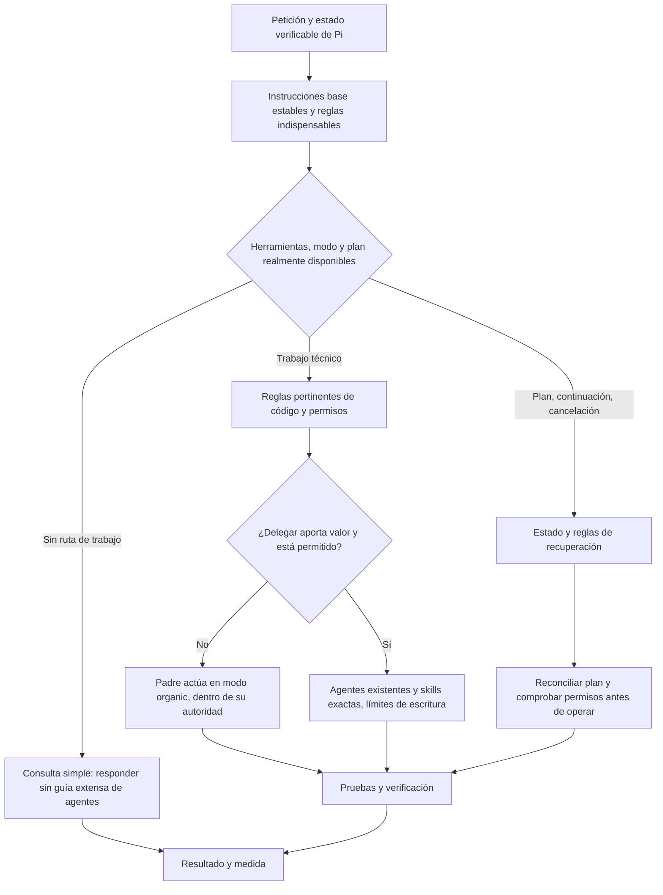

# ASEN — Plan final de optimización del contexto y conservación del flujo de agentes

> **Estado operativo comprobado 21/11/2026:** PRE-0/PRE-1, CTX-0 y el cambio CTX-1 de selección real de herramientas ya figuran integrados mediante PR auxiliares cerradas; no repetir #66/#71. La [PR matriz #61](https://github.com/asenbanskaliev/ASEN/pull/61) sigue en borrador, HEAD en este corte `8b62891f2545f5053b065220154f03ddd8bdac29`; [CI #44946902816](https://github.com/asenbanskaliev/ASEN/actions/runs/44946902816) y puertas restantes seguían pendientes. CTX-0 solo aporta pruebas sintéticas: **ningún ahorro de tokens o coste está demostrado**. CTX-2…6 deben priorizarse por beneficio medible y pruebas de seguridad. E1–E4/F y los 18 objetivos mantienen aceptación pendiente. G0 bloqueado describe el corte histórico del 20/11, no acredita ni invalida por sí solo un SHA posterior. `globalFull:false`.

**Corte histórico:** 20/11/2026 · **Versión:** 1.2 del plan consolidado y auditado · **Estado en aquel corte (superado para PRE-0/PRE-1):** DIAGNÓSTICO OFFLINE PERMITIDO; G0 BLOQUEADO POR CI; IMPLANTACIÓN PENDIENTE. **Estado vigente:** ver actualización del 21/11 y verificar el último SHA; las demás puertas siguen siendo obligatorias.
**Rama/PR:** `feat/flujo-de-agentes-20261115` / [PR #61](https://github.com/asenbanskaliev/ASEN/pull/61). **Referencia de código auditada:** `a05424fec15ba5770b45695fefd126638c88b1a7`. No representa la versión futura del producto.
**Fuente rectora:** [plan de los 18 objetivos, E0–E4 y F](../odd/tasks/flujo-de-agentes-plan-implantacion-4.9.0.md), cuya **sección 14** remite a este plan. Los apartados 11–13 previos son antecedentes documentales, no otras tandas ejecutables.
**Contraste:** [auditoría OPT anterior](audit/opt-contexto-skills-asen-2026-11-20.md), [auditoría crítica final](audit/plan-final-opt-investigacion-avanzada-2026-11-20.md), [P16](audit/p16-gentle-4.9.0-18-sesiones-2026-11-20.md); Gentle Shell 4.9.0 en `ce64a9a708e50c0ca899c8023140e63f29f293e1`.
**Compromiso:** optimizar las peticiones al modelo sin rehacer Pi, skills, agentes, memoria, perfiles ni controles de autoridad. El resultado será **medido**, no supuesto.

## 1. Dictamen de la investigación y límites de evidencia

1. **Confirmado en ASEN:** `src/runtime/ui/request-guidance.ts` declara una guía común de unas 6 KB; en `extensions/asen.ts` se decide su inyección comprobando `!!pi.registerTool`, que expresa capacidad de **registro**, no presencia de herramientas seleccionadas para el turno.
2. **Confirmado en ASEN:** `src/skills/registry.ts` ya selecciona las skills necesarias; `src/agents/pi-process-runner.ts` valida las rutas recibidas y usa `--no-skills` junto con `--skill` explícitos. No crear un catálogo ni un motor nuevo.
3. **Confirmado en ASEN:** la memoria de proyecto usa un presupuesto de hasta 4096 bytes y el resumen de planes hasta 2048 bytes; los dos son condicionales. No atribuirlos a todas las peticiones.
4. **API que merece prueba exacta:** `package-lock.json` fija `@earendil-works/pi-coding-agent` **1.2.0**; su ejemplo de personalización [versión 1.2.0](https://app.unpkg.com/@earendil-works/pi-coding-agent@1.2.0/files/examples/extensions/prompt-customizer.ts) consulta `event.systemPromptOptions.selectedTools` y `skills`, y añade/quita una sección propia. Esto **justifica una prueba del anfitrión de ASEN**, no un cambio inmediato ni el uso de métodos de versiones nuevas.
5. **Confirmado en Gentle Shell 4.9.0:** instrucciones centrales y referencias de consulta, rutas de skills para agentes, filtrado de bloques de contexto duplicados y pruebas de presupuesto; **Gentle completo también inyecta instrucciones extensas**. No convertir su ejemplo en un modelo sin contexto.
6. **P16 no es comparativa de sistemas completos:** en 9 ejecuciones por producto, ASEN consumió 16.940 tokens de entrada y Gentle 4.584; ASEN 9/9 respuestas exactas, Gentle 8/9. El comparador cargó `extensions/asen.ts` frente a solo `extensions/gentle-shell.ts`, con `--no-tools --no-skills`; no había Writer ni agentes reales. No concluir que Gentle completo cuesta 3–4 veces menos, ni que el 8/9 representa un fallo de seguridad.
7. **Terceras opciones:** la divulgación progresiva de Agent Skills (Anthropic), la separación de instrucciones de proyecto en Codex y la reducción de duplicados de Gentle inspiran el diseño; **no migrar a otro motor** ni incorporar herramientas externas sin demostrar una carencia concreta.

**Desestimado como evidencia:** ahorro del 30–50 %, del 60–70 %, velocidad igual o mejor, paridad funcional total, costes facturados y seguridad «3/3 frente a 2/3». Son cifras o afirmaciones no validadas para los productos completos.

## 2. Arquitectura objetivo



**Regla de arquitectura:** el **código ejecutable** sigue teniendo la última palabra en escritura, riesgo, alcance, revisión, autorización, reinicio y publicación. La guía al modelo no sustituye ningún control. Una regla solo sale del núcleo cuando se demuestra que **no es necesaria antes de una acción** en ese contexto o que otro mecanismo comprobado ya la impone.

### Clasificación de carga, sin modelos extra

| Bloque | Cuándo cargar | Riesgo si se omite |
| --- | --- | --- |
| Núcleo estable: idioma, objetivo, límites, referencia de herramientas y autoridad | Siempre | Pérdida de orientación o permiso incorrecto |
| Código y exploración: CodeGraph, lecturas, límites y selección de Explorer | Solo contexto técnico/capacidades verificadas | Investigación innecesaria o exploración mal dirigida |
| Trabajo directo / modo delegación completa | Según perfil **verificado**, nunca solo por texto | Escritura del padre en modo prohibido |
| Plan, agentes y paralelismo | Con trabajo planificado/delegación efectiva | Lanzar hijos incorrectos o duplicados |
| Continuidad, cancelación, fallos y recuperación | Con tareas/plan persistidos, señales de transición o instrucciones aplicables | Repetir una escritura o cancelar lo equivocado |
| Memoria pertinente y resumen de plan | Solo si identidad de proyecto/sesión y utilidad son válidas | Contexto irrelevante o cruce de datos |
| Skills de hijos | Rutas exactas derivadas y validadas por ASEN/Pi | Trabajos sin contrato obligatorio |
| Herramientas poco usadas | **No cambiar aún** | Pérdida de acceso, reglas o esquemas |

**Desconocido o degradado:** si la fuente de capacidades/estado no es fiable, aplicar la **guía anterior compatible** y las mismas denegaciones. Nunca confiar en una clasificación por palabras sueltas ni iniciar otro modelo solo para escoger el módulo.

## 3. Intervenciones ejecutables únicas

Se normalizan los nombres duplicados de anexos 11–13: **CTX-0…CTX-6** son la única secuencia ejecutable; **OPT-00…OPT-07** permanecen como referencias, no como trabajos adicionales.

| Unidad | Equivalente | Enlace E/F | Archivos iniciales | Cambio y resultado verificable |
| --- | --- | --- | --- | --- |
| **CTX-0** | OPT-00 | E0 | `extensions/asen.ts`, pruebas de composición, `package-lock.json` | Medir secciones, orden, herramientas, skills, memoria, plan, padre/hijos, bytes y uso de Pi **sin guardar contenido**; fijar SHA y línea base sin proveedor |
| **CTX-1** | OPT-01 | E0/E1B | `extensions/asen.ts`, `src/runtime/ui/request-guidance.ts` | Verificar `selectedTools` y casos sin herramientas en Pi 1.2.0; reemplazar `!!pi.registerTool` **solo si la prueba confirma la semántica**; si falta señal, conservar guía anterior |
| **CTX-2** | OPT-02 | E1B | `src/runtime/ui/request-guidance.ts`, `extensions/asen.ts` | Extraer núcleo y módulos de exploración, código, plan, agentes y recuperación; variar solo la composición; comprobar obligaciones antes/después y modo del padre |
| **CTX-3** | OPT-03 y OPT-04 | E1B/E2B | `src/memory/pi-integration.ts`, `src/runtime/lifecycle/plan-context.ts`, pruebas Pi de skills | Investigar duplicados de AGENTS.md/Pi/memoria/plan/skills. Quitar exclusivamente repeticiones **medidas y demostradas**; mantener rutas, presupuestos e identidades |
| **CTX-4** | OPT-05 | E4, **opcional** | Inventario de herramientas y extensiones | Reducir declaraciones **solo si** la versión concreta de Pi permite ocultarlas sin perder su ejecución, descubrimiento y autorización; si no, **NO APLICAR** |
| **CTX-5** | OPT-06 | E4 | `scripts/p16-comparacion-real.mjs` (sin activar su flujo de pago), pruebas A/B nuevas | A/B ASEN actual vs optimizado con mismo Pi, perfil y capacidades; **otro ensayo** independiente para Gentle completo |
| **CTX-6** | OPT-07 | F | Ajuste reversible acotado, tests, CI, informe de auditoría | Evaluar resultados con revisión independiente, permitir vuelta atrás sin migración ni repetición de trabajos, mantener `globalFull:false` hasta cerrar toda la matriz de 18 |

**Dependencias:** CTX-0 → CTX-1 → CTX-2 → CTX-5 (primera evaluación); CTX-3 solo después de observar duplicación; CTX-4 se puede omitir; CTX-6 al final. **Nunca** modificar `extensions/asen.ts` en paralelo con E1A/E1B/E2B sobre el mismo archivo. Los estudios de memoria y skills sí pueden realizarse en paralelo **solo lectura**.

**Unidades de cambio:** una sola razón técnica por commit, diff mínimo, pruebas primero (RED/GREEN cuando sea aplicable), resultados del SHA exacto, sin mezclar mejoras de contexto con nuevas autorizaciones de Writers.

## 4. Pruebas mínimas por capa

| Capa | Casos obligatorios | Regla de aceptación |
| --- | --- | --- |
| Construcción de contexto (sin red) | Pregunta simple, código, revisión, solo lectura, sin herramientas, herramientas desconocidas, `selectedTools=[]`, skills activadas/no activadas | Secciones adecuadas; ausencia de contenido irrelevante **sin perder rutas necesarias** |
| Estados y perfiles | `organic`, `full-delegation`, perfil cambiado, sesión reanudada, plan activo, plan múltiple, pregunta «continúa», parada | No cambia autoridad; se preserva identidad y el sentido del estado |
| Hijos y skills Pi | Explorer, Writer, Verifier, rutas exactas `--skill`, fallo de lectura de `SKILL.md`, falta de herramienta `read` | No se delega trabajo con contrato faltante; sin catálogo duplicado por error |
| Seguridad negativa | Inyección desde memoria/AGENTS.md/herramienta, ruta fuera de permiso, SHA distinto, permiso rechazado, escritura incierta, cancelación y fallo | **Cero bypass** y mismos bloqueos con contexto reducido |
| Concurrencia y recuperación | Dos Writers independientes y tercero dependiente, entrega duplicada, padre ocupado, reinicio, agotamiento de intentos | Una sola entrega y ningún reintento de escritura dudosa |
| Métricas y privacidad | Petición sin modelo, fallos del medidor, datos sintéticos con secretos falsos, cambio de proyecto | No almacenar cuerpo del prompt, claves, documentos ni datos privados; medidor no puede bloquear Pi |

**Reutilizar pruebas existentes:** `tests/pi-native-skill-load.test.ts`, `tests/pi-memory-skill-sdk-lifecycle.test.ts`, `tests/extension-runtime-commands.test.ts`, `tests/pi-host-compatibility-matrix.test.ts`, `tests/plan-context.test.ts` y controles de planes/agentes. Añadir tests centrados en composición; **no** crear otra infraestructura de selección.

## 5. Medición y comparación justa

### 5.1 Línea base (CTX-0)

- Congelar el SHA exacto y `package-lock.json`; registrar versión Pi, nombre de proveedor, configuración de herramientas, modo, inicio limpio/reanudación y si cada sección es realmente enviada.
- Recoger por categoría **nombre, bytes, cantidad y orden**, sin texto libre, sin hashes reversibles de datos privados. Métricas de Pi por solicitud/proceso: tokens de entrada/salida, `cacheRead`/`cacheWrite` (si existen), latencia inicial/final, llamadas, fallos y reintentos. Coste solo si hay dato verificable; en otro caso `unknown`.
- Distinguir el texto construido por Pi, la composición efectiva transmitida al proveedor y lo facturado por éste. Son magnitudes distintas.
- Si no se puede observar la carga final del proveedor, etiquetar la medición `PROMPT_ASSEMBLY_ONLY`; nunca estimar facturación como observación.

### 5.2 Experimento por parejas (CTX-5)

**A/B principal:** ASEN anterior y ASEN optimizado, cada uno en el **mismo Pi 1.2.0**, modelos, herramientas, recursos, datos sintéticos, sesión limpia y permisos. Repetir grupos de tareas simples, lectura, programación permitida, revisión, memoria, plan, parada, reanudación, fallos y agentes hijos; guardar resultados de cada réplica. **No** forzar herramientas iguales si eso elimina precisamente las capacidades que se quieren evaluar: separar la prueba aislada de contexto de la funcional.

**Comparación externa separada:** Gentle Shell 4.9.0 con `gentle-ai.ts`, `gentle-agents.ts` y las demás piezas de su carga real. Verificar compatibilidad de la versión Pi y sus dependencias; cuando no sea equivalente, indicar `NO_COMPARABLE` o comparar dentro del entorno nativo de cada producto **sin atribuir el resultado solo al producto**.

**Frenos:** presupuesto máximo, número de sesiones y reintentos (por defecto **cero**), proveedor autorizado, fecha y tipo de datos **antes** del primer ensayo real. No activar el flujo P16 ni modelos de pago por una actualización documental. Autorizar por separado escrituras, publicación y fusión.

### 5.3 Umbrales propuestos, aún no demostrados

- **Seguridad:** ningún permiso nuevo, escape de ámbito, fuga, repetición de escritura incierta ni pérdida de rechazo en ninguna prueba negativa.
- **Función:** conservar resultados y decisiones en casos equivalentes de ASEN; todo fallo relevante bloquea la promoción, incluso si hay ahorro.
- **Eficiencia:** establecer antes del A/B un umbral por clase con datos de CTX-0. Propuesta de salida: **al menos 15 % menos tokens de entrada medianos en tareas simples** y **ningún aumento relevante del coste total** de las tareas complejas, teniendo en cuenta caché/tiempo. El 15 % es **umbral de aceptación propuesto**, no ahorro medido ni compromiso comercial.
- **Caché/tiempo:** no empeorar significativamente el tiempo hasta respuesta ni el coste observado; si el coste es desconocido, registrar `unknown` y no afirmar ahorro monetario.
- **Evidencia:** todas las pruebas requeridas del **SHA exacto**; ningún `SKIP` o `UNKNOWN` cuenta como `PASS`.

## 6. Conservación de los 18 objetivos y puertas G0–G6

| Objetivos originales | Qué obliga a conservar esta línea | Unidad de prueba |
| --- | --- | --- |
| **01 y 04** | Decisión directo/ODD y unidades completas, sin ceremonia artificial | CTX-1/2/5 |
| **02 y 10** | Perfiles, dos modos y modelo del padre sin deriva en reanudación | CTX-1/2/5 |
| **03 y 09** | Explorer proporcionado, presupuestos, perfil de modelos y cuotas | CTX-2/5 |
| **05 y 06** | Writers reales paralelos y ámbitos exactos aprobados | CTX-3/5 |
| **07 y 08** | Aviso terminal único y continuación segura | CTX-2/3/5 |
| **11, 12 y 13** | Verifier, revisión proporcional, jueces y corrección acotada | CTX-2/5 |
| **14** | Clarifier y autorización humana sin inferencia | CTX-1/2/5 |
| **15** | Integridad Git/SHA, permisos y diario | CTX-0/5/6 |
| **16 y 17** | Medir A/B y agentes con proveedor real | CTX-5 |
| **18** | API Pi real, degradación segura por versión y host | CTX-0/1/4/6 |

**Puertas de avance:** G0 autoriza cambios tras línea base; G1 protege capacidades/perfiles; G2 conserva paralelismo real antes de declararlo; G3 exige continuidad segura; G4 revisión; G5 A/B real; G6 auditoría y CI exacto. CTX **no salta ni sustituye** G2–G4. Si E2/E3 no está cerrado, se registra su estado real y la optimización **no puede darlo por cerrado**.

## 7. Protección de cambios y vuelta atrás

1. Antes de editar, comprobar HEAD, árbol y comentarios pendientes; seleccionar archivos exactos del parche. No tocar cambios ajenos.
2. Mantener un **selector de composición anterior/nueva** que solo afecte las secciones de contexto, nunca permisos, skills del runner ni estado persistido. El valor inicial sigue siendo `anterior` hasta superar G5/G6.
3. Revertir únicamente commits de CTX o volver al selector `anterior` si falla una puerta. No resetear rama, borrar trabajo, reemitir Writers, ni migrar/alterar recuerdos o planes.
4. Un plan activo conserva su identidad y las restricciones vigentes durante el cambio de variante. Al reabrir, nunca interpretar una guía diferente como nueva autorización.
5. Guardar resultados con estado `PLANIFICADO`, `IMPLEMENTADO_NO_VALIDADO`, `VALIDADO_LOCAL`, `A_B_COMPARABLE` o `ACEPTADO`. Nada se declara aceptado por ver solo CI verde.

## 8. Decisiones prohibidas hasta contar con evidencia

- **No** establecer `event.systemPrompt=""`, `customPrompt` o reemplazo completo del prompt de Pi como solución a la sobrecarga. La vía normal es la **sección propia** validada de `systemPromptOptions`.
- **No** usar `pi.setActiveTools()` como si fuera un detector: su función es **modificar** herramientas. Tampoco equiparar `registerTool` a herramientas activas.
- **No** suprimir skills, cambiar el esquema del registro, modificar el runner ni activar herramientas ocultas por analogía con Gentle sin confirmar los efectos.
- **No** reducir memoria o estado de plan por un porcentaje arbitrario; sin estado fiable no existe continuidad segura.
- **No** crear un modelo clasificador adicional ni usar coincidencias de palabras como única decisión.
- **No** convertir la comparación P16, 9/9 y 8/9, en una nota general de seguridad o paridad.
- **No** alterar la autoridad sobre modelos configurados, Writers, cambios destructivos, proveedores y fusión.

**Decisión final de diseño:** ejecutar **CTX-0 y pruebas de CTX-1 primero**, en modo sin red. Con resultados, abordar solo la composición de texto de ASEN. **El ahorro nunca se antepone a la seguridad ni al cumplimiento funcional de los 18 objetivos.**

---

## 9. Ejecución quirúrgica preparada (aplicación de la auditoría)

**Estado de todas las unidades:** `PENDIENTE`. Esta sección vuelve el diseño **directamente ejecutable**, no certifica que se hayan ejecutado pruebas, que exista ahorro ni que estén cerradas E0–E4/F.

**Una única fuente de ejecución:** apartados **3, 9–13 de este documento**. El rector mantiene las condiciones originales E0–E4/F; sus anexos 11–13 y las denominaciones OPT son referencias históricas. **Nunca crear dos tareas por el mismo código CTX.**

### 9.1 Megatandas para trabajar rápido sin interferencias

| Megatanda | Qué agrupar y qué NO | Resultado que deja | Puerta |
| --- | --- | --- | --- |
| **A · Diagnóstico sin red** | **CTX-0 + pruebas de CTX-1** en una misma revisión; lectura de Pi, mediciones sintéticas, matriz de obligaciones. **Sin cambios en guías activas.** | Base por SHA, evidencia de `selectedTools`, decisión «cambio pequeño posible / no posible» | **G0**; si no hay evidencia de API, no iniciar B |
| **B · Parche mínimo** | **CTX-1 y CTX-2 en serie**, cada uno con su propio commit y pruebas. Solo código de composición del padre; sin tocar seguridad, memoria ni runner. | Guía por contexto detrás de selección **desactivada inicialmente**, con comparación offline | **G1 y G3**; rechazo ante pérdida de regla crítica |
| **C · Depuración condicional** | **CTX-3** únicamente para duplicaciones concretas medidas. **CTX-4 aplazado por defecto** salvo compatibilidad y beneficio demostrados | Se eliminan solo duplicados observados; ningún cambio del motor | **G1/G3**; «NO APLICAR» es resultado válido |
| **D · Ensayo y admisión** | **CTX-5 + CTX-6**: ensayo dentro de ASEN; **Gentle completo por separado**; revisión independiente, CI exacto y decisión de activación | Informe de eficacia y seguridad, opción de revertir y estado verificable | **G5/G6**; sin cerrar E2/E3 por herencia |

**Paralelismo permitido:** preparar en lectura las matrices de código/guías y tests en archivos independientes. **Prohibido** que dos agentes escriban `extensions/asen.ts` o `request-guidance.ts` a la vez. Una sola integración por SHA; las ramas/tareas ajenas se conservan. Sin reintentos automáticos de trabajos con escritura incierta.

### 9.2 Tarjetas de trabajo exactas (una modificación mínima por unidad)

| ID y responsable lógico | Archivos a inspeccionar o modificar | Prueba roja / resultado verde esperado | No tocar |
| --- | --- | --- | --- |
| **A1 · Exploración/medición** (`CTX-0`; Explorer o padre, solo lectura) | `extensions/asen.ts`, `src/runtime/ui/request-guidance.ts`, `src/memory/pi-integration.ts`, `src/runtime/lifecycle/plan-context.ts`, `src/skills/registry.ts`, `src/agents/pi-process-runner.ts`, `package-lock.json` | Inventario de secciones del padre y de hijos, orden, bytes, habilidades, herramientas declaradas/activas y capacidades desconocidas; 0 contenidos privados en el registro | Ejecutar proveedor o modificar producción |
| **A2 · Pruebas de Pi** (`CTX-0/CTX-1`; Writer de pruebas autorizado) | **Nuevo solo si no existe:** `tests/context-guidance-assembly.test.ts`; ampliar `tests/pi-host-compatibility-matrix.test.ts` / `tests/pi-memory-skill-sdk-lifecycle.test.ts` | Caso RED: `registerTool` existe con `selectedTools=[]` y guía extensa aún aparece; matriz de ausente/vacío/lectura/edición, normal y completo, sesiones distintas; no consumir red | `event.systemPrompt`, `pi.setActiveTools()`, runner de hijos |
| **B1 · Capacidad efectiva** (`CTX-1`; Writer acotado) | `src/runtime/ui/request-guidance.ts` y **solo la llamada relevante** de `extensions/asen.ts` | Se decide con la selección real que Pi 1.2.0 entrega; si falta, ruta conservadora. Pruebas anteriores y de guardas pasan | Políticas de autorización, registro general de herramientas, API pública adicional |
| **B2 · Guía por etapas** (`CTX-2`; Writer acotado) | `src/runtime/ui/request-guidance.ts`, llamada `before_agent_start` y pruebas focalizadas | Núcleo estable; los detalles de código, exploración, plan, delegación y recuperación solo aparecen cuando corresponde **sin clasificador de pago**. Regla crítica no se pierde | `src/agents/pi-process-runner.ts`, diarios, memoria, permisos, modelos |
| **C1 · Relevancia probada** (`CTX-3`; investigador antes de Writer) | `src/memory/pi-integration.ts`, `src/runtime/lifecycle/plan-context.ts`, `src/skills/registry.ts`, `tests/pi-native-skill-load.test.ts`, `tests/plan-context.test.ts` | Dos fragmentos redundantes identificados con procedencia, caso y prueba. Si no hay duplicación, entregar `NO_APLICAR` sin cambio de código | Disminución arbitraria de 4096/2048 bytes o eliminación de `--skill` |
| **C2 · Posible ahorro adicional** (`CTX-4`; solo si C1 demuestra valor) | Inventario de herramientas y versión Pi concreta | Herramienta sigue descubrible, ejecutable y con la misma guardia; si Pi no admite mecanismo público, `NO_APLICAR` | Simular mecanismos privados de Gentle |
| **D1 · A/B** (`CTX-5`; probador con presupuesto) | `scripts/p16-comparacion-real.mjs` **solo como antecedente**, crear ensayo nuevo sin activar P16; pruebas existentes | ASEN previo vs ASEN optimizado pareados; informe separado Gentle completo; resultados por proceso y escenario | Ejecutar P16 antiguo o pagar sin presupuesto/permiso |
| **D2 · Cierre** (`CTX-6`; auditor distinto del autor) | Todos los cambios CTX, recibos, PR, CI y plan rector | G0–G6 satisfechas donde apliquen; revisión independiente, selector reversible, sin hallazgos P0; `globalFull:false` hasta cerrar los 18 puntos | Autoaceptación, auto-fusión o afirmar ahorro desconocido |

**Acotación de modificaciones:** si las pruebas descubren que un módulo tiene una dependencia no listada, **registrar el archivo y el motivo** antes de ampliar la unidad. No ampliar de forma silenciosa el ámbito del Writer. Una aprobación de lectura no concede escritura.

## 10. Pruebas listas para ejecutar y registro de evidencia

### 10.1 Secuencia sin proveedor (primer paso real)

Ejecutar desde la raíz exacta del repositorio, con Node y dependencias ya instaladas o instalación reproducible autorizada. El operador comprueba previamente el árbol y no sobrescribe archivos existentes.

```bash
git rev-parse HEAD
git status --porcelain=v1 --untracked-files=all
node -p "require('./node_modules/@earendil-works/pi-coding-agent/package.json').version"
npm run typecheck
node --import tsx --test tests/pi-host-compatibility-matrix.test.ts tests/pi-native-skill-load.test.ts tests/pi-memory-skill-sdk-lifecycle.test.ts tests/plan-context.test.ts
```

**Después de crear las pruebas nuevas de CTX-0/1:** ejecutar `node --import tsx --test tests/context-guidance-assembly.test.ts`. Para cada unidad: primero prueba que detecte el defecto, después parche mínimo, después la misma prueba en verde y regresiones de permisos, modos y continuidad.

**Integración antes de D:** `npm run check:fast`, `npm run check` y, al preparar la aceptación, `npm run release:check`, conservando resultado exacto por SHA. No tratar un resultado `SKIP` como verde.

**Entorno:** comprobar `npm ci`/dependencias y la versión exacta desde `package-lock.json` antes de ensayos. El plan no ordena instalar dependencias ni ejecutar comandos de escritura sin la autorización apropiada.

**No confundir:** la barra `P32` de `tests/p32-context-gauge.test.ts` muestra el **porcentaje de ventana de contexto** y no mide el texto adicional, tokens enviados, caché ni factura. No reutilizarla como prueba de ahorro CTX.

### 10.2 Contrato del registro mínimo (sin datos privados)

Para cada escenario y proceso guardar únicamente:
- `id_escenario`, `sha`, `version_pi`, `variante` (`anterior` / `nueva`), `modo`, `tipo_agente`, `estado` (`PASS` / `FAIL` / `SKIP` / `UNKNOWN` / `NO_APLICAR`).
- `secciones[]`: **nombre controlado**, longitud en bytes y orden; número de skills y herramientas, sin nombres de archivos privados ni texto.
- `tokens_entrada`, `tokens_salida`, `cacheRead`, `cacheWrite`, duración, número de llamadas e intentos **solo donde el anfitrión/proveedor lo informe**. Ausencia de dato = `unknown`, nunca cero inventado.
- `tipo_resultado`, `motivo_bloqueo`, categoría de fallo y referencia a CI, sin mensajes privados. Usar datos sintéticos y versiones de prueba.

**Prohibido** guardar prompts, textos de memorias, conversaciones, credenciales, respuestas privadas y huellas de datos sensibles en logs de GitHub. Registrar el hecho de que una métrica no pudo obtenerse sin obligar al usuario a compartir contenido.

### 10.3 Matriz cerrada de escenarios de aceptación

| Caso | Resultado obligatorio |
| --- | --- |
| **S01** pregunta sencilla, `selectedTools=[]` | Guía de agentes ausente si el host lo acredita; respuesta correcta, sin pérdida del núcleo |
| **S02** `selectedTools` ausente o malformado | Guía conservadora; nunca asumir permiso o capacidad adicional |
| **S03** lectura de código con CodeGraph disponible/no disponible | Se conserva alternativa de lectura y límites de exploración; no ejecutar `init/sync` sin permiso |
| **S04** cambio simple `organic` | Misma autoridad de escritura y pruebas; sin Writer artificial |
| **S05** cambio simple `full-delegation` | Padre no escribe; Writer exige ámbito y admisión propios |
| **S06** plan activo, consulta de estado y «continúa» | Proyección fiel de plan/sesión; sin reintentar Writer dudoso |
| **S07** dos planes activos, cancelación y reinicio | Sin cruce de sesiones ni cancelación ajena |
| **S08** memoria relevante/irrelevante y texto adverso | Sin filtrar secretos; texto recuperado nunca concede autoridad |
| **S09** skill nativa válida/ausente o ilegible | Se usa ruta exacta; fallo explícito, sin saltarse contrato |
| **S10** dos Writers independientes y uno dependiente | No se pisan; dependencia espera; entrega única |
| **S11** resultado duplicado, padre ocupado y fallo tras escritura | Una entrega; estado incierto bloquea reintento |
| **S12** SHA cambiado, permiso denegado o herramienta no disponible | Operación bloqueada, sin atajo por otra ruta |
| **S13** revisión con riesgo alto y hallazgos | Verifier/revisión y permisos se mantienen |
| **S14** 2 turnos iguales y reinicio con estado | Medir cambios de prefijo y caché; continuidad segura |
| **S15** datos sintéticos con claves falsas en métricas | Ninguna clave ni contenido libre aparece en los artefactos |

**Resultado aceptable de CTX:** `PASS` en todos los negativos críticos S02, S05, S07–S13 y S15, además de la funcionalidad propia de cada unidad. Cualquier `FAIL/UNKNOWN` relevante bloquea activación. `SKIP` significa no probado.

## 11. Decisiones para cerrar cada etapa sin preguntas repetidas

- **CTX-0:** si hay inventario y medidas reproducibles del ensamblado, continuar automáticamente a las pruebas offline de CTX-1. Si `selectedTools` no está en el SDK real, clasificar `CAPABILITY_BLOCKED` y mantener el texto anterior.
- **CTX-1:** solo después de comprobar el SDK, redactar un parche mínimo y pasar la prueba con `selectedTools=[]`, ausente y activo. Un fallo de autoridad **detiene esa unidad**.
- **CTX-2:** activar la variante nueva **solo para pruebas**, manteniendo variante anterior como valor inicial de producción. Enviar al modelo las reglas mínimas según estado/capacidades reales; ante duda, guía anterior.
- **CTX-3:** sin doble carga demostrada, `NO_APLICAR`; no alargar por investigar un ahorro hipotético.
- **CTX-4:** `POSPUESTO` por defecto; únicamente si hay API Pi pública y mejora atribuible.
- **CTX-5:** las pruebas sintéticas sin red pueden prepararse de inmediato. Para proveedores reales, fijar antes modelo, número máximo de sesiones, reintentos, coste y autorización de consumo. **No consumir NVIDIA** por el hecho de existir este plan.
- **CTX-6:** el auditor debe ser independiente del autor; revisar diffs, contratos, registros, permisos y CI del mismo SHA. Activación gradual con vía de reversión. No fusionar sin autorización distinta.

**Regla de rapidez:** mientras una unidad está bloqueada, investigar otra unidad **realmente independiente y de solo lectura** sin alterar tareas en curso. No crear una cola perpetua ni volver a preguntar por decisiones ya resueltas.

## 12. Comprobación previa a la implantación

| Control | Valor documental actual | Para marcar LISTO |
| --- | --- | --- |
| Fuente única y 18 objetivos | **DOCUMENTADO** | Rector enlaza esta sección y evita interpretar anexos como trabajos adicionales |
| Pi 1.2.0 / APIs | **BLOQUEADO HASTA TEST SDK** | Evidencia de `selectedTools`, herramientas reales y modos |
| Matriz de seguridad | **DEFINIDA, NO EJECUTADA** | Casos negativos automatizados y control de guardias en código |
| Skills, memoria y plan | **PRESENTES EN CÓDIGO** | Evidencia de carga por tarea/sesión sin duplicados |
| A/B completo y calidad | **PENDIENTE** | Sesiones comparables, coste/caché o `unknown` y revisión |
| CI y revisión independiente | **PENDIENTES** | Mismo SHA, revisión por otra persona/agente y sin hallazgos graves |
| Reversión | **DISEÑADA, NO PROBADA** | Volver a variante anterior sin pérdida de memoria ni replantear permisos |

**Veredicto histórico de CI (corte 20/11, sustituido por la actualización del 21/11):** `CTX_0_DIAGNOSTICO_OFFLINE_PERMITIDO`; `G0_BLOQUEADO` en aquel SHA. PRE-0/PRE-1 fueron reparados e integrados posteriormente; repetir CI y arquitectura en el SHA vigente sigue siendo obligatorio. No interpretar como `LISTO_PARA_DESPLEGAR` ni `GLOBAL_FULL`; la prueba funcional Pi 1.2.0 y las restantes puertas siguen pendientes donde corresponda.

---

## 13. Auditoría de coherencia contra el código de los 18 objetivos (actualización vinculante)

**Referencia de código y CI:** `daa250a80b58d80c48336ac017deaf8e68cc396c` (20/11/2026). **Auditoría por archivo, línea y prueba:** [auditoría detallada de 18 objetivos y CTX-0–CTX-6](audit/auditoria-detallada-codigo-y-plan-18-ctx-2026-11-20.md). La evidencia corresponde a aquel SHA y **no prueba** el CI de los commits documentales posteriores.

**DIAGNÓSTICO HISTÓRICO DEL 20/11 (NO REEJECUTAR COMO PRIORIDAD VIGENTE):** este corte detectó fallos PRE-0 (referencias externas) y PRE-1 (prueba textual T06). Ambos se repararon e integraron después mediante PR #64, con CI del candidato y revisión externa. **Antes de cualquier paso nuevo, verificar el CI y la arquitectura del SHA actual; esta reparación no acredita E2/E3, CTX-1 ni aceptación global.**

### 13.1 Dos reparaciones previas en el corte del 20/11 (PRE-0 y PRE-1, ya corregidas)

La tabla siguiente conserva las evidencias y propuestas **históricas** que motivaron la reparación. No es una lista de tareas nuevas.

| Unidad | Evidencia real | Intervención mínima (por decidir con pruebas) | Puerta |
| --- | --- | --- | --- |
| **PRE-0 — Arquitectura y procedencia** | [Phase 0 44824200893](https://github.com/asenbanskaliev/ASEN/actions/runs/44824200893), [CI 44824200603](https://github.com/asenbanskaliev/ASEN/actions/runs/44824200603). `scripts/audit-upstream-boundary.mjs` rechaza 6 archivos con referencias externas no registradas | Auditar cada referencia. Documentos: preferir trasladar procedencia a archivos exactos previamente aprobados; si es imprescindible admitir nuevas rutas, usar **solo excepciones individuales justificadas y revisadas**. Scripts/flujos: identidad y huella de blob fija, controles de origen intactos. Nunca apagar ni generalizar el auditor | **G0**, arquitectura en verde y sin ampliar permisos |
| **PRE-1 — Prueba T06** | `tests/t06-github-workflow-boundary.test.ts` exige `if(!githubReview)`; `scripts/t06-native-independent-review.ts` usa `if(!githubReview&&!automaticReview)` y verificaciones separadas de aprobación | Matriz de verdad de revisión automática/GitHub/replay. Crear negativos de consentimiento y no ejecución, y **solo entonces** ajustar el test rígido si ambas rutas son equivalentes. Corregir código únicamente si hay bypass reproducible | G0, test T06 en Linux/Windows, preservando aprobación real |

**Regla de seguridad:** `PRE-0` no es un permiso para incorporar código de terceros, y `PRE-1` no permite convertir un test rojo en verde eliminando una comprobación de autorización. Los cambios en `scripts`, `tests` y políticas requieren su propio ámbito de edición, revisión y prueba; este documento **no ejecuta esos cambios**.

**Actuación prevista en el corte del 20/11 (histórica):** PRE-0 y PRE-1 se investigaban en solo lectura y sus ediciones se integrarían secuencialmente. **Ambas reparaciones ya se incorporaron.** CTX-0 puede medir sin proveedor; cualquier cambio CTX-1/2 requiere verificar los controles del SHA actual y los requisitos de Pi, sin relajar autorizaciones.

### 13.2 Única matriz de adaptación de los 18 objetivos

La columna «faltante» es la **brecha mínima**, no una solicitud para reimplantar un módulo que ya existe. Cada punto conserva su puerta E0–F y su evidencia independiente.

| Nº | Ya existe en ASEN | Adaptación mínima o evidencia faltante | Validación/fase |
| --- | --- | --- | --- |
| **01** | `odd-routing.ts` y `orchestrator.ts` deciden ruta | Trazar decisión Pi real y evitar que la guía del padre contradiga la ruta | Ruta pequeña/ambigua/riesgosa; E1B + CTX-2 |
| **02** | `profiles.ts` y guardas de delegación | Perfil inmutable durante turno, rechazo de escritura directa en modo completo, reanudación | Pruebas de modos y SDK; E1B |
| **03** | `explorer-budget.ts` y `pi-agent-tools.ts` | Medir ventaja del Explorer y no lanzarlo dos veces por una señal textual | Presupuesto 3/40 KiB, gasto real; E1A/E1B |
| **04** | `executable-plan.ts` y `plan-dispatcher.ts` | Probar unidades de comportamiento y dependencia sin repartir por archivos | Dos independientes + una dependiente; E1B |
| **05** | `parallel-parent-supervisor.ts` y `parallel-worktrees.ts` | **Verificar dos Pi Writer simultáneos**; consentimiento por lote aún exige concesión ejecutable comprobada por hijo | Dos procesos, ámbitos y permisos; E2A |
| **06** | `route-command.ts` y controles de candidatura | Cambio de ámbito requiere nueva aprobación; nunca heredar consentimiento | Git deriva/rechazo; E2A |
| **07** | `agent-notification-journal.ts` y `agent-terminal-delivery.ts` | Demostrar aviso asentado único con padre ocupado y reinicio | Duplicados/cancelación; E2B |
| **08** | `task-agent-reconciler.ts` y `plan-advance-queue.ts` | Continuar trabajo independiente; **nunca** repetir Writer incierto | Caída y dependencia; E2B |
| **09** | `model-fallback-policy.ts`, hasta 8 modelos y espera 30/2 min | Ensayo con modelo configurado, 429, credencial y coste `unknown` | Proveedor auténtico con límites; E1A/E2B |
| **10** | `startup-orchestrator-model.ts` | Confirmar modelo **utilizado** y no cambiar sesiones reanudadas | Pi autenticado, identidad; E1A |
| **11** | Seis riesgos en `odd-routing.ts` y evaluación en `review-assessment-policy.ts` | Trazar consumidor/guardia efectiva de `independentVerifier`; no equiparar sugerencia con verificación | Seis riesgos con negativas; E3 |
| **12** | `ordinary-review-command.ts` y `review-acceptance.ts` | Demostrar candidato congelado, pausa/retorno, recibo y aceptación separada | Revisión integral; E3 |
| **13** | `judgment-day.ts` y `dual-rejudgment.ts` | Diferencias entre jueces, Fix autorizado y dos rondas máximo; **prueba específica por crear** | Modelos distintos/negativas; E3 |
| **14** | `natural-plan-tool.ts` y Clarifier en despachador | Respuesta normal, cancelación y recuperación **sin** inferir permisos | Clarifier real; E1B |
| **15** | Controles Git/SHA/ámbito y worktrees | PRE-0/PRE-1 reparados después del corte inicial; **comprobar CI y arquitectura del SHA actual** antes de afirmar seguridad global | Phase 0 y CI 3 SO; E0/E2/F |
| **16** | `agent-flow-ab-comparison.ts` y métricas P16 limitadas | A/B **ASEN previo/optimizado** y comparación externa completa separada; medición hijos/caché/coste | Pares comparables; E4 + CTX-5 |
| **17** | `flow-closure-evidence.ts`, arreglos de tipos/arrays ya presentes | Testigos realmente autenticados de 2 Writers, revisión, pruebas y aceptación; no dar por válido un recibo alegado | E2E integral; E4/F |
| **18** | `pi-host.ts` acepta desde 1.2; `package-lock.json` fija 1.2.0 | La matriz de cierre exige **1.2.0 exacto**, 3 **sistemas operativos** × 4 modos. Versión futura requiere su propia matriz | 12 celdas sin SKIP; E0/E2/F |

**Estado general de todos los puntos:** piezas de código presentes, pero **ningún cierre integral** de `LIVE_AUTHENTICATED + AB_PARITY + CI_EXACT_SHA + ACCEPTED`. P16 acredita una ejecución real limitada de lectura, no cierre 16/17.

### 13.3 Adaptaciones CTX-0…6 y orden único sin solapamiento

| Etapa | Condiciones que no se deben saltar | Decisión |
| --- | --- | --- |
| **CTX-0 · Medir** | Separar texto ensamblado, texto remitido y tokens/caché facturados. Medir padre **e hijos**; datos sintéticos sin secretos | Empezar en **solo lectura y pruebas offline**, aunque se investigue G0 |
| **CTX-1 · Herramientas** | Verificar `systemPromptOptions.selectedTools` en Pi 1.2.0 real. Ausencia de herramientas **no** implica ausencia de plan o reglas de seguridad | Parche tras PRE/G0, con fallback conservador |
| **CTX-2 · Modular** | Tabla **regla → guardia de código → momento de carga**; si guardia no demostrada, conservar regla esencial siempre | Parche mínimo después de CTX-1 |
| **CTX-3 · Duplicados** | Memoria 4096 B y plan 2048 B ya limitados. Catálogo Pi no prueba lectura del cuerpo `SKILL.md` | `NO_APLICAR` si no se demuestra redundancia |
| **CTX-4 · Herramientas ocultas** | API pública Pi y herramientas accesibles con mismos permisos | **POSPONER** por defecto |
| **CTX-5 · A/B** | Primero ASEN antes/después, por parejas; referencia externa separada con extensiones completas. Coste desconocido = `unknown` | Solo con autorización, límites y G0–G4 |
| **CTX-6 · Activación** | Calidad/seguridad sin regresión, revisión independiente, CI de SHA exacto, reversión sin migración | **NO ACTIVAR** mientras haya FAIL crítico |

**Secuencia vinculante:** `PRE-0 + PRE-1 (investigación paralela; integración separada) → G0 → CTX-0/1 offline → CTX-1 y CTX-2 cambios seriados → CTX-3 solo si hay prueba → CTX-4 opcional → E2/E3 cerrados según sus puertas → CTX-5 → CTX-6/F`.

Las fases funcionales E1A/E1B/E2A/E2B/E3 conservan el orden del rector. **No** editar `extensions/asen.ts` a la vez para E1 y CTX; si coinciden, primero resolver el control de funcionalidad y después la modificación de texto, con pruebas en cada commit.

### 13.4 Pruebas adicionales obligatorias para coherencia

Añadir a los 15 escenarios S01–S15 ya descritos **12 negativos N01–N12** de la [auditoría detallada](audit/auditoria-detallada-codigo-y-plan-18-ctx-2026-11-20.md#7-pruebas-negativas-adicionales-que-faltaba-distinguir). En particular: plan/cancelación sin herramientas, modo completo, lote sin consentimiento por hijo, reporte con arrays malformados, T06 combinando modos, Pi 1.5 sin matriz y reinicio con Writer incierto.

**Auditoría de existencia de archivos:** `tests/context-guidance-assembly.test.ts` y la prueba específica de dos rondas **todavía no existen** y deben crearse en una unidad acotada. El resto de rutas mencionadas en la nueva auditoría se comprobó en el árbol del SHA inspeccionado. No presentar esas pruebas pendientes como verdes.

### 13.5 Dictamen histórico del 20/11 y estado corregido el 21/11

- **PRE-0:** `FALLABA` en el CI de arquitectura del corte antiguo; **reparado e integrado** mediante PR #64 con excepciones limitadas a rutas verificadas.
- **PRE-1:** `FALLABA` en los tests T06 del corte antiguo; **reparado e integrado** mediante PR #64 manteniendo controles de autorización.
- **G0:** `BLOQUEADO` en `daa250a8` (histórico); después hubo CI verde para la reparación integrada. **Volver a comprobar las puertas del SHA vigente antes de cualquier nueva promoción.**
- **CTX-0:** `PREPARABLE_DIAGNÓSTICO_OFFLINE`.
- **CTX-1…CTX-6:** `NO IMPLEMENTADAS NI VALIDADAS` por esta actualización.
- **18 objetivos:** `SIN PARIDAD FUNCIONAL COMPLETA`. **Revisión independiente:** pendiente. **Ahorro real:** no demostrado.
- **Prohibiciones:** sin modelos reales por esta actualización, sin autorizaciones adicionales, sin reintento oculto, sin cambios de producción, sin fusión.
