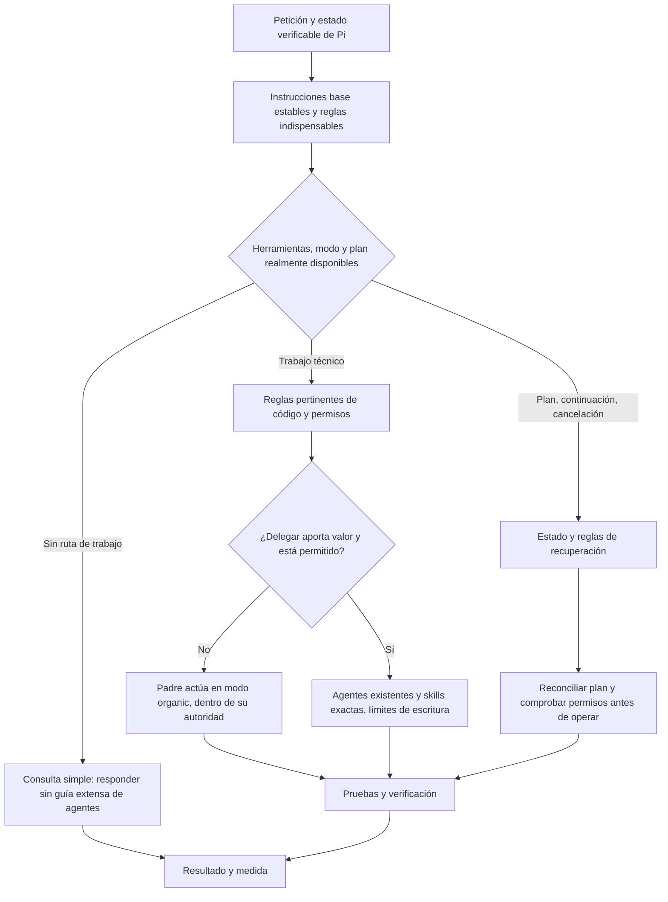

# ASEN — Plan final de optimización del contexto y conservación del flujo de agentes

**Fecha:** 20/11/2026 · **Versión:** 1.0 de diseño · **Estado:** LISTO PARA PREPARAR PRUEBAS SIN PROVEEDOR; IMPLEMENTACIÓN PENDIENTE.
**Rama/PR:** `feat/flujo-de-agentes-20261115` / [PR #61](https://github.com/asenbanskaliev/ASEN/pull/61). **Referencia de código auditada:** `a05424fec15ba5770b45695fefd126638c88b1a7`. No representa la versión futura del producto.
**Fuente rectora:** [plan de los 18 objetivos, E0–E4 y F](../odd/tasks/flujo-de-agentes-plan-implantacion-4.9.0.md), cuya **sección 14** remite a este plan. Los apartados 11–13 previos son antecedentes documentales, no otras tandas ejecutables.
**Contraste:** [auditoría OPT anterior](audit/opt-contexto-skills-asen-2026-11-20.md), [auditoría crítica final](audit/plan-final-opt-investigacion-avanzada-2026-11-20.md), [P16](audit/p16-gentle-4.9.0-18-sesiones-2026-11-20.md); Gentle Shell 4.9.0 en `ce64a9a708e50c0ca899c8023140e63f29f293e1`.
**Compromiso:** optimizar las peticiones al modelo sin rehacer Pi, skills, agentes, memoria, perfiles ni controles de autoridad. El resultado será **medido**, no supuesto.

## 1. Dictamen de la investigación y límites de evidencia

1. **Confirmado en ASEN:** `src/runtime/ui/request-guidance.ts` declara una guía común de unas 6 KB; en `extensions/asen.ts` se decide su inyección comprobando `!!pi.registerTool`, que expresa capacidad de **registro**, no presencia de herramientas seleccionadas para el turno.
2. **Confirmado en ASEN:** `src/skills/registry.ts` ya selecciona las skills necesarias; `src/agents/pi-process-runner.ts` valida las rutas recibidas y usa `--no-skills` junto con `--skill` explícitos. No crear un catálogo ni un motor nuevo.
3. **Confirmado en ASEN:** la memoria de proyecto usa un presupuesto de hasta 4096 bytes y el resumen de planes hasta 2048 bytes; los dos son condicionales. No atribuirlos a todas las peticiones.
4. **API que merece prueba exacta:** `package-lock.json` fija `@earendil-works/pi-coding-agent` **1.2.0**; su ejemplo de personalización [versión 1.2.0](https://app.unpkg.com/@earendil-works/pi-coding-agent@1.2.0/files/examples/extensions/prompt-customizer.ts) consulta `event.systemPromptOptions.selectedTools` y `skills`, y añade/quita una sección propia. Esto **justifica una prueba del anfitrión de ASEN**, no un cambio inmediato ni el uso de métodos de versiones nuevas.
5. **Confirmado en Gentle Shell 4.9.0:** instrucciones centrales y referencias de consulta, rutas de skills para agentes, filtrado de bloques de contexto duplicados y pruebas de presupuesto; **Gentle completo también inyecta instrucciones extensas**. No convertir su ejemplo en un modelo sin contexto.
6. **P16 no es comparativa de sistemas completos:** en 9 ejecuciones por producto, ASEN consumió 16.940 tokens de entrada y Gentle 4.584; ASEN 9/9 respuestas exactas, Gentle 8/9. El comparador cargó `extensions/asen.ts` frente a solo `extensions/gentle-shell.ts`, con `--no-tools --no-skills`; no había Writer ni agentes reales. No concluir que Gentle completo cuesta 3–4 veces menos, ni que el 8/9 representa un fallo de seguridad.
7. **Terceras opciones:** la divulgación progresiva de Agent Skills (Anthropic), la separación de instrucciones de proyecto en Codex y la reducción de duplicados de Gentle inspiran el diseño; **no migrar a otro motor** ni incorporar herramientas externas sin demostrar una carencia concreta.

**Desestimado como evidencia:** ahorro del 30–50 %, del 60–70 %, velocidad igual o mejor, paridad funcional total, costes facturados y seguridad «3/3 frente a 2/3». Son cifras o afirmaciones no validadas para los productos completos.

## 2. Arquitectura objetivo

**Regla de arquitectura:** el **código ejecutable** sigue teniendo la última palabra en escritura, riesgo, alcance, revisión, autorización, reinicio y publicación. La guía al modelo no sustituye ningún control. Una regla solo sale del núcleo cuando se demuestra que **no es necesaria antes de una acción** en ese contexto o que otro mecanismo comprobado ya la impone.

### Clasificación de carga, sin modelos extra

| Bloque | Cuándo cargar | Riesgo si se omite |
| --- | --- | --- |
| Núcleo estable: idioma, objetivo, límites, referencia de herramientas y autoridad | Siempre | Pérdida de orientación o permiso incorrecto |
| Código y exploración: CodeGraph, lecturas, límites y selección de Explorer | Solo contexto técnico/capacidades verificadas | Investigación innecesaria o exploración mal dirigida |
| Trabajo directo / modo delegación completa | Según perfil **verificado**, nunca solo por texto | Escritura del padre en modo prohibido |
| Plan, agentes y paralelismo | Con trabajo planificado/delegación efectiva | Lanzar hijos incorrectos o duplicados |
| Continuidad, cancelación, fallos y recuperación | Con tareas/plan persistidos, señales de transición o instrucciones aplicables | Repetir una escritura o cancelar lo equivocado |
| Memoria pertinente y resumen de plan | Solo si identidad de proyecto/sesión y utilidad son válidas | Contexto irrelevante o cruce de datos |
| Skills de hijos | Rutas exactas derivadas y validadas por ASEN/Pi | Trabajos sin contrato obligatorio |
| Herramientas poco usadas | **No cambiar aún** | Pérdida de acceso, reglas o esquemas |

**Desconocido o degradado:** si la fuente de capacidades/estado no es fiable, aplicar la **guía anterior compatible** y las mismas denegaciones. Nunca confiar en una clasificación por palabras sueltas ni iniciar otro modelo solo para escoger el módulo.

## 3. Intervenciones ejecutables únicas

Se normalizan los nombres duplicados de anexos 11–13: **CTX-0…CTX-6** son la única secuencia ejecutable; **OPT-00…OPT-07** permanecen como referencias, no como trabajos adicionales.

| Unidad | Equivalente | Enlace E/F | Archivos iniciales | Cambio y resultado verificable |
| --- | --- | --- | --- | --- |
| **CTX-0** | OPT-00 | E0 | `extensions/asen.ts`, pruebas de composición, `package-lock.json` | Medir secciones, orden, herramientas, skills, memoria, plan, padre/hijos, bytes y uso de Pi **sin guardar contenido**; fijar SHA y línea base sin proveedor |
| **CTX-1** | OPT-01 | E0/E1B | `extensions/asen.ts`, `src/runtime/ui/request-guidance.ts` | Verificar `selectedTools` y casos sin herramientas en Pi 1.2.0; reemplazar `!!pi.registerTool` **solo si la prueba confirma la semántica**; si falta señal, conservar guía anterior |
| **CTX-2** | OPT-02 | E1B | `src/runtime/ui/request-guidance.ts`, `extensions/asen.ts` | Extraer núcleo y módulos de exploración, código, plan, agentes y recuperación; variar solo la composición; comprobar obligaciones antes/después y modo del padre |
| **CTX-3** | OPT-03 y OPT-04 | E1B/E2B | `src/memory/pi-integration.ts`, `src/runtime/lifecycle/plan-context.ts`, pruebas Pi de skills | Investigar duplicados de AGENTS.md/Pi/memoria/plan/skills. Quitar exclusivamente repeticiones **medidas y demostradas**; mantener rutas, presupuestos e identidades |
| **CTX-4** | OPT-05 | E4, **opcional** | Inventario de herramientas y extensiones | Reducir declaraciones **solo si** la versión concreta de Pi permite ocultarlas sin perder su ejecución, descubrimiento y autorización; si no, **NO APLICAR** |
| **CTX-5** | OPT-06 | E4 | `scripts/p16-comparacion-real.mjs` (sin activar su flujo de pago), pruebas A/B nuevas | A/B ASEN actual vs optimizado con mismo Pi, perfil y capacidades; **otro ensayo** independiente para Gentle completo |
| **CTX-6** | OPT-07 | F | Ajuste reversible acotado, tests, CI, informe de auditoría | Evaluar resultados con revisión independiente, permitir vuelta atrás sin migración ni repetición de trabajos, mantener `globalFull:false` hasta cerrar toda la matriz de 18 |

**Dependencias:** CTX-0 → CTX-1 → CTX-2 → CTX-5 (primera evaluación); CTX-3 solo después de observar duplicación; CTX-4 se puede omitir; CTX-6 al final. **Nunca** modificar `extensions/asen.ts` en paralelo con E1A/E1B/E2B sobre el mismo archivo. Los estudios de memoria y skills sí pueden realizarse en paralelo **solo lectura**.

**Unidades de cambio:** una sola razón técnica por commit, diff mínimo, pruebas primero (RED/GREEN cuando sea aplicable), resultados del SHA exacto, sin mezclar mejoras de contexto con nuevas autorizaciones de Writers.

## 4. Pruebas mínimas por capa

| Capa | Casos obligatorios | Regla de aceptación |
| --- | --- | --- |
| Construcción de contexto (sin red) | Pregunta simple, código, revisión, solo lectura, sin herramientas, herramientas desconocidas, `selectedTools=[]`, skills activadas/no activadas | Secciones adecuadas; ausencia de contenido irrelevante **sin perder rutas necesarias** |
| Estados y perfiles | `organic`, `full-delegation`, perfil cambiado, sesión reanudada, plan activo, plan múltiple, pregunta «continúa», parada | No cambia autoridad; se preserva identidad y el sentido del estado |
| Hijos y skills Pi | Explorer, Writer, Verifier, rutas exactas `--skill`, fallo de lectura de `SKILL.md`, falta de herramienta `read` | No se delega trabajo con contrato faltante; sin catálogo duplicado por error |
| Seguridad negativa | Inyección desde memoria/AGENTS.md/herramienta, ruta fuera de permiso, SHA distinto, permiso rechazado, escritura incierta, cancelación y fallo | **Cero bypass** y mismos bloqueos con contexto reducido |
| Concurrencia y recuperación | Dos Writers independientes y tercero dependiente, entrega duplicada, padre ocupado, reinicio, agotamiento de intentos | Una sola entrega y ningún reintento de escritura dudosa |
| Métricas y privacidad | Petición sin modelo, fallos del medidor, datos sintéticos con secretos falsos, cambio de proyecto | No almacenar cuerpo del prompt, claves, documentos ni datos privados; medidor no puede bloquear Pi |

**Reutilizar pruebas existentes:** `tests/pi-native-skill-load.test.ts`, `tests/pi-memory-skill-sdk-lifecycle.test.ts`, `tests/extension-runtime-commands.test.ts`, `tests/pi-host-compatibility-matrix.test.ts`, `tests/plan-context.test.ts` y controles de planes/agentes. Añadir tests centrados en composición; **no** crear otra infraestructura de selección.

## 5. Medición y comparación justa

### 5.1 Línea base (CTX-0)

- Congelar el SHA exacto y `package-lock.json`; registrar versión Pi, nombre de proveedor, configuración de herramientas, modo, inicio limpio/reanudación y si cada sección es realmente enviada.
- Recoger por categoría **nombre, bytes, cantidad y orden**, sin texto libre, sin hashes reversibles de datos privados. Métricas de Pi por solicitud/proceso: tokens de entrada/salida, `cacheRead`/`cacheWrite` (si existen), latencia inicial/final, llamadas, fallos y reintentos. Coste solo si hay dato verificable; en otro caso `unknown`.
- Distinguir el texto construido por Pi, la composición efectiva transmitida al proveedor y lo facturado por éste. Son magnitudes distintas.
- Si no se puede observar la carga final del proveedor, etiquetar la medición `PROMPT_ASSEMBLY_ONLY`; nunca estimar facturación como observación.

### 5.2 Experimento por parejas (CTX-5)

**A/B principal:** ASEN anterior y ASEN optimizado, cada uno en el **mismo Pi 1.2.0**, modelos, herramientas, recursos, datos sintéticos, sesión limpia y permisos. Repetir grupos de tareas simples, lectura, programación permitida, revisión, memoria, plan, parada, reanudación, fallos y agentes hijos; guardar resultados de cada réplica. **No** forzar herramientas iguales si eso elimina precisamente las capacidades que se quieren evaluar: separar la prueba aislada de contexto de la funcional.

**Comparación externa separada:** Gentle Shell 4.9.0 con `gentle-ai.ts`, `gentle-agents.ts` y las demás piezas de su carga real. Verificar compatibilidad de la versión Pi y sus dependencias; cuando no sea equivalente, indicar `NO_COMPARABLE` o comparar dentro del entorno nativo de cada producto **sin atribuir el resultado solo al producto**.

**Frenos:** presupuesto máximo, número de sesiones y reintentos (por defecto **cero**), proveedor autorizado, fecha y tipo de datos **antes** del primer ensayo real. No activar el flujo P16 ni modelos de pago por una actualización documental. Autorizar por separado escrituras, publicación y fusión.

### 5.3 Umbrales propuestos, aún no demostrados

- **Seguridad:** ningún permiso nuevo, escape de ámbito, fuga, repetición de escritura incierta ni pérdida de rechazo en ninguna prueba negativa.
- **Función:** conservar resultados y decisiones en casos equivalentes de ASEN; todo fallo relevante bloquea la promoción, incluso si hay ahorro.
- **Eficiencia:** establecer antes del A/B un umbral por clase con datos de CTX-0. Propuesta de salida: **al menos 15 % menos tokens de entrada medianos en tareas simples** y **ningún aumento relevante del coste total** de las tareas complejas, teniendo en cuenta caché/tiempo. El 15 % es **umbral de aceptación propuesto**, no ahorro medido ni compromiso comercial.
- **Caché/tiempo:** no empeorar significativamente el tiempo hasta respuesta ni el coste observado; si el coste es desconocido, registrar `unknown` y no afirmar ahorro monetario.
- **Evidencia:** todas las pruebas requeridas del **SHA exacto**; ningún `SKIP` o `UNKNOWN` cuenta como `PASS`.

## 6. Conservación de los 18 objetivos y puertas G0–G6

| Objetivos originales | Qué obliga a conservar esta línea | Unidad de prueba |
| --- | --- | --- |
| **01 y 04** | Decisión directo/ODD y unidades completas, sin ceremonia artificial | CTX-1/2/5 |
| **02 y 10** | Perfiles, dos modos y modelo del padre sin deriva en reanudación | CTX-1/2/5 |
| **03 y 09** | Explorer proporcionado, presupuestos, perfil de modelos y cuotas | CTX-2/5 |
| **05 y 06** | Writers reales paralelos y ámbitos exactos aprobados | CTX-3/5 |
| **07 y 08** | Aviso terminal único y continuación segura | CTX-2/3/5 |
| **11, 12 y 13** | Verifier, revisión proporcional, jueces y corrección acotada | CTX-2/5 |
| **14** | Clarifier y autorización humana sin inferencia | CTX-1/2/5 |
| **15** | Integridad Git/SHA, permisos y diario | CTX-0/5/6 |
| **16 y 17** | Medir A/B y agentes con proveedor real | CTX-5 |
| **18** | API Pi real, degradación segura por versión y host | CTX-0/1/4/6 |

**Puertas de avance:** G0 autoriza cambios tras línea base; G1 protege capacidades/perfiles; G2 conserva paralelismo real antes de declararlo; G3 exige continuidad segura; G4 revisión; G5 A/B real; G6 auditoría y CI exacto. CTX **no salta ni sustituye** G2–G4. Si E2/E3 no está cerrado, se registra su estado real y la optimización **no puede darlo por cerrado**.

## 7. Protección de cambios y vuelta atrás

1. Antes de editar, comprobar HEAD, árbol y comentarios pendientes; seleccionar archivos exactos del parche. No tocar cambios ajenos.
2. Mantener un **selector de composición anterior/nueva** que solo afecte las secciones de contexto, nunca permisos, skills del runner ni estado persistido. El valor inicial sigue siendo `anterior` hasta superar G5/G6.
3. Revertir únicamente commits de CTX o volver al selector `anterior` si falla una puerta. No resetear rama, borrar trabajo, reemitir Writers, ni migrar/alterar recuerdos o planes.
4. Un plan activo conserva su identidad y las restricciones vigentes durante el cambio de variante. Al reabrir, nunca interpretar una guía diferente como nueva autorización.
5. Guardar resultados con estado `PLANIFICADO`, `IMPLEMENTADO_NO_VALIDADO`, `VALIDADO_LOCAL`, `A_B_COMPARABLE` o `ACEPTADO`. Nada se declara aceptado por ver solo CI verde.

## 8. Decisiones prohibidas hasta contar con evidencia

- **No** establecer `event.systemPrompt=""`, `customPrompt` o reemplazo completo del prompt de Pi como solución a la sobrecarga. La vía normal es la **sección propia** validada de `systemPromptOptions`.
- **No** usar `pi.setActiveTools()` como si fuera un detector: su función es **modificar** herramientas. Tampoco equiparar `registerTool` a herramientas activas.
- **No** suprimir skills, cambiar el esquema del registro, modificar el runner ni activar herramientas ocultas por analogía con Gentle sin confirmar los efectos.
- **No** reducir memoria o estado de plan por un porcentaje arbitrario; sin estado fiable no existe continuidad segura.
- **No** crear un modelo clasificador adicional ni usar coincidencias de palabras como única decisión.
- **No** convertir la comparación P16, 9/9 y 8/9, en una nota general de seguridad o paridad.
- **No** alterar la autoridad sobre modelos configurados, Writers, cambios destructivos, proveedores y fusión.

**Decisión final de diseño:** ejecutar **CTX-0 y pruebas de CTX-1 primero**, en modo sin red. Con resultados, abordar solo la composición de texto de ASEN. **El ahorro nunca se antepone a la seguridad ni al cumplimiento funcional de los 18 objetivos.**
