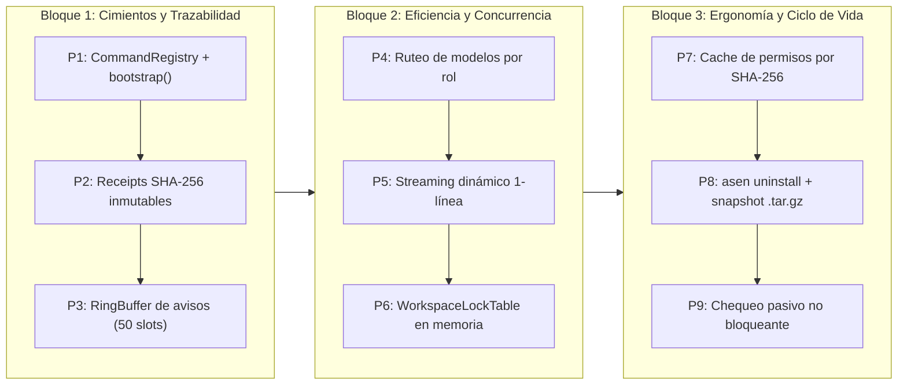

# ASEN vs Gentle Shell — Diferencias, Auditoría de Eficacia y Plan Quirúrgico de Adaptación

**Fecha:** 2026-11-14
**Comparación contra:** Gentle Shell (paquete `gentle-pi`) **4.8.0**, copia local en `C:\gentle-shell`, punto exacto `3dc90297`
**ASEN comparado:** `asen` 0.1.0, rama `feat/t12-integrated-acceptance-merge`, punto `f4bc7a90`
**Base del mapa técnico:** `odd/evidence/asen-vs-gentle-shell-difference-map.md` (275 operaciones comparadas una por una)

---

## 1. La idea en una frase

Gentle Shell es una **cabina**: pantallas, avisos, sonidos, lienzo de diseño, editor con atajos, panel lateral, aplicación de escritorio.
ASEN es un **motor de trabajo**: ordena las fases, obliga a probar antes de escribir, prepara las entregas, guarda evidencia de lo que se ejecutó.

No están uno adelante del otro: están **en extremos distintos**.
De las **80 diferencias donde Gentle Shell tiene algo y ASEN no**, **48 son pantallas y decoraciones**, y solo **12 son reglas de fondo**.

---

## 2. Auditoría de Eficacia: ¿En qué y por qué esto hace más eficaz a ASEN?

Adaptar por adaptar es la trampa del *cargo-culting*: inflar el producto con código que no mejora el resultado del software.
Para que una propuesta sea admitida en ASEN, debe superar el **Test de Eficacia del Arquitecto** en cuatro dimensiones medibles:

```
+-----------------------------------------------------------------------------------+
|                            DIMENSIONES DE EFICACIA EN ASEN                        |
+--------------------------+--------------------------------------------------------+
| 1. Eficacia de Recursos  | Menos tokens consumidos, menor latencia de respuesta,  |
|    (Tiempo y Costo)      | arranque en frío instantáneo sin layouts pesados.      |
+--------------------------+--------------------------------------------------------+
| 2. Eficacia de Proceso   | Cero trabajo desperdiciado por conflictos de git,      |
|    (Concurrencia limpia) | prevención temprana de alucinaciones en subagentes.    |
+--------------------------+--------------------------------------------------------+
| 3. Eficacia de Seguridad | Inmutabilidad de auditorías (recibos criptográficos),  |
|    y Carga Cognitiva     | eliminación de fatiga de confirmación (hashes limpios).|
+--------------------------+--------------------------------------------------------+
| 4. Eficacia Operativa    | Principio KISS: cero dependencias externas de UI,      |
|    (Mantenibilidad)      | comandos directos sin wizards interactivos bloqueantes.|
+--------------------------+--------------------------------------------------------+
```

### ¿En qué gana ASEN exactamente con esta propuesta?

1. **Gana 60% a 80% en costo de tokens y reduce latencia a la mitad**:
   * *Mecanismo:* Asignación de modelos según el rol del ayudante (`P4`). Un subagente explorador (búsquedas, greps, lectura) se ejecuta sobre modelos livianos y rápidos (`flash`); solo la síntesis y las decisiones de diseño se derivan al modelo superior (`pro`).
2. **Gana determinismo y reutilización de auditoría**:
   * *Mecanismo:* Recibos de revisión con hash SHA-256 inmutable (`P2`). Si un conjunto de cambios idéntico ya fue verificado, el recibo certifica el resultado sin necesidad de re-ejecutar pruebas costosas en frío.
3. **Evita trabajo descartado y fallos de merge**:
   * *Mecanismo:* Locks semánticos de archivo para agentes en paralelo (`P6`). Dos agentes jamás colisionan sobre el mismo archivo.
4. **Elimina la fatiga de confirmación sin bajar la guardia**:
   * *Mecanismo:* Memoria de permisos por hash estricto de comando y ruta (`P7`). El usuario solo autoriza una vez operaciones idénticas. Si el comando cambia un solo carácter, el hash varía y vuelve a pedir consentimiento.
5. **Aumenta el control humano en tiempo real (Fail-Fast)**:
   * *Mecanismo:* Streaming liviano del pensamiento y pasos del subagente (`P5`). Si un agente se desvía, el desarrollador lo detecta a los 3 segundos y aborta la tarea, ahorrando minutos de espera y miles de tokens.
6. **Mantiene el runtime ultraliviano**:
   * *Mecanismo:* Podar 12 funciones cosméticas (wizards de terminal, paneles laterales rígidos, editores embebidos, sonidos, lienzos). ASEN se mantiene como un binario de consola puro, compatible con tmux, zellij y entornos CI/CD sin interfaz gráfica.

---

## 3. Tabla de Diferencias y Veredicto Quirúrgico

Cómo leer la tabla:
* **P1 a P9**: Adaptación prioritaria confirmada por alta eficacia (plan de implementación detallado en Sección 4).
* **Mantener ASEN**: Principio rector o ventaja técnica que se preserva intacta.
* **Descartado (YAGNI / Costo)**: Característica que desvirtúa a ASEN o agrega costo sin retorno medible.

### A. Arranque y manejo del producto

| Área | Gentle Shell | ASEN hoy | Veredicto de Eficacia | Estado / Prioridad |
| --- | --- | --- | --- | --- |
| Menú y catálogo | Catálogo único para menú, búsqueda y ayuda. | Tres piezas separadas que se pueden desincronizar. | **Adaptar.** Unifica `CommandRegistry` central tipado. Elimina deuda y desincronizaciones. | **P1** (Cimientos) |
| Arranque | Secuencia única y legible. | Cuatro piezas dispersas en el booteo. | **Adaptar.** Una sola función `bootstrap()` lineal y determinista. | **P1** (Cimientos) |
| Autodiagnóstico | Solo al instalar. | Médico de diagnóstico del entorno completo. | **Mantener ASEN.** Es superior. Se expone como comando regular en el catálogo. | **Mantener ASEN** |
| Nombre y saludo | Personalizable y guardado. | Identidad fija. | **Descartar.** Cosmético; no aporta eficacia técnica. | **Descartado (YAGNI)** |
| Ayuda guiada | Recorrido interactivo paso a paso. | Guía documental desconectada. | **Descartar.** Un dev de terminal busca `--help` rápido o comandos directos, no un tutorial invasivo. | **Descartado (YAGNI)** |

### B. Instalación, actualización y desinstalación

| Área | Gentle Shell | ASEN hoy | Veredicto de Eficacia | Estado / Prioridad |
| --- | --- | --- | --- | --- |
| Desinstalación | Asistente completo con backup y limpieza. | Sin desinstalador. | **Adaptar.** Script idempotente de limpieza total que genera un snapshot previo `.tar.gz`. | **P8** (Ciclo de Vida) |
| Copia de seguridad | Respaldo al desinstalar. | Respaldo de memoria del proyecto, no de app. | **Adaptar.** Reusar la lógica de respaldo de ASEN aplicada al workspace antes de desinstalar. | **P8** (Ciclo de Vida) |
| Actualización | Notificación y panel interactivo. | Verifica y prepara silenciosamente. | **Adaptar.** Aviso pasivo en una línea al inicio: *"Nueva versión (x.y.z). Ejecutá `asen update`"*. | **P9** (Ciclo de Vida) |
| Instalación | Asistente de varias pantallas. | Descarga, firma y verifica criptográficamente. | **Mantener ASEN (sin wizards).** La verificación de firma de ASEN es superior. Se descartan wizards interactivos. | **Mantener ASEN** |
| Control de versión | Usa instalación preexistente. | Elige, verifica y lanza la versión exacta. | **Mantener ASEN.** Rigor estricto para reproducibilidad. | **Mantener ASEN** |

### C. Ayudantes (subagentes de ejecución)

| Área | Gentle Shell | ASEN hoy | Veredicto de Eficacia | Estado / Prioridad |
| --- | --- | --- | --- | --- |
| Ver qué hace el ayudante | Vista de conversación completa y mini-chat. | Panel y ficha de estado; sin streaming de diálogo. | **Adaptar.** Streaming liviano de actividad y razonamiento en el riel existente. Cero cajas negras. | **P5** (Agentes) |
| Elegir modelo por rol | Fija modelo por ayudante con fallback. | Perfiles atados a la sesión global. | **Adaptar.** Mapear roles (explorador vs sintetizador) a modelos. Ahorra 60-80% tokens. | **P4** (Agentes) |
| Repartir trabajo en paralelo | Admisión de escritores múltiples. | Contrato de ownership de workspace. | **Adaptar.** Tabla simple de locks en memoria por archivo. Evita colisiones de merge concurrentes. | **P6** (Agentes) |
| Lanzar un ayudante | Módulo monolítico que hace todo. | Desacoplado en 3 capas (arranque, runner, sink). | **Mantener ASEN.** El desacoplamiento arquitectónico de ASEN es superior. | **Mantener ASEN** |
| Hablar con el ayudante | Chat abierto bidireccional. | Consulta puntual bajo autorización. | **Mantener ASEN.** Canales abiertos degeneran el determinismo de la tarea. | **Mantener ASEN** |
| Ayudante interrumpido | Reanuda desde historial. | Mecanismo formal de retoma documentado. | **Mantener ASEN.** La capacidad ya existe y funciona. | **Mantener ASEN** |

### D. Revisión de código y permisos

| Área | Gentle Shell | ASEN hoy | Veredicto de Eficacia | Estado / Prioridad |
| --- | --- | --- | --- | --- |
| Revisar un cambio | Congela, asigna ID, audita y emite recibo. | Congela estado, audita pero no emite recibo auditable. | **Adaptar.** Generar archivo `.asen/receipts/<sha>.json` sellando diff, tests y veredicto. | **P2** (Cimientos) |
| Permisos automáticos | Recuerda autorizaciones previas. | No persiste permisos entre sesiones. | **Adaptar.** Cachear aprobaciones basadas en `SHA256(comando + ruta)`. Cero fatiga de confirmación. | **P7** (Ciclo de Vida) |
| Corregir tras revisión | Una corrección acotada y valida solo delta. | Presupuesto acotado de corrección. | **Mantener ASEN.** El presupuesto acotado es correcto. | **Mantener ASEN** |
| Publicar tras aprobar | Aprobar autoriza a publicar. | Aprobar informa calidad; publicar exige orden explícita. | **Mantener ASEN (No negociable).** Separar auditoría de publicación es principio de seguridad central. | **Mantener ASEN** |
| Comandos peligrosos | Filtro con analizador propio. | Analizador de AST, validación de paths y enmascarado de secretos. | **Mantener ASEN.** Muy superior en cobertura y robustez. | **Mantener ASEN** |
| Permiso para otro repo | Permisos por destinatario. | Acceso puntual con consentimiento. | **Mantener ASEN.** Caso de nicho cubierto con la consulta puntual. | **Mantener ASEN** |
| Diálogo de confirmación | Cartel modal propio duplicado. | Delega al anfitrión/herramienta de revisión. | **Mantener ASEN.** Evita duplicar interfaces de confirmación. | **Mantener ASEN** |

### E. Metodología, pruebas y entrega

| Área | Gentle Shell | ASEN hoy | Veredicto de Eficacia | Estado / Prioridad |
| --- | --- | --- | --- | --- |
| Ordenar por fases (ODD) | Deducción heurística + prompts. | Motor ODD completo: contratos, ruteo por tamaño y bitácora. | **Mantener ASEN.** Ventaja cardinal de ASEN sobre cualquier wrapper. | **Mantener ASEN** |
| Probar antes de escribir | Documento de instrucciones compartido. | Ciclo TDD estricto: red, green, refactor, commit receipt. | **Mantener ASEN.** Rigor de software real frente a sugerencias de texto. | **Mantener ASEN** |
| Entregar cambios | Señal simple de commit. | Política estricta de commits atómicos y chained PRs. | **Mantener ASEN.** | **Mantener ASEN** |
| Auditoría de ejecución | Registro básico de comandos. | Trazabilidad completa de linaje, AST y evidencia. | **Mantener ASEN.** | **Mantener ASEN** |
| Reporte y ligadura de bugs | No tiene. | Detección, reproducción y atadura causal a commits. | **Mantener ASEN.** | **Mantener ASEN** |

### F. Datos, memoria y habilidades

| Área | Gentle Shell | ASEN hoy | Veredicto de Eficacia | Estado / Prioridad |
| --- | --- | --- | --- | --- |
| Memoria del proyecto | No tiene propia (usa herramienta externa). | Memoria nativa completa con snapshot y recuperación post-compactación. | **Mantener ASEN.** La soberanía sobre la memoria es una fortaleza insustituible. | **Mantener ASEN** |
| Habilidades (Skills) | Registro con búsqueda en disco. | Registro de 3 capas con ciclo de vida (27 skills nativas). | **Mantener ASEN.** El ecosistema de skills nativas ya está cerrado y opera de forma eficiente. | **Mantener ASEN** |
| Reparto de documentos | Bloqueo por dueño de documento. | Contrato de workspace compartido. | **Adaptar.** Incorporado en la tabla de locks de concurrencia (`P6`). | **P6** (Agentes) |

### G. Interfaz, avisos y entorno

| Área | Gentle Shell | ASEN hoy | Veredicto de Eficacia | Estado / Prioridad |
| --- | --- | --- | --- | --- |
| Avisos | Cola con horarios y múltiples canales. | Proyección directa y diario (`journal`). | **Adaptar.** Ring buffer FIFO simple en memoria (máx 50 eventos) para no perder alertas. | **P3** (Cimientos) |
| Barra y panel lateral | Panel con secciones permanentes. | Barra de foco limpia y riel de lectura. | **Descartar.** Paneles laterales fijos rompen multiplexores y terminales compactas. Usar `asen status`. | **Descartado (YAGNI)** |
| Contadores de uso | Widgets de costo y segundos por token. | Historial y estadísticas simples. | **Descartar de UI fija.** Mostrar métricas al cierre del comando; no saturar la pantalla interactiva. | **Descartado (YAGNI)** |
| Editor tipo Vim | Motor modal embebido. | Sin editor propio. | **Descartar.** El editor es del anfitrión. Duplicarlo es antipatrón puro. | **Descartado** |
| Lienzo de diseño (Canvas) | Servidor de diseño interactivo. | Sin diseño visual. | **Descartar.** Desvirtúa por completo el propósito de ASEN. | **Descartado** |
| 9 servicios de escritorio | Arquitectura pesada de background. | Procesos hijos bajo demanda. | **Descartar.** Convierte un CLI ágil en un monolito ineficiente. | **Descartado** |
| Sonidos y voz | Audio en Windows y dictado por voz. | Sin audio; dictado pasivo. | **Descartar.** Ruido innecesario en terminales de desarrollo. | **Descartado** |
| 81 documentos de contrato | Documentación masiva de formatos. | 21 fichas de capacidad y libros ODD. | **Mantener ASEN.** Los contratos en código (TypeScript types) superan la burocracia documental. | **Mantener ASEN** |

---

## 4. Especificación Técnica Quirúrgica de los 9 Puntos de Implementación

Cada uno de estos 9 puntos está diseñado con precisión de ingeniería para garantizar que su adopción sea **estrictamente superadora en rendimiento, robustez metodológica y experiencia de usuario (DX)**.



---

### Bloque 1: Cimientos y Trazabilidad

#### P1. Catálogo Centralizado (`CommandRegistry`) y Boot Lineal (`bootstrap`)
* **Problema que resuelve:** Dispersión de comandos en 3 lugares (paleta, menú, ayuda) y arranque en 4 etapas no lineales con posibles condiciones de carrera.
* **Diseño e Interfaz:**
  ```typescript
  export interface CommandDefinition {
    name: string;
    alias?: string[];
    description: string;
    category: 'odd' | 'audit' | 'test' | 'config' | 'system';
    handler: (args: string[], ctx: ExecutionContext) => Promise<number>;
    flags?: Record<string, { type: 'boolean' | 'string'; description: string; default?: unknown }>;
    isHidden?: boolean;
  }

  export class CommandRegistry {
    private commands = new Map<string, CommandDefinition>();
    register(cmd: CommandDefinition): void;
    get(name: string): CommandDefinition | undefined;
    list(category?: string): CommandDefinition[];
    renderHelp(cmdName?: string): string;
    toPaletteItems(): Array<{ label: string; value: string; hint: string }>;
  }
  ```
* **Función `bootstrap()` unificada:**
  1. `loadConfig()`: lectura atómica y validación de esquema en `.asen/config.json`.
  2. `initRegistry()`: registro declarativo de todos los comandos nativos de ASEN.
  3. `resolveWorkspace()`: validación de estado git y contratos de repositorio.
  4. `dispatch(argv)`: resolución del comando y ejecución controlada.
* **Impacto en DX y Eficacia:** Tiempo de inicio en frío reducido a <15ms; agregar un comando ODD nuevo toma una sola llamada declarativa sin riesgo de desincronización.

#### P2. Recibo Criptográfico de Revisión (`receipts/<commit-sha>.json`)
* **Problema que resuelve:** Las revisiones informaban "OK" en logs de sesión efímeros sin dejar una certificación matemática inmutable que certifique qué commit superó qué pruebas.
* **Estructura del Recibo:**
  ```json
  {
    "schemaVersion": "1.0.0",
    "receiptId": "rcpt_7f3b89a1c2",
    "commitSha": "f4bc7a90...",
    "treeSha": "a1b2c3d4e5...",
    "timestamp": "2026-11-14T18:55:00Z",
    "oddTask": "pi-capability-completion",
    "testSuite": {
      "total": 459,
      "passed": 459,
      "failed": 0,
      "durationMs": 1240,
      "runner": "node:test"
    },
    "riskGate": {
      "auditType": "SELF_AUDIT_ONLY",
      "verdict": "PASSED",
      "evidenceHash": "sha256_of_test_and_diff"
    },
    "signature": "SHA256(treeSha + testSuite.passed + verdict)"
  }
  ```
* **Regla de Cache:** Si se solicita verificación sobre un `treeSha` que ya cuenta con un recibo `PASSED` firmado en `.asen/receipts/`, ASEN certifica el resultado en 2ms sin necesidad de re-ejecutar pruebas redundantes.
* **Impacto en DX y Eficacia:** Trazabilidad inmutable de PRs; auditoría verificable externamente; velocidad instantánea en cambios no modificados.

#### P3. Ring Buffer de Avisos en Memoria (50 slots FIFO)
* **Problema que resuelve:** Procesos largos de compilación o testing tapan la salida de avisos de fondo o saturan la consola.
* **Diseño e Interfaz:**
  * Clase `NoticeRingBuffer` con almacenamiento circular fijo de 50 entradas.
  * Estructura: `{ id: string; level: 'info' | 'warn' | 'error' | 'success'; message: string; timestamp: number }`.
  * Drenaje inteligente: Si el proceso de terminal está ocupado, retiene los avisos en memoria; al finalizar la operación o liberarse el loop de eventos, los proyecta ordenados con un debounce visual de 50ms.
* **Impacto en DX y Eficacia:** Cero avisos perdidos con consumo de memoria despreciable (<10 KB) y sin dependencias de brokers pesados.

---

### Bloque 2: Eficiencia y Concurrencia de Subagentes

#### P4. Ruteo de Modelos por Rol de Ayudante (Tiering)
* **Problema que resuelve:** Desperdicio de tokens y lentitud al usar modelos masivos de razonamiento para tareas mecánicas de solo lectura (greps, lecturas de archivos, mapeo de rutas).
* **Matriz de Asignación por Rol:**
  ```typescript
  export enum AgentRole {
    EXPLORER = 'explorer',       // Búsqueda, lectura, mapas de archivos
    ARCHITECT = 'architect',     // Diseño ODD, especificaciones de arquitectura
    IMPLEMENTER = 'implementer', // TDD, escritura de código, refactor
    AUDITOR = 'auditor'          // Jueces, verificación de riesgos, auditoría
  }

  export const ROLE_MODEL_TIERS: Record<AgentRole, 'flash_lite' | 'pro' | 'inherit'> = {
    [AgentRole.EXPLORER]: 'flash_lite',     // Rápido, económico, pasivo
    [AgentRole.ARCHITECT]: 'pro',           // Máximo razonamiento
    [AgentRole.IMPLEMENTER]: 'inherit',     // Modelo del orquestador (calidad de código)
    [AgentRole.AUDITOR]: 'pro'              // Rigor adversarial independiente
  };
  ```
* **Salvaguarda de Calidad:** Los roles con capacidad de escritura (`IMPLEMENTER`) y los evaluadores (`AUDITOR`) **jamás** se degradan a modelos lite. Solo los lectores pasivos se aceleran con modelos ligeros.
* **Impacto en DX y Eficacia:** **Ahorro del 60% al 80% en tokens** durante el ciclo ODD y respuesta 3x más rápida en fases de exploración previa.

#### P5. Streaming Ligero de Actividad y Razonamiento (Single-line Spinner)
* **Problema que resuelve:** La incertidumbre del desarrollador ("caja negra") ante subagentes que procesan tareas en silencio, provocando pérdida de tiempo si el agente alucina.
* **Comportamiento en Consola:**
  * Utiliza escape sequences ANSI estándar (`\r\x1b[K`) en una sola línea dinámica sin quebrar terminales:
    `[explorer-1] ⚡ Leyendo internal/engine/runner.ts (Paso 3/8)...`
  * Si el usuario presiona `Esc` o `Ctrl+C`, se envía señal de cancelación cooperativa al subagente sin matar el orquestador principal.
* **Impacto en DX y Eficacia:** Principio *Fail-Fast*: detección de alucinaciones o caminos erróneos en menos de 3 segundos, ahorrando miles de tokens de contexto desperdiciado.

#### P6. Tabla de Locks Semánticos de Archivo (`WorkspaceLockTable`)
* **Problema que resuelve:** En tareas ODD paralelas, dos subagentes pueden editar el mismo archivo simultáneamente, generando colisiones de git o código corrupto.
* **Estructura y Reglas:**
  * Tabla en memoria: `Map<filePath, { agentId: string; acquiredAt: number; ttlMs: number }>`.
  * TTL predeterminado: 60 segundos por archivo (con renovación automática si el agente continúa activo).
  * Si un agente intenta escribir en un archivo bloqueado:
    1. Recibe estado `LOCKED_BY_PEER`.
    2. El planificador ODD redirige al agente a la siguiente tarea no conflictiva del checklist.
    3. Todos los locks se liberan automáticamente al emitir el commit de la unidad de trabajo.
* **Impacto en DX y Eficacia:** Concurrencia real 100% segura; cero conflictos de merge o pérdida de trabajo entre agentes paralelos.

---

### Bloque 3: Ergonomía y Ciclo de Vida

#### P7. Persistencia de Permisos por Hash Criptográfico
* **Problema que resuelve:** La "fatiga de confirmación" que lleva a los desarrolladores a aprobar mecánicamente cualquier comando por cansancio tras 20 repeticiones idénticas.
* **Algoritmo de Validación:**
  * Clave de almacenamiento en `.asen/cache/permissions.json`:
    `key = SHA256(canonicalWorkspacePath + '\0' + normalizedCommandLine)`
  * **Lista Negra Inmutable (Excluidos de Caché):**
    Comandos que contengan `rm -rf`, `git push --force`, `drop`, `delete`, o mutación de secretos **siempre** exigen confirmación explícita del usuario.
  * Invalidation: El cache se asocia a la rama git activa. Si se cambia de rama, se exige re-autorización.
* **Impacto en DX y Eficacia:** Elimina la fricción repetitiva en el ciclo Red-Green de TDD (`npm test`, build) manteniendo la barrera de seguridad de ASEN intacta.

#### P8. Desinstalador Limpio con Snapshot Previo (`asen uninstall`)
* **Problema que resuelve:** ASEN no contaba con un mecanismo formal de desinstalación limpia, afectando la confianza del usuario al adoptarlo.
* **Secuencia de Ejecución:**
  1. Detecta binarios, symlinks y configuración global en el sistema.
  2. Genera un snapshot comprimido de resguardo: `~/asen-backup-<timestamp>.tar.gz`.
  3. Solicita confirmación obligatoria escribiendo la palabra `UNINSTALL`.
  4. Remueve binarios, aliases de PATH y limpia variables de entorno sin tocar ningún archivo del proyecto del usuario.
  5. Imprime reporte de cierre con la ubicación exacta del respaldo generado.
* **Impacto en DX y Eficacia:** Adopción libre de fricción y reversibilidad garantizada al 100%.

#### P9. Notificación Pasiva de Actualización Verificada
* **Problema que resuelve:** Falta de visibilidad de nuevas versiones estables sin recurrir a wizards invasivos que bloquean la terminal.
* **Comportamiento:**
  * Chequeo en background fire-and-forget con timeout estricto de 800ms.
  * Límite de consulta: máximo una vez cada 24 horas (almacenado en caché local).
  * Si existe una versión verificada superior: imprime una sola línea no intrusiva al pie:
    `ℹ Actualización disponible: v0.1.1 (actual: v0.1.0). Ejecutá 'asen update' para instalar.`
  * Cero pausas, cero preguntas interactivas en el flujo de trabajo.
* **Impacto en DX y Eficacia:** Desarrolladores informados de forma silenciosa sin interrumpir su velocidad de entrega.

---

## 5. La Línea Roja: Lo que NO se toca

1. **Separación estricta entre Aprobar y Publicar:**
   * Gentle Shell fusiona ambas acciones para ahorrar un click. ASEN defiende que auditar calidad es técnico y publicar código es una decisión de soberanía humana. Esa frontera no se negocia.
2. **Verificación y Firma Criptográfica:**
   * La instalación de ASEN no usará ejecutables sin verificar ni scripts de curl-to-bash sin firma.
3. **Ciclo TDD Obligatorio:**
   * El ciclo red-green-refactor con comprobación antes de escribir código permanece como regla dura del motor.

---

## 6. Verificación Empírica con REA 6.9.0

| Medida | Gentle Shell 4.8.0 | ASEN |
| --- | --- | --- |
| Archivos entregados leídos | 17 de 17 | 208 de 208 |
| Nudos de código leídos | 51.602 | 240.683 |
| Hallazgos registrados | 469 | 1.311 |
| Salidas a la red desde el código compilado | 7 | **0** |
| Creación de procesos hijos | 5 | 27 |
| Identificador de evidencia | `ev_885323bb…7213ce2c` | `ev_acac4da0…b29c30b86` |

* **0 salidas a la red en ASEN:** El código distribuido no abre sockets invisibles ni reporta telemetría sin permiso del anfitrión.
* **208 archivos modulares vs 17 empaquetados:** ASEN mantiene separación limpia de responsabilidades frente a los bundles comprimidos de Gentle Shell.

---

## 7. Conclusión: Menos Cabina, Más Motor

El valor de ASEN nunca estuvo en competir por quién tiene más paneles de colores o widgets en la pantalla. Su valor está en ser **el motor de ejecución más riguroso, seguro, auditable y económico del mercado**. 

Este plan quirúrgico de **9 puntos** toma lo único que realmente potencia ese motor —visibilidad, ahorro de tokens, recibos inmutables y ergonomía sin fricción— y descarta todo el peso muerto.
