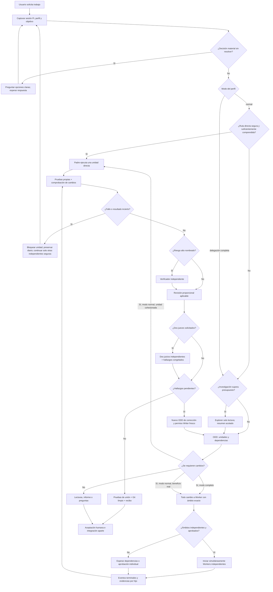

# ASEN — Plan de equivalencia funcional del flujo de agentes (referencia 4.9.0)

**Fecha:** 2026-11-19. **Rama de trabajo:** `feat/flujo-de-agentes-20261115`; PR #61 en borrador.
**Objetivo:** igualar **decisiones, transiciones, concurrencia, revisión y recuperación** de la referencia 4.9.0, aprovechando el motor propio de ASEN, ODD, Pi y sus barreras de seguridad.
**Punto de partida comprobado:** commit `dcb68a67a5801ee672523206235273ac72e7a7cc`: CI `44496356490`, control de arquitectura `44496356513`, pruebas Pi 1.2 `44496356769` y control de publicación `44496356488`, todos **success**. Prueba gratuita externa `skipped`.
**Fuentes ya auditadas:** [comparación actual y 18 diferencias](./flujo-de-agentes-comparativa-actual-4.9.0.md), [investigación de escenarios](./flujo-de-agentes-gentle-shell-4.9.0-investigacion.md), [objetivo anterior](./flujo-de-agentes-objetivo.md).
**Estado:** PLANIFICADO, NO IMPLEMENTADO EN ESTAS FASES. La corrección de D está cerrada por CI; `globalFull:false` porque faltan comportamientos y pruebas auténticas equivalentes.

## 1. Definición de «mismo flujo»

**Equivalencia funcional** significa que para una misma petición, contexto, perfil, dependencias, permisos, riesgos, estado de agentes y fallos:
1. Ambos sistemas eligen una ruta del mismo tipo: directo, investigar, planificar, Writer, verificador, preguntar o bloquear.
2. Las unidades de trabajo independientes se solapan realmente; las dependientes esperan; nunca se reutiliza un permiso entre unidades.
3. El padre observa un evento terminal genuino, recibe como máximo una entrega por hijo y vuelve a decidir sin sondeo repetitivo ni relanzamientos ocultos.
4. Los modelos y costes se identifican por los valores realmente empleados; fallos conducen a sustitución autorizada o parada con diagnóstico, no a una facturación supuesta.
5. Una escritura termina en pruebas y revisión; observaciones, cambios de Git, conflicto o incertidumbre bloquean la aceptación.
6. El modo de delegación completa impide cualquier edición directa del padre, incluso de documentación, pruebas o archivos auxiliares.
7. El usuario puede ver **qué agente trabaja, qué tarea espera, qué permiso falta y qué resultado fue probado**, sin confundir `completed` con `accepted`.

**Diferencias deliberadas y documentadas:** ASEN mantiene comprobación de SHA exacto, límites de archivos, una autorización Pi por Writer, consentimiento nuevo para gasto positivo o desconocido, bloqueo por escritura incierta y prohibición de fusión automática. Estas medidas pueden exigir una decisión humana adicional; no constituyen fallo de equivalencia en la ruta permitida.

**Prohibiciones:** no copiar el motor de agentes externo, no crear un segundo despachador, no introducir permisos derivados del modelo, no lanzar modelos de pago sin consentimiento específico, no fusionar a otra rama sin autorización.

## 2. Mapa de decisiones obligatorio

**Nota de la ruta:** las preguntas normales son interactivas. La aprobación de un Writer, de una revisión con consumo, de un cambio de riesgo o de una integración es siempre una autorización verificable del anfitrión Pi, nunca un simple texto del agente.

## 3. Ejecución óptima por fases, en este orden

| Fase | Qué falta exactamente | Código que se debe reutilizar o modificar | Criterio de terminación |
| --- | --- | --- | --- |
| **E0 — Baseline y trazabilidad** | Congelar versión de referencia y SHA verde de ASEN, 18 diferencias y pruebas existentes; crear matriz de casos con identificadores `F49-*`. | `flujo-de-agentes.md`, `agent-flow-ab-comparison.ts`, CI. | Un único SHA inicial; 0 regresiones; matriz de casos y fuente por decisión. **Ya hay CI verde en D; falta registrar la matriz ejecutable.** |
| **E1 — Dos modos por perfil (P0)** | Añadir modo `normal` y `delegación-completa` por perfil; migración compatible desde perfiles actuales; prioridad sesión/proyecto/global; cambio desde el siguiente turno, sin alterar el modelo en ejecución. En modo completo el padre planifica y revisa, pero **nunca escribe**. | `src/runtime/lifecycle/profiles.ts`, `session-profile-binding.ts`, `src/orchestration/orchestrator.ts`, `src/runtime/ui/request-guidance.ts`, `extensions/asen.ts`. | Dos sesiones con modos diferentes; cambio de perfil entre turnos; reinicio/reanudación; modo completo rechaza toda edición primaria y bloquea si no hay Writer admitido. |
| **E2 — Decisión orgánica y Explorer (P0)** | Convertir las reglas actuales en decisiones observables de Pi: directo si claro/seguro, ODD si largo, Explorer solo después de límite acumulado de lectura; escalada de riesgo nombrada. Preferir 3 consultas o presupuesto ~10k tokens cuando se pueda medir; etiquetar aproximaciones por bytes, no presentarlas como tokens reales. | `odd-routing.ts`, `orchestrator.ts`, `explorer-budget.ts`, `request-guidance.ts`, `pi-agent-tools.ts`. | Tarea pequeña directa, grande cohesionada sin Writer forzado, contexto desconocido → una sola exploración; resumen `ruta:línea`, límite de tamaño y una comprobación de contraste. Sin Explorer doble ni de pago automático. |
| **E3 — Lanzamiento paralelo real desde el padre (P0)** | Crear un contrato único de **unidades de comportamiento**, cada una con implementación + pruebas + documentación, ámbitos no superpuestos, dependencias y candidato. El padre debe poder proponer y preparar 2+ Workers en un único turno; cada uno requiere su confirmación exacta. Reutilizar el despachador y los procesos Pi ya existentes, no construir otro sistema. | `src/runtime/agents/parallel-parent-supervisor.ts`, `parallel-worktrees.ts`, `task-agent-coordinator.ts`, `src/runtime/lifecycle/plan-dispatcher.ts`, `src/agents/agent-runtime.ts`, `extensions/asen.ts`. | Dos sesiones Pi hijas **realmente solapadas**, identificadas por hora de inicio/fin y procesos distintos; rechazo del segundo no reescribe el primero; unidades dependientes esperan; conflicto de rutas se bloquea. La preparación manual previa de sesiones no debe ser requisito de la ruta automática si Pi ofrece un mecanismo seguro para crearlas. |
| **E4 — Resultados y recuperación (P1)** | Demostrar fin auténtico y entrega única tras compactación, cambio de turno, cancelación o reinicio. Tras fallo conocido, continuar otras unidades independientes, nunca repetir Worker incierto. Mantener resultados caducados resumidos y consultar evidencia durable a demanda. | `agent-lifecycle.ts`, `agent-terminal-delivery.ts`, `agent-notification-journal.ts`, `task-agent-reconciler.ts`, `extensions/asen.ts`. | No confundir `agent_end` con terminación genuina; aviso consumido distinto de encolado; no sondeo frecuente, doble turno, doble efecto, nueva autorización inferida ni mensajes obsoletos completos. |
| **E5 — Modelos y costes (P1)** | Equivalencia de elección de modelo por agente, sustituciones de hasta 8 alternativas configuradas, cuotas 30 min, errores transitorios 2 min; observación de modelo solicitado, elegido y realmente consumido. No cambiar modelo global ni cobrar silenciosamente. | `src/runtime/lifecycle/model-fallback-policy.ts`, `parent-model-fallback.ts`, `startup-orchestrator-model.ts`, `session-profile-binding.ts`, `src/agents/pi-process-runner.ts`. | Cuota/401/429/red/modelo ausente/coste desconocido: rutas comprobadas, sin bucles; cambio de perfil del padre no muta hijos activos; evidencias de consumo o `unknown`. |
| **E6 — Verificación y corrección (P1)** | Una política vinculante de riesgo nombrado: siempre pruebas del autor; verificador independiente solo para alto riesgo; revisión 4R proporcional; control único de uniones de los trabajos paralelos; Judgment Day con dos jueces distintos y presupuesto fijo. Hallazgos → ODD nuevo y permiso fresco. | `review-assessment-policy.ts`, `ordinary-review-command.ts`, `judgment-day.ts`, `dual-rejudgment.ts`, `review-acceptance.ts`, `parallel-worktree-reconciliation.ts`. | Riesgo bajo no dispara revisores innecesarios; riesgo alto sí activa verificación real; desacuerdo o hallazgo leve no se oculta; no hay tercera ronda, autocorrección, aceptación ni fusión. |
| **E7 — Prueba comparable y cierre (P0 de evidencia)** | Ejecutar T06/T08/T09/T10 con sesiones Pi y proveedores reales previamente autorizados. Mismas tareas, modelo, esfuerzo, proyecto, permisos y versión de referencia; medir tiempo, calidad, fallos, coste observado, solapamiento y número de turnos. | `src/review/agent-flow-ab-comparison.ts`, `agent-flow-ab-series.ts`, recibos de Pi y GitHub Actions. | Informe A/B reproducible, sin métricas fabricadas; si faltan costes o datos, `unknown`; CI completo por SHA y aceptación separada. |
| **F — Auditoría independiente final** | Revisar seguridad, legibilidad, fiabilidad y resistencia ante fallos, junto con 18 diferencias, escenarios negativos y pruebas auténticas. | Plan, código, CI y evidencia; revisor independiente. | 0 hallazgos graves abiertos, aceptación humana y matriz de equivalencia cerrada; **solo entonces** proponer `globalFull:true`, nunca cambiarlo automáticamente. |

**Por qué este orden:** E1 decide quién puede escribir; E2 decide si debe delegarse; E3 ejecuta esa decisión; E4 y E5 recuperan sin duplicar ni gastar; E6 comprueba; E7 mide. No iniciar una tanda que presuponga una anterior sin el contrato y las pruebas de esta.

## 4. Matriz obligatoria de escenarios A/B

| Caso | Condición A | Condición B | Resultado exigido |
| --- | --- | --- | --- |
| **F49-E01** | Modo normal, tarea pequeña | Modo completo, misma tarea | A escribe el padre si está autorizado; B solo un Worker aprobado |
| **F49-E02** | Unidad grande cohesionada | Dos unidades reales independientes | A no añade Writer innecesario; B permite dos Writers |
| **F49-E03** | Modo completo y Writer disponible | Modo completo y Writer ausente | A puede proponer autorización; B se bloquea, jamás escribe el padre |
| **F49-E04** | Perfil cambia entre turnos | Perfil cambia durante un lanzamiento | El turno siguiente aplica el nuevo modo; el hijo en vuelo conserva sus permisos y modelo |
| **F49-E05** | Lectura por debajo del presupuesto | Lecturas acumuladas lo superan | A permanece directa; B propone un solo Explorer de lectura |
| **F49-E06** | Explorer gratuito acreditado | Precio desconocido o positivo | A puede arrancar; B exige consentimiento o se detiene |
| **F49-E07** | Dos Writers con archivos separados | Dos Writers con mismo archivo | A puede solaparse; B no comienza sin aislar o replanificar |
| **F49-E08** | Dos unidades independientes | Unidad B depende de A | A puede solaparse; B espera resultado genuino de A |
| **F49-E09** | Worker A aprobado; B rechazado | B muestra estado o efectos inciertos | A sigue independiente; B no provoca nuevos lanzamientos |
| **F49-E10** | Resultado hijo `agent_end` | Resultado realmente asentado | Solo el segundo permite cierre y entrega definitiva |
| **F49-E11** | Padre ocupado | Padre inactivo | Un mensaje al siguiente turno / un único despertar autorizado |
| **F49-E12** | Resultado reciente | Resultado antiguo o duplicado | Resumen seguro / no reproducción íntegra ni segunda entrega |
| **F49-E13** | Falló Explorer | Falló Worker tras posible escritura | Lectura independiente segura puede continuar / no replay de escritura |
| **F49-E14** | Cuota 429 del modelo | Error de solicitud inválida | Sustitución permitida y consentida / diagnóstico y parada |
| **F49-E15** | Modelo configurado gratuito | Coste del modelo no comprobado | Se permite lectura según presupuesto / no gasto automático |
| **F49-E16** | Modelo solicitado coincide con el real | Proveedor devuelve modelo diferente o sin dato | Registrar evidencia / modelo real desconocido, nunca inventado |
| **F49-E17** | Riesgo normal | Riesgo alto identificado por categoría | Pruebas propias / pruebas + verificación independiente |
| **F49-E18** | Verificador aprueba y sin hallazgos | Jueces aprueban pero dejan observaciones | Informe limpio / observaciones pendientes sin aceptación |
| **F49-E19** | Un Fix resuelve los hallazgos | Se agota presupuesto de correcciones | Revisión posterior / escalada humana, nunca tercera ronda |
| **F49-E20** | SHA y árbol vigentes | Cambios ajenos al alcance o SHA distinto | Candidato válido / bloquear, no fusionar |
| **F49-E21** | Revisor devuelve texto favorable | Revisor tiene recibo auténtico y consentimiento | Texto solo no acepta / se puede aceptar el objeto exacto |
| **F49-E22** | Respuesta normal de selección | Respuesta de aprobación de gasto/escritura | Ofrecer opciones completas / validación estricta del anfitrión |
| **F49-E23** | Pi no puede ejecutar una herramienta necesaria | Herramienta real disponible | Reportar capacidad y bloqueo / ejecutar sin falsificar resultado |
| **F49-E24** | Windows/macOS/Linux en CI | Entorno real con modelo | CI certifica código / ensayo auténtico certifica comportamiento, son evidencias distintas |
| **F49-E25** | Dos Workers corren, terminan y pasan pruebas | Uno incumple alcance o falla | Evidencias separadas y control de unión / bloqueo parcial sin ocultar otro éxito |
| **F49-E26** | Usuario cancela un hijo | Usuario cancela el padre | No convertir ninguna cancelación en consentimiento ni reiniciar hijos sin revisar estado |

## 5. Condiciones para cada fase

Cada PR o grupo de commits de la fase debe contener, en este orden:

1. **RED:** prueba que falla en el comportamiento ausente; no una prueba que simplemente renombre un método.
2. **Código mínimo conectado** desde `extensions/asen.ts` u otro punto de entrada Pi **real**; documentación de qué piezas se reutilizan.
3. **Pruebas negativas:** permisos falsos, cancelación, cambio de identidad, SHA distinto, simultaneidad, gasto positivo/desconocido, datos del modelo usados como órdenes y reintentos inciertos.
4. **Concurrencia real observada** cuando aplique (inicio/fin de dos procesos hijos con solapamiento, no solo dos promesas o una lista de tareas).
5. **CI exacto:** Linux, macOS, Windows, controles de arquitectura, Pi, publicación, huella de autoridad y prueba de integración; el mismo SHA para todas las evidencias.
6. **Revisión independiente** de los cambios, hallazgos resueltos y estado explícito de implementación, conexión, prueba simulada, ejecución real y equivalencia.
7. **Límite de coste:** pruebas simuladas y comprobaciones sin generación primero; modelos reales solo bajo aprobación expresa para ese intento y límites medibles.

**Entrega esperada de cada fase:** archivo cambiado y por qué, caso A/B cubierto, prueba roja/verde, SHA final, estado del CI, rutas sin evidencia, bloqueos que requieren decisión humana y siguiente fase.

## 6. Secuencia óptima de trabajo en GitHub

- **Megatanda E-I:** E1 + E2, rutas y perfiles. Se pueden preparar en paralelo archivos separados, pero se integran como una única decisión del padre.
- **Megatanda E-II:** E3 + E4, ejecución simultánea real y entrega fiable. Prioridad absoluta por ser la principal diferencia de flujo.
- **Megatanda E-III:** E5 + E6, modelos, riesgos, revisiones y una comprobación de unión.
- **Megatanda E-IV:** E7 y F, pruebas autenticadas, comparación independiente, costes y cierre.

**No confundir implementación con certificación:** las fases E-I a E-III pueden producir código y pruebas totalmente en GitHub sin consumir proveedores; **E-IV no puede cerrarse** sin las sesiones reales y permisos exigidos. Si una función de la referencia depende de una capacidad de Pi ausente, documentar `CAPABILITY_BLOCKED` y elegir una ruta segura con igual comportamiento observable o dejar explícita esa diferencia; no simularla.

## 7. Decisión sobre el resultado

`D_CI_CERRADA:true` para `dcb68a67...`.
`E_IMPLEMENTADA:false`.
`E_LIVE_PARITY:false`.
`F_AUDITADA:false`.
`globalFull:false`.

**Criterio final:** cambiar cualquier estado a FULL únicamente cuando exista evidencia repetible del **mismo flujo en situaciones normales, casos extremos y fallos**, sin perder autorización humana, trazabilidad o integridad de Git.
