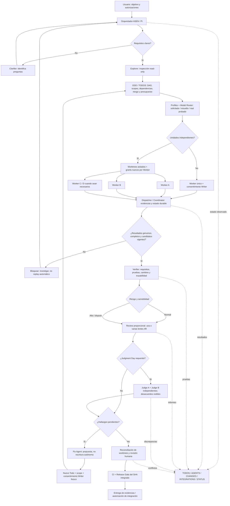

# Flujo de agentes — objetivo funcional de ASEN

**Estado:** OBJETIVO_DE_PRODUCTO — no representa funcionalidades ya verificadas.
**Plan ejecutable y estados:** [flujo-de-agentes.md](./flujo-de-agentes.md), tareas T00–T10.
**Referencia de comparación:** Gentle Shell 4.8.0, con validación funcional, no paridad por nombres.
**Fecha de fijación:** 2026-11-15.

## Resultado esperado desde la perspectiva del usuario

Al pedir «desarrolla esta funcionalidad», ASEN debe descomponer el trabajo en un plan ODD/TODOS verificable, elegir el mínimo conjunto de agentes necesarios y sus modelos, ejecutar en paralelo solo unidades sin conflicto y expresamente autorizadas, observar y conservar resultados/revisiones, proponer correcciones mediante una nueva autorización Writer cuando proceda y dejar los cambios preparados para **revisión e integración controladas**.

No debe presentar una simulación, una UI conectada pero sin modelo, un CI offline o un estado terminal como evidencia de tarea real completada. No debe introducir permisos implícitos, costes no consentidos, reintentos peligrosos ni fusiones automáticas. El objetivo no implica que ASEN tenga autonomía para aprobar sus propios cambios.

## Mapa de flujo de referencia (objetivo, no estado actual)

## Responsabilidades y límites de los componentes

| Componente | Responsabilidad | Prohibición o gate |
| --- | --- | --- |
| Orquestador | Evaluar riesgo, dependencias, coste y número mínimo de agentes | No replanificar un Writer ya autorizado a otro alcance |
| Clarifier / Explorer | Aclarar e investigar | Solo lectura, sin grants de escritura |
| ODD/TODOS | Identidad durable, DAG, artefactos, aprobaciones y estados | No convertir `planned` en `done` sin evidencia |
| Profiles / Model Router | Asignar modelo y thinking por rol/especialidad, fallback autorizado | Desconocido/pago requiere consentimiento; modelo real no inferido del solicitado |
| Workers | Cambios de código y tests autorizados | Un scope/lease/candidato por Worker; worktrees separados |
| Dispatcher / Coordinator | Aplicar concurrencia, permisos, resultados y recuperación | Fallos ambiguos requieren revisión; no doble lanzamiento |
| Verifier | Comprobar calidad de evidencias y pruebas | No sustituye tests reales ni los aprueba por narración |
| 4R | Risk, Resilience, Reliability y Readability según riesgo | Análisis read-only, no cuatro llamadas indiscriminadas |
| Judgment Day | Jueces A/B independientes, desacuerdos y refutación | Sin autoaceptación; sin Fix Writer implícito |
| Fix Agent | Preparar propuesta de reparación | Debe convertirse en un nuevo Writer autorizado |
| Reconciliación | Comparar diffs, conflictos y evidencias por worktree | Ninguna vista o dictamen puede auto-merge |
| Interfaz | Una fuente de verdad por Todo/Agent/Change/Integration | Mostrar `unknown`, `skipped` y `blocked` con precisión |

## Contrato de interfaz

En **TODOS**: tarea, dependencias, ámbito de escritura, worktree, autor del plan, autorizaciones pendientes, estado durable y siguiente paso seguro.

En **AGENTS**: función/especialidad, sesión/candidato, modelo solicitado / resuelto / efectivamente consumido (si no se prueba: `unknown`), proveedor, inicio, duración, resultado, fallos/reintentos y evidencia vinculada.

En **CHANGES**: diffs por worktree, conflicto/out-of-scope, revisor asignado, estado de pruebas, SHA observado, propuesta de reconciliación (sin auto-merge).

En **INTEGRATIONS**: artefactos/servicios de integración con gates reales, CI por SHA y avisos de indisponibilidad, no aprobaciones ficticias.

En la **barra de estado**: tareas activas, terminadas, bloqueadas y en revisión, modelo real comprobado o desconocido, gasto conocido/consentido, y alertas de permisos/recuperación.

Los nombres de paneles son objetivo de producto, no prueba de que todas las pantallas ya estén enlazadas al runtime.

## Criterios medibles para declarar el objetivo logrado

1. **Flujo E2E:** petición → ODD/TODOS → agente Pi real autenticado → Writer consentido → prueba → revisión → cambios propuestos, todo con recibos de correlación.
2. **Paralelismo:** al menos dos Workers reales simultáneos, en worktrees no superpuestos, con grants individuales, apagado/recuperación controlada y conflicto rechazado.
3. **Modelos:** las rutas configuradas se usan realmente; la UI distingue solicitado, resuelto y modelo consumido, sin afirmar `actual` con datos inferidos.
4. **Revisión:** 4R proporcional y JD cuando procede, sin herramientas de escritura; desacuerdo y dictámenes inválidos no producen PASS.
5. **Fix:** hallazgo → propuesta de corrección → nuevo Todo y consentimiento Writer; pruebas negativas de negación y no replay.
6. **Seguridad y plataforma:** Windows/macOS/Linux, no secretos, pagos, grants ni merges automáticos; diagnosticar `0xC0000409` con evidencia real o mantenerlo explícitamente abierto.
7. **Comparativa:** benchmark A/B con Gentle Shell bajo condiciones equivalentes, registrando tiempo, tasa de tarea válida, defectos, tokens y coste; sin inventar cifras.
8. **Cierre:** Phase 0, Pi runtime, CI y Release Gate verdes para el **SHA final**, revisión independiente y confirmación humana antes de cualquier integración.
9. **Eficiencia:** medir si 1, 2 o 4 agentes mejoran tiempo/coste sin sacrificar calidad; no imponer paralelismo ni 4R en tareas triviales.
10. **Estados:** mantener `IMPLEMENTED`, `RUNTIME_WIRED`, `HOST_TESTED`, `LIVE_AUTHENTICATED`, `AB_PARITY`, `FULL` con evidencia separada. `globalFull:false` hasta superar todos los gates.

## Orden de construcción basado en dependencias

- **F0 · Fundamentos:** T00, T01, T02. Resolver/aislar fallos P0; pruebas realistas solo con host/modelo expresamente autorizados.
- **F1 · Roles y control:** T03, T04, T05. 4R, ODD/TODOS y perfiles aplicados al runtime, no solo configurables.
- **F2 · Paralelismo:** T06. Origen → worktrees → sesión Pi hija → autorización propia → Workers → recibos y reconciliación manual.
- **F3 · Observabilidad:** T07. Paneles existentes como proyecciones de fuentes de verdad, sin almacenar/promocionar estados engañosos.
- **F4 · Juicio y reparación:** T08. Dualidad real + propuesta Fix y Writer separado.
- **F5 · Medición y aceptación:** T09, T10. Benchmarks, regresión e inspección independiente.

**Estado de partida al registrar el objetivo:** T00 auditada; T01/T03/T04/T05/T06/T08 con implementaciones parciales; T02 bloqueada por prueba live; T07/T09/T10 sin cierre funcional. La PR #61 permanece en borrador, sin autorización para fusionar a `main`.

### Qué NO debe considerarse un atajo válido

- Un botón «launch» o un nombre de agente sin prueba de modelo consumido.
- Una sesión hija vinculada a un Todo de origen como si hubiese heredado `writerAdmission`/grants.
- `completed` en el almacén como si fuese aceptación de cambios o Release Gate verde.
- Pasar tests con mocks y declararlos equivalencia con Gentle Shell.
- Lanzar modelos pagos, reintentar un Worker incierto, borrar worktrees o integrar ramas sin nueva autorización.
