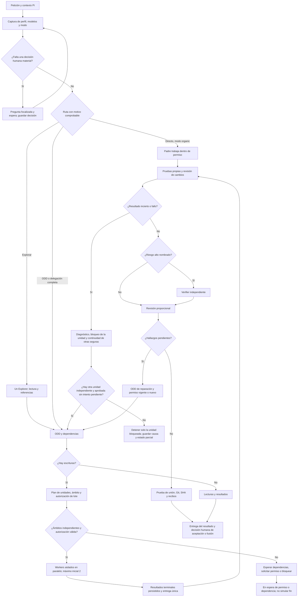

# ASEN — Plan rector completo de implantación del flujo de agentes

**Versión:** 1.2 (con anexo C propuesto) · **Fecha:** 2026-11-20 · **Estado:** PLAN AUDITADO CONTRA CÓDIGO Y COMPLETADO PARA IMPLANTACIÓN; fases E y F aún no ejecutadas. Auditoría independiente de los cambios futuros pendiente.
**Repositorio:** asenbanskaliev/ASEN · **PR:** #61, borrador · **Rama:** `feat/flujo-de-agentes-20261115`.
**Objetivo de referencia:** Gentle Shell 4.9.0, commit `ce64a9a708e50c0ca899c8023140e63f29f293e1`. Objetivo propio: misma eficacia **observable** con controles de seguridad de ASEN y más autonomía útil.
**Punto de partida seguro:** D, commit `dcb68a67a5801ee672523206235273ac72e7a7cc`, con CI, arquitectura, Pi y publicación correctos. Los commits posteriores no heredan ese resultado.
**Fuentes:** [18 diferencias verificadas](./flujo-de-agentes-comparativa-actual-4.9.0.md), [matriz anterior de 26 casos](./flujo-de-agentes-equivalencia-operativa-4.9.0.md), [objetivo funcional](./flujo-de-agentes-objetivo.md) y [plan histórico](./flujo-de-agentes.md).
**Decisión principal:** máxima autonomía para planificar, leer, delegar, comprobar, recuperar y volver a intentar **solo acciones seguras**. El usuario no deberá escribir «continúa» repetidamente.

> Este plan no es evidencia de que E1–E4 estén implementadas. Las piezas A–D ya conectadas se deben reutilizar, sin reescribir el motor de agentes.

## 1. Condiciones de diseño no negociables

- **Automatización por defecto:** una petición basta para planificar y avanzar por las etapas autorizadas; las dependencias y eventos terminales despiertan al orquestador cuando haga falta, sin sondeo constante.
- **Modelos de pago normales:** los modelos del perfil elegido, sean gratuitos o de pago, y las alternativas configuradas se pueden usar automáticamente. No pedir una autorización por cada llamada al proveedor. El perfil es la autorización de elección de modelos; **no** concede escritura ni fusión.
- **Proveedores y modelos nuevos:** no inventar sustitutos, ni iniciar un proveedor no configurado, ni aparentar que se conoce su coste. Registrar coste real si está disponible y `unknown` en otro caso.
- **Una autorización por lote de escritura:** objetivo de automatización: una autorización humana **acotada** al lote, con identidad, SHA, rutas, operaciones, dependencias y duración. El anfitrión emite concesiones individuales y no ampliables para cada Worker; si Pi no lo permite sin rebajar controles, conservar temporalmente las confirmaciones por Worker. Cambios fuera del lote requieren nueva autorización.
- **Ningún merge por defecto:** la aceptación de código, el despliegue, la publicación y la fusión siguen siendo decisiones distintas con autorización explícita. Nunca hacer `git reset`, `stash`, sobrescritura, push o merge para resolver un bloqueo automáticamente.
- **Única autoridad:** el motor Pi y `Dispatcher` existentes son los puntos autorizantes; ni mensajes de modelo, ni documentación, ni resúmenes de Explorer amplían permisos.
- **Resultados verificables:** `started` ≠ `settled` ≠ `delivered` ≠ `reviewed` ≠ `accepted`. El historial sobrevive interrupciones y no dispara ejecuciones duplicadas.
- **Dos modos por perfil:** `organic` (normal: el padre puede ejecutar tareas directas permitidas) y `full-delegation` (el padre nunca escribe; Writer autorizado ejecuta todos los cambios). El modo se aplica al próximo turno, no muta agentes en marcha.
- **Sin datos sensibles:** no registrar claves, instrucciones privadas completas ni respuestas de proveedores con secretos. Mantener SHA y recibos de aceptación exactos.

## 2. Mapa de estados objetivo

**Si no se permite actuar:** detener la parte bloqueada y explicar causa, consecuencias y requisito exacto. Otras tareas realmente independientes pueden continuar sin solicitar repetidamente «continúa».

## 3. Matriz completa de los 18 objetivos

| Nº | Situación real de ASEN | Resultado final que debe demostrarse | Fase | Evidencia principal |
| --- | --- | --- | --- | --- |
| **01** | Ruta directo/delegar parcialmente guiada por texto | Política observable con motivo; directo si seguro y suficiente | E1B | Prueba Pi de selección |
| **02** | Solo perfiles por rol/modelo | `organic` y `full-delegation` por perfil y sesión | E1B | A/B mismo encargo |
| **03** | Explorer limitado por lecturas/bytes y coste cero | Un Explorer por presupuesto/contexto, modelo configurado aun si es de pago; resumen acotado | E1A+E1B | Pruebas de presupuesto y coste |
| **04** | ODD y ámbito requieren preparación | Unidades de comportamiento completas y dependencias explícitas, sin partición artificial | E1B | Matriz de independencia |
| **05** | Supervisor exige preparar hijos | Padre prepara y lanza hasta 2 Writers Pi reales en paralelo | E2A | Tiempos de procesos solapados |
| **06** | Ámbitos exactos ya seguros | Propuesta de ampliación verificable; nunca permiso implícito | E2A | Prueba de rutas no admitidas |
| **07** | Entrega terminal con diario propio | Única entrega tras estado asentado y despertar sin duplicidad | E2B | Cancelación, reinicio, padre ocupado |
| **08** | Continuación tras fallo conservadora | Continuar otras unidades ya autorizadas; jamás repetir escritura incierta | E2B | Pruebas de fallo y dependencia |
| **09** | Cadena de modelos y esperas existentes | Usar modelos configurados pagos/gratuitos, alternativas, cuotas y coste observado | E1A+E2B | Fallos 429/red/autenticación |
| **10** | Modelo principal requiere tarifa cero | Modelo del perfil con identidad válida, sin cambiar sesiones reanudadas | E1A | Pruebas positiva y de reanudación |
| **11** | Riesgo informativo conectado a revisión | Riesgos nombrados obligan a Verifier; casos simples no sobrerrevisan | E3 | Pruebas de seis riesgos |
| **12** | Revisión ordinaria Pi existente | Ciclo único sobre candidato congelado, estados y decisiones recuperables | E3 | Revisión + interrupción |
| **13** | Dos jueces secuenciales y Fix separado | Dos jueces distintos cuando corresponda, hallazgos visibles, ≤2 rondas y Fix autorizado | E3 | Discrepancia, agotamiento |
| **14** | Clarifier y permiso estricto | Preguntas normales con opciones, respuesta y reanudación; no convertir texto en consentimiento | E1B | Pregunta + cancelación |
| **15** | SHA, ámbitos y diarios robustos | Conservar garantías y reducir solo bloqueos falsos demostrados | E0+E2 | Pruebas de carrera y Git |
| **16** | Comparador sin A/B autenticado | Medir calidad, tiempo, turnos, tokens, coste real cuando exista | E4 | Repeticiones comparables |
| **17** | Flujo integrado probado sobre todo con simulación | Demostrar recorrido completo con proveedores Pi reales y dos Workers | E4 | Registros de procesos y resultados |
| **18** | Contratos Pi distintos de la referencia | Detectar capacidades reales, degradar de forma segura; no fingir eventos | E0+E2 | Matriz Pi por versión/sistema |

## 4. Plan de implantación — secuencia y entregables

### E0 — Línea base, seguridad y pruebas de ausencia
**Meta:** congelar el último SHA verde, inventario de contratos de Pi y políticas vigentes. Preparar pruebas rojas que fallen **por las funciones que faltan**, no por una diferencia de nombre.
**Intervenir:** `odd/tasks/flujo-de-agentes.md`, pruebas de rutas, `tests/pi-agent-runtime.test.ts`, `src/agents/pi-agent-tools.ts`, `src/runtime/lifecycle/profiles.ts`, CI.
**Salida:** lista de capacidades reales Pi, 18 objetivos y 26 casos comparativos con estado `PASS/FAIL/SKIP/UNKNOWN`; 0 regresiones del CI de D.

### E1A — Modelos configurados, incluidos los de pago
**Meta:** dejar de aplicar la política «solo coste cero» a un modelo **ya elegido en el perfil**, sin ampliar la lista de modelos.
**Intervenir:** `src/runtime/lifecycle/startup-orchestrator-model.ts`, `src/agents/pi-agent-tools.ts`, `src/runtime/lifecycle/plan-dispatcher.ts`, `extensions/asen.ts`, `src/runtime/lifecycle/parent-model-fallback.ts` y pruebas.
**Contrato:** modelo exacto en catálogo y perfil/cadena congelada, disponibilidad confirmada por resultado Pi, precio observado `number` o `unknown`. Ninguna autorización humana repetida para llamadas de un modelo configurado. Las alternativas conservan el máximo de 8 y las esperas 30/2 minutos existentes.
**Pruebas:** tarifa positiva/0/ausente, credencial caducada, 429, modelo externo no configurado, cambio de sesión, reanudación, coste no observable y sustitución sin bucle.
**Salida:** padre, Explorer, Reviewer y Verifier pueden usar modelos configurados independientemente de su precio, sin escribir por ello.

### E1B — Dos modos, decisiones y ODD autónomo
**Meta:** el padre elige, justifica y ejecuta rutas sin depender solo de recomendaciones de texto.
**Intervenir:** `profiles.ts` y migración compatible `asen.runtime-profiles/v1`, `session-profile-binding.ts`, `src/flow/odd-routing.ts`, `src/orchestration/orchestrator.ts`, `request-guidance.ts`, `explorer-budget.ts` y `extensions/asen.ts`.
**Contrato:** en modo normal trabajo directo si es seguro; en completo ninguna edición del padre. Crear unidades completas con dependencias. Explorer solo cuando aporte valor, con resumen `ruta:línea` y una comprobación focalizada.
**Pruebas:** tarea corta/grande cohesionada/dos unidades, perfil cambiado a mitad de sesión, Writer no disponible, contexto incompleto, 2 exploraciones simultáneas, pregunta de bloqueo y cancelación.
**Salida:** la misma petición en modos diferentes produce decisiones y efectos correctos; cada decisión deja motivo auditado.

### E2A — Lanzamiento paralelo real y autorización por lote
**Meta:** no exigir al usuario preparar manualmente dos sesiones hijas. Un solo permiso de lote **acotado** y no reutilizable debe servir para emitir autorizaciones exactas de sus unidades, cuando el anfitrión lo soporte.
**Intervenir:** `src/runtime/agents/parallel-parent-supervisor.ts`, `parallel-worktrees.ts`, `src/runtime/lifecycle/plan-dispatcher.ts`, `src/runtime/agents/task-agent-coordinator.ts`, `src/agents/agent-runtime.ts` y `extensions/asen.ts`.
**Contrato:** unidades con código+pruebas+documentación, SHA inicial, ámbito por hijo, tareas y dependencias inmutables al autorizar. Concurrencia inicial 2; cada Worker tiene identidad y permiso independiente **derivados de autorización de lote real**, nunca de texto generado. Si la API Pi no puede comprobar esa concesión, conservar aprobación por Worker.
**Pruebas:** dos hijos Pi reales con intervalos solapados; rutas coincidentes, conflicto de Git, rechazo de uno, segundo fuera del lote, reintento del lote, identidad cambiada y dependencia pendiente.
**Salida:** dos Writers realmente simultáneos sin escritura cruzada ni confirmaciones redundantes dentro del lote aprobado.

### E2B — Entrega, fallos y continuidad autónoma
**Meta:** trabajo continuo cuando termina un hijo, sin tener que escribir «continúa».
**Intervenir:** `agent-terminal-delivery.ts`, `agent-notification-journal.ts`, `task-agent-reconciler.ts`, `plan-dispatcher.ts`, `model-fallback-policy.ts`, `extensions/asen.ts`.
**Contrato:** estado asentado único, entrega única, recibo durable, despertar si Pi está libre; si padre ocupado, encolar y recuperar al turno correcto. Fallo conocido: otras unidades independientes con permiso vigente pueden continuar; escritura dudosa jamás se repite.
**Pruebas:** fallos antes/después del lanzamiento, timeout, resultado vacío, cancelación, proceso muerto, reinicio, padre ocupado, aviso duplicado y fallback de proveedor.
**Salida:** la ejecución prosigue sola cuando es seguro y explica bloqueos reales con causa verificable.

### E3 — Verificación proporcional y reparación acotada
**Meta:** no revisar en exceso trabajos sencillos y no aceptar cambios arriesgados sin Verifier.
**Intervenir:** `review-assessment-policy.ts`, `ordinary-review-command.ts`, `judgment-day.ts`, `dual-rejudgment.ts`, `review-acceptance.ts`, `parallel-worktree-reconciliation.ts`.
**Contrato:** siempre ejecutar las pruebas del autor; seis categorías de riesgo nombrado elevan a verificación independiente. Dos jueces distintos cuando se solicite, hallazgos congelados, corrección por ODD y permiso vigente o nuevo, máximo de dos rondas de nuevo juicio. Comprobación única de integración de unidades.
**Pruebas:** riesgo bajo/alto, ambos jueces pass con hallazgos, desacuerdo, revisión con diferente SHA, recibo falsificado, presupuesto agotado, intento de tercera ronda.
**Salida:** resultado comprobado y entregado, nunca autocertificado ni fusionado.

### E4 — Ensayos reales y comparación controlada
**Meta:** demostrar equivalencia observable con la referencia, no solo pruebas de contratos.
**Intervenir:** `src/review/agent-flow-ab-comparison.ts`, informes de tareas y CI, pruebas Pi autenticadas.
**Contrato:** tareas corta, exploratoria y multicomponente (2 independientes + 1 dependiente), condiciones repetibles, mismas capacidades/modelos comparables, coste real o `unknown`. Medir éxito funcional, fallos, tiempo, turnos, consumo, número de procesos en solape, revisiones y permisos solicitados.
**Pruebas:** al menos tres repeticiones por escenario cuando el presupuesto y proveedores estén disponibles; incluir cancelaciones y fallos controlados.
**Salida:** informe A/B con datos auditables; no afirmar que es más eficaz si hay diferencia de modelos o evidencias incompletas.

### F — Auditoría independiente final
**Meta:** revisar código conectado, seguridad, legibilidad, fiabilidad, resistencia a fallos, coste, concurrencia y equivalencia.
**Salida:** 0 hallazgos graves abiertos, matriz de 18 puntos con evidencias por SHA, CI completo Linux/macOS/Windows, publicación, Pi, permisos y recepción humana; propuesta de cierre **sin** fusionar automáticamente.

## 5. Automatización y autorización — decisión operativa

| Acción | Comportamiento recomendado |
| --- | --- |
| Investigar, planificar, preparar ODD, consultar Git y ejecutar pruebas permitidas | Automático |
| Usar modelos gratuitos o de pago **configurados** | Automático, con observabilidad de consumo |
| Cambiar al siguiente modelo **configurado** tras error recuperable | Automático dentro de la cadena, respetando pausas |
| Crear y lanzar Writers dentro de un lote de escritura ya autorizado | Automático **solo cuando el anfitrión pueda emitir permisos individuales comprobables** |
| Cambiar archivos fuera del lote, cambiar objetivo o elevar privilegios | Requiere nueva aprobación expresa |
| Repetir una escritura de resultado incierto | Prohibido hasta reconciliación y nueva decisión humana si procede |
| Aceptar un resultado sin recibos o pruebas exigidas | Prohibido |
| Fusionar ramas, publicar versiones o desplegar | Aprobación humana independiente |

**La experiencia objetivo es una aprobación inicial por lote, no un diálogo por cada paso**. Esta capacidad debe implementarse y probarse; todavía no existe de forma equivalente en el supervisor actual.

## 6. Contrato mínimo de pruebas (26 casos) y protección contra vacíos

| Casos | Qué comprobar |
| --- | --- |
| F49-E01–E04 | Modos normal/completo, Writer ausente, perfil nuevo y tarea en marcha |
| F49-E05–E06 | Explorer al superar presupuesto y modelo de pago/0/desconocido ya configurado |
| F49-E07–E09 | Writers con ámbitos disjuntos, dependencias, rechazo y lote incierto |
| F49-E10–E12 | Evento terminal frente a asentado, padre ocupado, aviso antiguo o duplicado |
| F49-E13–E16 | Fallos, fallback configurado, precio no visible y modelo realmente ejecutado |
| F49-E17–E19 | Riesgo bajo/alto, dos jueces y límite de corrección |
| F49-E20–E23 | SHA/árbol, recibo firmado, preguntas, capacidades Pi |
| F49-E24–E26 | CI exacto, concurrencia real, cancelación de hijo o padre |

**Se añaden escenarios nuevos:** C-PAGO-01 (modelo de pago configurado en padre), C-PAGO-02 (Explorer de pago configurado), C-PAGO-03 (alternativa pagada configurada), C-PAGO-04 (precio desconocido ≠ 0), C-PAGO-05 (modelo ajeno al perfil bloqueado), C-LOTE-01 (una aprobación válida para unidades exactas), C-LOTE-02 (ampliación de alcance rechazada), C-LOTE-03 (lote reanudado no repite escrituras), C-LOTE-04 (pérdida de autorización), C-CONT-01 (avance autónomo por evento real) y C-FIN-01 (CI, aceptación y no fusión automáticas).

Para **cada** prueba: guardar precondición, acción, efecto observado, evidencia, SHA, sistema operativo, modelo real/simulado, resultado y condición de bloqueo. Un `SKIP` no es `PASS`.

## 7. Control de cambios y decisiones previas a cada tanda

1. Congelar SHA antes de empezar, revisar CI y comentarios pendientes; dejar constancia de fallos previos.
2. Escribir pruebas que reproduzcan el hueco (RED), conectar el cambio mínimo al punto de entrada Pi, pasar pruebas (GREEN) y comprobar permisos negativos.
3. Aislar archivos por tarea y probar estados concurrentes y cambios de sesión/árbol.
4. Resolver observaciones de revisión, verificar CI, Pi, arquitectura, huella y Release Gate **en el mismo SHA**.
5. Marcar independientemente `IMPLEMENTED`, `RUNTIME_WIRED`, `HOST_SIMULATED`, `LIVE_AUTHENTICATED`, `AB_PARITY`, `CI_EXACT_SHA`, `ACCEPTED`.
6. No empezar una fase dependiente si la anterior tiene un fallo de seguridad o regresión crítica.

**Prioridad de trabajo:** E0 → E1A (modelos) → E1B (modos y decisiones) → E2A (Workers simultáneos) → E2B (continuidad) → E3 (revisiones) → E4 (equivalencia) → F (auditoría). La cola WAIT no implica que el agente haya terminado; HOLD no puede volver a planificarse sin nueva evidencia que cambie el estado.

## 8. Riesgos, incertidumbres y límites del plan

- **Capacidad Pi no verificada:** si no ofrece un permiso derivado de lote o creación segura de hijos, diseñar una adaptación mínima y probarla antes de prometer «un clic». No simular permisos.
- **Perfiles heredados:** conservar el esquema `asen.runtime-profiles/v1` o migrar con compatibilidad y pruebas de lectura/escritura antes de cambiar el formato.
- **Coste:** un modelo configurado de pago se puede usar automáticamente, pero sin información de la factura no puede afirmarse que una operación costó 0 €.
- **Concurrencia:** dos Workers simultáneos son el valor inicial para medir, no una garantía universal; ajustar con resultados sobre conflictos, memoria y latencia.
- **Ajustes de fallbacks:** no ampliar cadenas ni reducir tiempos de espera por conjetura.
- **Seguridad:** las comprobaciones adicionales de ASEN pueden aumentar las confirmaciones frente a Gentle; reducirlas solo si la concesión de lote demuestra iguales o mejores garantías.
- **Comparación:** arquitectura distinta no significa diferencia funcional; exigir evidencia de comportamiento.
- **Integración:** PR #61 sigue en borrador y no se fusionará automáticamente.

## 9. Entregables verificables y definición de terminado

Cada fase debe publicar: contrato de estados y permisos; código mínimo; pruebas positivas/negativas; evidencia de ejecución del punto de entrada real; trazas sin secretos; informe de hallazgos; SHA; enlaces al CI y al control de publicación; lista de bloqueos/pendientes.

**Objetivo final:** ASEN acepta una petición, decide la ruta, trabaja en paralelo cuando conviene, usa automáticamente los modelos configurados, se recupera si puede, verifica el resultado y solicita intervención humana **solo en los límites de autoridad que no pueda cubrir una autorización previa**.

**`globalFull:false` hasta demostrar E4 y F.** El plan no afirma que las fases estén implementadas ni que existan llamadas reales certificadas.

## 10. Auditoría quirúrgica del plan (19/11/2026)

**Tipo de revisión:** contraste documental del plan v1.0 con la rama exacta, las rutas de ejecución reales y el control de arquitectura. **No** es una prueba de funcionamiento de E1–E4 ni sustituye una revisión independiente final.

| Código | Hallazgo comprobado | Corrección en el plan / prueba exigida |
| --- | --- | --- |
| **AUD-01 · Documentación bloqueada (P0)** | El control «Audit all tracked references» de Phase 0 Architecture falla para el archivo de implantación recién creado (en la rama todavía no estaba registrado como documento de procedencia). | Registrar **solo la ruta .md exacta** en \`scripts/upstream-reference-policy.mjs\`; probar que versiones distintas y extensiones ejecutables siguen prohibidas. Verificar CI sobre el nuevo SHA. |
| **AUD-02 · Espera ≠ fin (P0)** | La flecha de la versión 1.0 enviaba una rama «esperar permiso/dependencia» a «resultados terminales». | La rama de espera termina en estado \`WAITING\`, con motivo y disparador; no inventa agente ni resultado. |
| **AUD-03 · Recuperación sin bucles (P0)** | La flecha de fallo regresaba siempre a ODD, incluso sin una unidad lista; arriesgaba bucles inútiles. | Volver a planificar **solo** con otro Todo realmente independiente, preparado, no reclamado, autorizado y con nueva evidencia; de lo contrario \`PARTIAL/BLOCKED\`. |
| **AUD-04 · Permiso de lote (P0)** | El supervisor actual exige \`confirmBatch\` y \`confirmWorker\`; no emite una concesión reutilizable desde el padre. | No prometer un clic hasta verificar la capacidad Pi. Diseñar \`BatchGrant\` firmado por estado Pi con SHA, sesión, ámbito, conjunto cerrado de IDs, versión y caducidad; derivar de él concesiones **de un solo uso** por Worker, o conservar \`confirmWorker\`. |
| **AUD-05 · Modo completo (P0)** | \`profiles.ts\` solo define rutas de modelo/razonamiento; una instrucción del modelo no impide al padre usar herramientas de escritura. | Extender el perfil **compatible con v1**, capturar el modo al comienzo de cada turno y añadir bloqueo real en el punto de ejecución de herramientas, no solo en el mensaje. |
| **AUD-06 · Modelos y pago (P0)** | \`startup-orchestrator-model.ts\`, \`pi-agent-tools.ts\` y \`plan-dispatcher.ts\` siguen comprobando coste cero en rutas reales. | Elegibilidad por **modelo exacto configurado y cadena congelada**, no por precio. No añadir un modelo ajeno; si el catálogo no lo reconoce, detener antes de la llamada. Probar tarifa >0, tarifa ausente y ausencia de credenciales. |
| **AUD-07 · Hijos paralelos (P0)** | \`parallel-parent-supervisor.ts\` exige hijos ya vinculados en sesiones Pi reales; \`AgentRuntime\` ya ofrece concurrencia y control de sesiones. | Añadir preparación segura de hijos **a través del mismo orquestador** y conservar el \`Dispatcher\` existente. Mostrar solapamiento de dos procesos reales, no solo promesas simuladas. |
| **AUD-08 · Avisos y espera (P1)** | El diario de avisos distingue \`pending\` y \`attempted\`; «encolado» no demuestra lectura o consumo del padre. | Definir identidad única de evento, estado asentado, entrega, confirmación de consumo y recuperación sin repetir \`attempted\` ambiguos. |
| **AUD-09 · Riesgo (P1)** | \`review-assessment-policy.ts\` produce \`lifecycleAuthority:false\`; diagnosticar alto riesgo no lanza por sí solo un Verifier. | Conectar una **escalada estructurada 1–6** al plan y al despachador ya autorizado. Mantener la regla de pruebas del autor y distinguir riesgo informado del disparador vinculante. |
| **AUD-10 · Juicio doble (P1)** | \`judgment-day.ts\` ejecuta dos jueces separados pero secuenciales; ya conserva hallazgos con \`pass\`. | Si el host permite paralelismo con evidencia y modelo distinto, solapar **solo los jueces**, congelando SHA y ámbito; sin duplicar juicios al reanudar. |
| **AUD-11 · Modelo real y costes (P1)** | \`runtimeRoutingMetadata\` conserva \`actual:"unknown"\`; el precio de catálogo no equivale a facturación observada. | Guardar solicitado, escogido, efectivo comprobado, uso, duración y factura **cuando existan**; valores faltantes quedan \`unknown\`. |
| **AUD-12 · Residuos de documentación (P1)** | Los planes anteriores incluyen «Explorer solo gratis» y «pagar exige confirmación por llamada», incompatibles con la decisión actual. | Este **plan v1.1 prevalece** para costes y automatización. No reescribir la historia; añadir referencia visible desde el plan principal y pruebas de regresión del contrato actual. |
| **AUD-13 · Estado de GitHub (P0)** | El commit documental v1.0 no pasaba Phase 0; el SHA D previo en verde no acredita los cambios posteriores. | Publicar documento auditado y control de referencias **en un solo commit**; no cerrar la auditoría de CI hasta los resultados de ese SHA. |

### 10.1 Máquina de estados mínima vinculante

| Estado | Entrada válida | Siguiente estado permitido | Nunca hacer |
| --- | --- | --- | --- |
| \`ANALYZING\` | Sesión + perfil capturados y petición | \`DIRECT / PLANNED / WAITING\` | Cambiar de modelo fuera de perfil o escribir en modo completo |
| \`WAITING\` | Falta permiso, decisión o dependencia | \`PLANNED\` **solo** con nuevo dato autenticado; \`CANCELLED\` | Inventar \`settled\` o activar un Writer por espera vencida |
| \`PLANNED\` | Tareas ODD, SHA, rutas y dependencias verificadas | \`AUTHORIZED\` o \`BLOCKED\` | Reclamar una tarea no lista o ruta no autorizada |
| \`AUTHORIZED\` | Concesión de Pi exacta y única, por lote o por unidad | \`DISPATCHED\` | Reutilizar consentimiento en una nueva revisión/ámbito |
| \`DISPATCHED\` | Identificador de hijo persistido | \`RUNNING / FAILED / INTERRUPTED\` | Iniciar un segundo hijo por timeout dudoso |
| \`RUNNING\` | Ejecución del hijo y propietario vigentes | \`SETTLED / FAILED / CANCELLED / INTERRUPTED\` | Tratar un mensaje parcial como salida terminal |
| \`SETTLED\` | Estado terminal auténtico y efecto reconciliado | \`DELIVERED\`, \`VERIFICATION_REQUIRED\` o \`BLOCKED\` | Autocertificar cambio o entregar dos veces |
| \`VERIFICATION_REQUIRED\` | Pruebas propias registradas y riesgo estructurado | \`REVIEWED\` o \`PARTIAL\` | Saltar verificador de alto riesgo |
| \`REVIEWED\` | Hallazgos, veredicto y candidato intactos | \`ACCEPTANCE_PENDING\` o nueva propuesta de corrección | Iniciar Writer sin concesión vigente ni reabrir presupuesto agotado |
| \`ACCEPTANCE_PENDING\` | Git limpio, SHA, recibo y evidencia exactos | \`ACCEPTED\` mediante consentimiento verdadero | Fusionar o desplegar automáticamente |
| \`FAILED/PARTIAL/BLOCKED\` | Causa, intento y efectos duraderos comprobados | Avanzar **otras unidades** admitidas; la bloqueada solo tras reconciliar | Reintentar escritura de resultado incierto o crear un ciclo sin progreso |

**Idempotencia:** un \`(sessionId, projectId, taskId, attemptId, candidateSHA)\` durable por intento. Reclamación atómica; un único resultado terminal; reanudación solo después de reconciliar la ejecución anterior. No crear una segunda autoridad para saltarse el plan.

### 10.2 Desglose de ejecución quirúrgica para los agentes de GitHub

| Subtarea y prioridad | Dependencia / rutas reales | Cambio mínimo conectado | Pruebas RED → GREEN y criterio de cierre |
| --- | --- | --- | --- |
| **E0-01 · Referencias P0** | Documento y política de procedencia | Permitir únicamente el .md del plan | Prueba de referencia exacta; no permitir .ts ni versiones distintas; Phase 0 verde |
| **E0-02 · Capacidades Pi P0** | \`pi-agent-tools.ts\`, \`extensions/asen.ts\` | Inventario de sesiones hijas, herramientas, confirmaciones, cancelación, consumo y eventos | Matriz que indique \`SUPPORTED / BLOCKED\` con prueba del host; no suponer funciones |
| **E0-03 · Contratos de estado P0** | \`plan-dispatcher.ts\`, diarios y recibos | Congelar transiciones e identidades; rechazar espera→fin | Pruebas negativas de doble reclamación y recuperación sin progreso |
| **E1A-01 · Selección de padre P0** | \`startup-orchestrator-model.ts\`, perfil y sesión | Sustituir precio cero por pertenencia al perfil y resolución exacta | 0, >0 y precio desconocido configurados pasan; modelo no configurado falla; reanudación intacta |
| **E1A-02 · Explorer por presupuesto P0** | \`pi-agent-tools.ts\`, \`explorer-budget.ts\` | Misma autorización de modelo del perfil, límite y deduplicación | Explorer de pago configurado sí; externo no; dos señales simultáneas generan un único hijo |
| **E1A-03 · Continuación de lectura P0** | \`plan-dispatcher.ts\`, \`extensions/asen.ts\` | Sustituir \`verifiedFreeModel\` por comprobador de modelo congelado y existente | Tras fallo, solo un Todo independiente preparado; pago permitido si configurado; Writer nunca autorizado por esta ruta |
| **E1A-04 · Sustitución P1** | \`model-fallback-policy.ts\`, \`parent-model-fallback.ts\`, hijos | Compartir contrato, no motor, de cadena congelada y diagnóstico | 429/timeout con siguiente modelo configurado; 400 y cancelación no generan cambio; máximo 8 |
| **E1B-01 · Perfil/migración P0** | \`profiles.ts\`, \`session-profile-binding.ts\` | Añadir \`mode\` opcional; perfil v1 sin modo = \`organic\`; validar y guardar | Lectura v1 antigua, persistencia, sesión vs proyecto y cambio al siguiente turno |
| **E1B-02 · Bloqueo real de escritura P0** | \`extensions/asen.ts\`, herramientas de Pi | En \`full-delegation\`, negar escrituras directas del padre en el control de ejecución | \`write/edit\` y operaciones shell equivalentes bloqueadas; Writer autorizado sí; instrucciones del modelo no eluden |
| **E1B-03 · Enrutamiento/decisiones P0** | \`odd-routing.ts\`, \`orchestrator.ts\`, \`request-guidance.ts\` | Elegir y registrar directo vs ODD vs Explorer vs preguntar | Misma petición con dos modos; sin unidad ficticia; desconocido requiere pregunta o exploración |
| **E2A-01 · Preparación de hijos P0** | \`parallel-parent-supervisor.ts\`, \`parallel-worktrees.ts\` | Proponer sesiones desde el padre; si Pi no garantiza admisión, mantener bloqueo visible | No inventar sesiones; prueba de propiedades del host y de desajuste de identidad |
| **E2A-02 · Permiso de lote P0** | Supervisor y despachador existentes | Consentimiento único sobre conjunto cerrado + concesión por unidad si verificable | Rechazo, cancelación, caducidad, subámbito no autorizado, intento duplicado y SHA cambiado |
| **E2A-03 · Concurrencia real P0** | \`agent-runtime.ts\`, \`Dispatcher\`, Worktrees | Límite de dos hijos, aislamiento de ficheros y dependencia real | Dos procesos Pi con intervalos solapados; un tercero espera; mismo archivo o SHA divergente bloquea |
| **E2B-01 · Entrega única P0** | \`agent-terminal-delivery.ts\`, \`agent-notification-journal.ts\` | Consumir evento asentado desde diario de identidad exacta | Padre ocupado, reinicio, entrega tardía, duplicado y \`attempted\` ambiguo |
| **E2B-02 · Continuidad segura P0** | \`task-agent-reconciler.ts\`, \`plan-dispatcher.ts\` | A cada terminal, reevaluar solo unidades aún listas y autorizadas | Fallo de lectura sí permite otra independiente; escritura incierta no se reintenta; sin bucle |
| **E3-01 · Riesgo ejecutable P0** | \`review-assessment-policy.ts\`, \`ordinary-review-command.ts\` | Propagar \`escalation.item=1..6\` al despachador para disparar Verifier | Riesgo medio no crea Verifier adicional; alta categoría nombrada sí, sin dar permiso a texto libre |
| **E3-02 · Doble juez P1** | \`judgment-day.ts\`, \`dual-rejudgment.ts\` | Dos juicios si autorizados, ledger congelado y resultados duraderos | Distintos modelos, hallazgo leve visible, fallo de uno, ≤2 rondas |
| **E3-03 · Unión y cierre P0** | \`parallel-worktree-reconciliation.ts\`, \`review-acceptance.ts\` | Una prueba de uniones y aceptación exacta con recibos/consentimiento | Cambio Git, receipt falso, riesgos no revisados, no fusión |
| **E4-01 · Medición real P0** | \`agent-flow-ab-comparison.ts\`, pruebas Pi | Comparación en 3 tareas y repeticiones documentadas | Misma tarea/modelo/esfuerzo/permisos; calidad + tiempo + costo observado/unknown |
| **F-01 · Auditoría externa P0** | Informe por SHA, PR y CI | Revisión independiente 4R de los 18 puntos y 26+ casos | Sin hallazgos graves abiertos; no cambiar \`globalFull\` sin evidencia |

**Ámbitos de trabajo:** cada cambio debe preparar su propio contrato y pruebas antes de tocar \`extensions/asen.ts\`; E1A y E1B pueden usar propuestas separadas pero su integración al anfitrión Pi será **serializada**. Igualmente E2A y E2B comparten despachador: no fusionar cambios en paralelo sin revalidar el SHA y la suite completa.

### 10.3 Puertas de admisión y entrega

| Puerta | Exigencia mínima y acción si falla |
| --- | --- |
| **G0 · Referencias** | Phase 0 y prueba de procedencia del documento verde. Si falla, **no iniciar E1**. |
| **G1 · Contratos** | Perfil v1 compatible, coste positivo configurado permitido, modo completo bloquea escritura directa; pruebas negativas. Si falta Pi, \`CAPABILITY_BLOCKED\`. |
| **G2 · Paralelismo** | Dos procesos reales con ámbitos distintos y consentimiento exacto; el tercero espera. Si no se puede demostrar, \`HOST_SIMULATED\` pero no equivalencia. |
| **G3 · Continuación** | Aviso único, estado asentado, sin reintento de escritura dudosa y sin ciclo sin progreso. |
| **G4 · Revisión** | Pruebas del autor, riesgos nombrados, candidato/recibo exactos y límites de corrección. |
| **G5 · Comparativa** | Datos reproducibles con proveedor real, uso/coste explícito o \`unknown\`, calidad contrastable. |
| **G6 · Auditoría F** | Revisión independiente, cero vulnerabilidades graves abiertas y **CI exacto** Linux/macOS/Windows + Pi + arquitectura + publicación del SHA final. Sin fusión automática. |

**Seguridad de la edición:** un permiso de lote no es un permiso infinito y la configuración de modelos (incluso de pago) no es consentimiento de escritura. El usuario puede automatizar muchos pasos dentro de las concesiones vigentes, sin diálogos repetitivos. Las funciones Pi no verificadas permanecen bloqueadas en vez de simularse.

### 10.4 Ejemplos de decisión que hay que reproducir

1. **Pequeño y claro, normal:** el padre responde o modifica dentro de permiso; no fabrica ODD ni Explorer.
2. **Pequeño y claro, delegación completa:** un único Worker autorizado; si no está disponible, \`WAITING/BLOCKED\`, nunca escritura directa del padre.
3. **Dos unidades independientes:** dos sesiones Pi con ámbitos disjuntos, un permiso de lote comprobable o autorizaciones individuales, resultados separados y revisión de unión.
4. **Una dependiente:** espera a la salida asentada y admitida de su predecesora; otro agente independiente puede avanzar.
5. **Límite de lectura:** un Explorer con modelo de pago configurado si corresponde; no tomar uno ajeno al perfil ni lanzar dos.
6. **Cuota 429:** intentar el siguiente modelo configurado tras la política de espera; si era Worker con resultado de escritura incierto, **no** repetir el intento, aunque exista alternativa.
7. **Dos jueces con observaciones menores:** mantener \`findings-require-review\`, no convertir dos \`pass\` en aceptación.
8. **Git cambia entre autorización y ejecución:** invalidar la concesión de trabajo afectada y pedir decisión nueva; el resto independiente no pierde evidencia ya válida.
9. **Usuario rechaza el lote:** ningún Worker arranca; no volver a pedir autorización por sondeo o reinicio.
10. **Reinicio de ASEN:** inspeccionar diario, no reemitir \`attempted\` ambiguo ni continuar una escritura de estado incierto.

### 10.5 Evidencia y alcance de esta auditoría

- El plan 1.1, su política de referencias y pruebas de registro se publican juntos. **Hasta que GitHub emita resultado verde, G0 sigue PENDIENTE.**
- Las fases E0–E4 y F siguen **NO IMPLEMENTADAS por esta intervención**. La auditoría hace implementables las decisiones, pero no equivale a ejecutar agentes ni contratar modelos.
- D tiene un SHA previo en verde, que **no** acredita el nuevo commit documental.
- La comparación externa no ofrece prueba de que ASEN sea más rápido: esa decisión queda **ABIERTA hasta E4**.
- El riesgo de consentimiento de lote se considera **CAPABILITY_BLOCKED** si Pi no puede generar y verificar concesiones por tarea sin sustituir el despachador seguro.

**Decisión:** implementar E0 y E1A primero; solo entonces E1B → E2A → E2B → E3 → E4 → F. Prioridad funcional: automatización con modelos configurados pagos, dos modos por perfil, Writers realmente paralelos y continuidad sin «continúa» manual, preservando permisos exactos y seguridad de Git.

## 11. Anexo C — Optimización del contexto y selección inteligente (20/11/2026)

**Estado:** PROPUESTO / PENDIENTE DE VERIFICACIÓN REAL; no se declara implementado. **Propósito:** mejorar el coste de contexto sin alterar los 18 objetivos ni sustituir las fases E0–E4 y F. Este anexo queda subordinado a las concesiones de Pi y a las puertas G0–G6. **Referencia de trabajo:** ASEN rama \`feat/flujo-de-agentes-20261115\`, HEAD observado antes de este anexo \`05340ec03fed768921149247f0d43f8607c31169\`; Gentle Shell 4.9.0 \`ce64a9a708e50c0ca899c8023140e63f29f293e1\`.

### 11.1 Hechos, no hipótesis

- **ASEN ya dispone de skills por tarea:** \`src/skills/registry.ts::selectSkills\`, \`src/orchestration/orchestrator.ts::buildOrchestrationPlan\` y \`src/agents/pi-process-runner.ts::promptWithSkills\` eligen rutas, comprueban el contexto emitido por ASEN y pasan \`--no-skills\` junto a las rutas explícitas \`--skill\` para el agente hijo. No rehacer este circuito ni quitar sus comprobaciones.
- **Candidato a sobrecarga del padre:** \`src/runtime/ui/request-guidance.ts\` define \`ASEN_REQUEST_GUIDANCE\` como una guía general de aproximadamente 6 KB. \`extensions/asen.ts\` la añade mediante \`addAsenRequestGuidance(options, !!pi.registerTool, explorationOverBudget)\`. La existencia del método de registro **no demuestra** que la herramienta esté activa en esa ejecución; hay que medir y corregir esa condición usando una capacidad real de Pi, si está disponible.
- **Contexto adicional ya limitado:** \`extensions/asen.ts\` también puede incluir estilo, modo, memoria y plan; \`projectMemoryContext\` recibe hasta 4096 bytes y \`formatActivePlanContext\` limita a 2048 bytes. No asumir que todos esos bloques aparecen en cada petición.
- **Gentle Shell combina núcleo y detalles:** \`assets/orchestrator.md\` conserva reglas principales y enlaza \`orchestrator-skills.md\`, \`orchestrator-memory.md\` y otras referencias bajo demanda. \`extensions/skill-registry.ts\` expone índice de skills ausentes de la lista Pi; los agentes de paquete reciben rutas concretas y \`extensions/child-context.ts\` suprime el catálogo general en ciertos hijos. También evita bloques de contexto repetidos mediante \`lib/child-context-files.ts\`.
- **Comparación P16 incompleta para esta pregunta:** \`docs/audit/p16-gentle-4.9.0-18-sesiones-2026-11-20.md\` recoge 18 sesiones reales de solo lectura, ASEN 9/9 y Gentle 8/9, 16.940 frente a 4.584 tokens de entrada. El lanzador usa \`--no-skills --no-tools\` y carga \`extensions/asen.ts\` frente a \`extensions/gentle-shell.ts\`; **no carga el orquestador completo de Gentle** (\`extensions/gentle-ai.ts\` más piezas necesarias). Los 1.372–1.373 tokens adicionales por petición son una observación que requiere aislamiento, **no** prueba de que esa guía sea el único factor ni de que ambos productos tengan distinto coste en funcionamiento completo.
- **La ilustración es una hipótesis de diseño**, no una medición: “-60/70 %”, menor latencia, misma fiabilidad y “seguridad 3/3 frente a 2/3” no son beneficios confirmados. La última cifra era coincidencia exacta de marcador, no nota de seguridad.

### 11.2 Arquitectura deseada de mínima intervención

\`\`\`mermaid
flowchart TD
  U[Petición + sesión y proyecto verificados] --> P[Pi: reglas mínimas y permisos invariables]
  P --> D[Componer contexto según capacidades y estado real]
  D --> C{Necesidad demostrada}
  C -->|Consulta sencilla| R[Respuesta directa, sin guía de agentes innecesaria]
  C -->|Código o revisión| S[Contexto técnico y skills exactas ya seleccionadas]
  C -->|ODD / agentes| O[Plan, coordinación y agentes actuales]
  C -->|Continuidad| M[Plan activo y memoria pertinente, sin reautorizar]
  S --> X[Herramientas y ejecución bajo autoridad Pi]
  O --> X
  M --> X
  R --> T[Resultado]
  X --> V[Pruebas, revisión proporcional y conciliación de permisos]
  V --> T
  T --> B[Medidas agregadas: uso, tiempo, calidad y errores]
\`\`\`

**Regla central:** el modelo recibe la instrucción breve aplicable; el **código** mantiene los límites de autorización, alcance, SHA, herramientas, seguridad y recuperación. Ningún clasificador de texto convierte una petición ambigua en autorización. No añadir una llamada a otro modelo solo para elegir instrucciones. Si Pi no permite comprobar una capacidad, usar la ruta segura actual y registrar \`UNKNOWN\`.

**Módulos de orientación propuestos:** (i) núcleo de comunicación + prohibiciones necesarias; (ii) lectura y programación; (iii) coordinación ODD/Workers; (iv) estado y continuidad; (v) recuperación de errores; (vi) memoria relevante; (vii) permisos/modos especiales. Solo ensamblarlos cuando la ruta o el estado comprobado lo justifique. Mantener orden estable para aprovechar posibles mecanismos de caché y no depender exclusivamente de coincidencias de palabras (“continúa”, “hazlo”, “revisa”).

**Agentes especializados:** mantener su selección exacta de skills, límites de rutas y contexto emitido; registrar cuántas habilidades se han anunciado, seleccionado y leído **sin registrar su contenido**. No modificar \`src/agents/pi-process-runner.ts\` hasta demostrar un exceso en sesiones hijas reales.

### 11.3 Implantación quirúrgica, integrada en E0–E4

| Paquete | Depende de | Cambios mínimos candidatos | Prueba de cierre |
| --- | --- | --- | --- |
| **C0 — Auditoría de composición (P0)** | E0/G0 | Instrumentación de solo lectura en \`extensions/asen.ts\` y pruebas de composición; medir secciones, bytes, inventario de herramientas, skills anunciadas/seleccionadas, contexto de memoria/plan y declaraciones. No guardar contenido ni secretos. | Inventario por ejecución sin datos privados, clasificación \`BASE/CONDICIONAL/NO PRESENTE\` y reproducción de la diferencia P16 sin proveedor. |
| **C1 — Núcleo modular (P1)** | C0 y G1 para permisos | Dividir solamente \`src/runtime/ui/request-guidance.ts\` en módulos pequeños; ensamblar en \`before_agent_start\` con el estado/capacidades ya verificados. No cambiar semántica de consentimiento ni reanudación. | Instantánea de cada tipo de petición; no faltan instrucciones esenciales; modo directo, ODD, “continúa”, paro, bloqueo, denegación y recuperación. |
| **C2 — Duplicados y memoria (P1/P2)** | C1 | Revisar el solapamiento entre guía, estilo, modo, memoria, plan y textos Pi/AGENTS.md; eliminar **solo** duplicados demostrables. Evitar leer recuerdos irrelevantes, pero no perder decisiones vigentes ni evidencia. | Sin duplicaciones semánticas verificadas; contexto estable por sesión; memoria correcta al reanudar y al cambiar de proyecto. |
| **C3 — Herramientas visibles (P2, condicional)** | C0; capacidad Pi demostrada | Sustituir \`!!pi.registerTool\` por comprobación real de carga del conjunto de herramientas. Explorar declaraciones abreviadas solo si Pi de ASEN tiene vía segura de ejecución y resolución; no copiar la opción \`codemode\` de Gentle sin ella. | \`--no-tools\` no recibe guía de uso de herramientas; catálogo y llamadas reales siguen accesibles en ejecuciones normales; ausencia de herramientas no se disfraza. |
| **C4 — Comparativa y admisión (P0 de medición)** | C1–C3 y E4/G5 | A/B entre ASEN actual y candidato sobre **mismo Pi, modelo, tareas, herramientas, permisos, memoria y skills**; comparación separada con Gentle Shell **completo**; pruebas reales solo con presupuesto autorizado. | Informe por SHA, 3+ repeticiones por caso, uso y caché si están disponibles, tiempo, respuestas, fallos, calidad, consentimiento y recuperación; sin “paridad” prematura. |

**Orden recomendado:** C0 → C1 → C2 → C3 solo si aporta reducción comprobada → C4. Estas tareas pueden convivir con E1–E3, pero **no** editar simultáneamente \`extensions/asen.ts\` ni los controladores de permisos de otras tandas: integrar de forma secuencial, rehacer pruebas y confirmar el SHA antes de cada unión. En caso de conflicto, prevalece completar la capacidad funcional y su seguridad antes de optimizar el texto.

### 11.4 Ensayo A/B justo: condiciones y frenos

1. Congelar la referencia ASEN actual y la optimizada sobre el mismo estado de repositorio; mantener otro ensayo separado para Gentle 4.9.0 **con sus extensiones de orquestación, registro, memoria y herramientas apropiadas**. No equiparar “solo shell” con “shell + coordinador”.
2. Ejecutar primero sin proveedor: inspección determinista del mensaje compuesto y declaraciones de herramientas con casos **cálculo, corrección pequeña, exploración, planificación, delegación, continuidad, permiso denegado, inyección y reanudación de escritura incierta**. Después tareas auténticas con Explorer/Writer/Verifier, segregadas según permiso.
3. Para el ensayo con modelo fijar proveedor, modelo exacto, configuración Pi, temperatura cuando sea controlable, tarea, estado inicial, perfil, herramientas, skills, memoria, historial, orden de ejecución y autorización; repetir cada caso tres veces como mínimo. No alterar el caso para favorecer el resultado.
4. Registrar \`inputTokens\`, \`outputTokens\`, \`cacheRead/cacheWrite\` **si el proveedor/host los suministra**, tiempo, número de llamadas, tokens por sección cuando se puedan medir sin exponer contenido, respuestas correctas, pruebas, fallos y coste \`observado\` o \`unknown\`. **Bytes no equivalen a tokens** y tokens no equivalen a euros facturados.
5. **Bloqueos:** cero escrituras fuera de ámbito, cero saltos de consentimiento, cero reintentos de Writer con resultado incierto, cero cruces de sesión/proyecto y ningún \`completed\` ficticio. No ejecutar pruebas de pago por efecto de este documento; usar solo presupuesto y autorización explícitos previamente válidos.
6. El porcentaje de reducción se calcula con resultados por caso y alcance comparable; el “-60/70 %” de la ilustración es **solo una hipótesis descartable**. Si reduce tokens pero empeora seguridad, fiabilidad, continuidad, caché o tiempo real, rechazarlo o revertirlo.

### 11.5 Seguridad, compatibilidad y marcha atrás

- Conservar intactos \`selectSkills\`, \`issueSkillContext\`, permisos por Writer, protección de rutas, perfil congelado, límites de plan, RDD/JD y decisión humana de fusión. Ninguna instrucción recortada reemplaza una comprobación del anfitrión.
- Adoptar una **activación reversible** de la composición compacta, con ruta anterior seleccionable por configuración estricta y sin alterar autorizaciones, solo tras las pruebas anteriores; mantener el comportamiento vigente como predeterminado hasta C4.
- Probar **Pi 1.2.0** usada en P16 y la versión realmente soportada por ASEN; controlar \`selectedTools\` y estructura de \`systemPromptOptions\` por contrato medido, no por suposición.
- No introducir un sistema paralelo de memoria, motor de agentes ni nuevo registro de skills. No reorganizar \`AGENTS.md\` sin un inventario de archivos, su procedencia y su orden de carga efectivo.
- Guardar resultados separados \`IMPLEMENTADO\`, \`MEDIDO\`, \`CI\`, \`INDEPENDENTEMENTE_REVISADO\`, \`PARIDAD\`. Mantener \`globalFull:false\` hasta las puertas funcionales E4/F.

**Fuentes de referencia:** ASEN [guía](../../src/runtime/ui/request-guidance.ts), [extensión](../../extensions/asen.ts), [skills](../../src/skills/registry.ts), [agentes Pi](../../src/agents/pi-process-runner.ts), [P16](../../docs/audit/p16-gentle-4.9.0-18-sesiones-2026-11-20.md). Gentle Shell 4.9.0 [orquestador](https://github.com/Gentleman-Programming/gentle-shell/blob/ce64a9a708e50c0ca899c8023140e63f29f293e1/assets/orchestrator.md), [skills](https://github.com/Gentleman-Programming/gentle-shell/blob/ce64a9a708e50c0ca899c8023140e63f29f293e1/assets/orchestrator-skills.md) y [presupuestos](https://github.com/Gentleman-Programming/gentle-shell/blob/ce64a9a708e50c0ca899c8023140e63f29f293e1/docs/prompt-budget.md).
