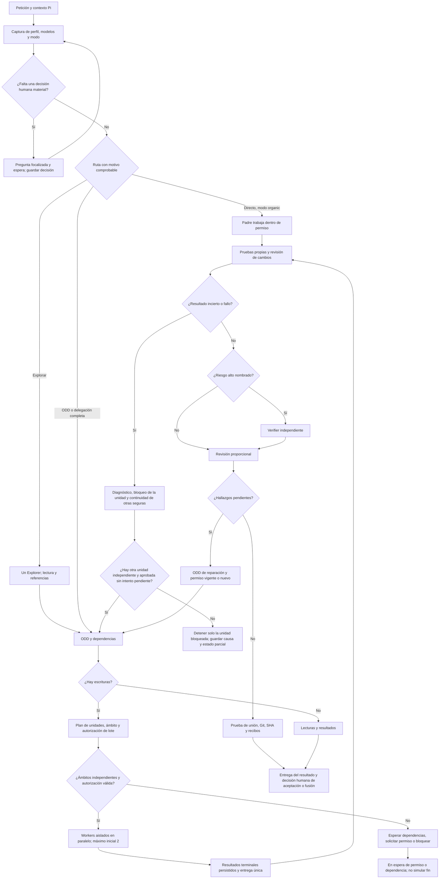
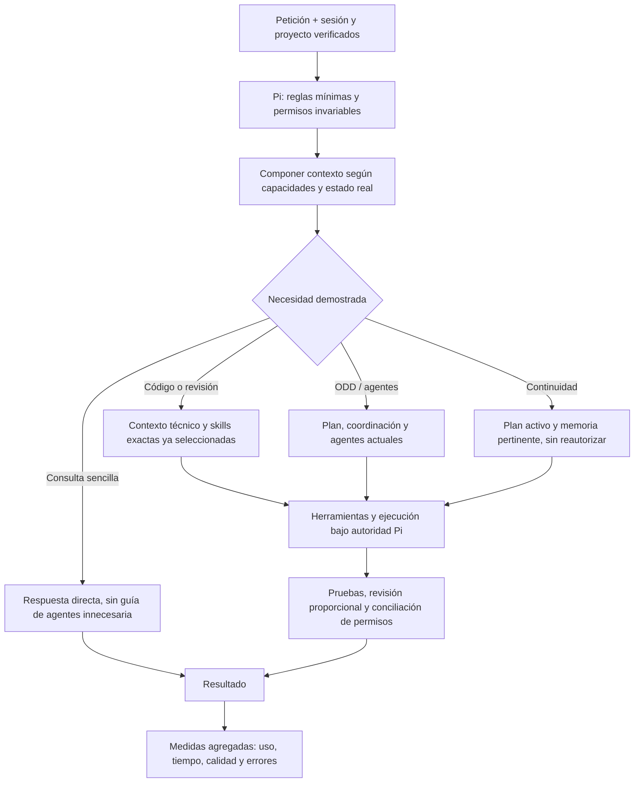
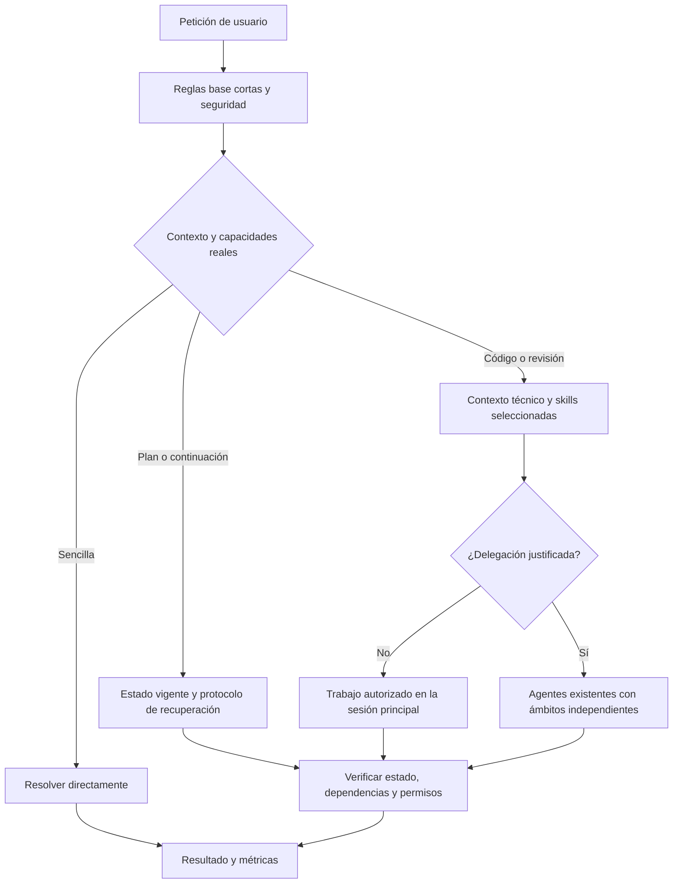

# ASEN — Plan rector completo de implantación del flujo de agentes

> **Actualización operativa 24/11/2026:** consultar el [apartado 16](#16-refuerzo-quirúrgico-de-megatandas-a-y-b-24112026), el [subplan P01–P06](flujo-agentes-refuerzo-quirurgico-ab-20261124.md) y la [matriz de 30 criterios](flujo-agentes-18-objetivos-12-puntos-aceptacion-20261123.md). Los cortes anteriores se conservan como históricos; no reiniciar trabajo ya admitido. Validar GitHub en vivo antes de ejecutar. A integrada; B con E2A/E3 reales limitados, integración y aceptación global pendientes. Se mantienen las condiciones del plan original y globalFull:false.

> **Estado operativo comprobado · 21/11/2026, tras PR #75:** las PR auxiliares #64–#75 constan cerradas e integradas en sus destinos. El HEAD de la rama de desarrollo de [PR #61](https://github.com/asenbanskaliev/ASEN/pull/61) al tomar este corte es `8b62891f2545f5053b065220154f03ddd8bdac29` (PR en borrador, no fusionar). Las correcciones PRE-0/PRE-1, pruebas sintéticas CTX-0 y CTX-1 de herramientas activas se han incorporado; no volver a abrir #66/#71 como pendientes. Para ese HEAD, [CI #44946902816](https://github.com/asenbanskaliev/ASEN/actions/runs/44946902816), arquitectura, Release Gate y Pi 1.2/1.5 finalizaron correctamente; Pi Free Smoke quedó omitida (NO equivale a PASS). Releer GitHub antes de admitir otro cambio: los controles CI/arquitectura/Release Gate del SHA `8b62891f` fueron correctos, pero **G0 NO ESTÁ FORMALMENTE ACEPTADO** y el SHA receptor requiere sus propios controles; la documentación no autoriza cambios de producción. Secuencia operativa vinculante (ver sección 13.3 del plan de contexto): E1A/E1B con **CTX-2 antes de E2/E3**, controlando las escrituras de `extensions/asen.ts` en serie; CTX-3 solo si hay repetición acreditada; después E2/E3, CTX-4 opcional durante E4 y CTX-5/E4; por último CTX-6/F. E1–E4, F y la aceptación de los 18 criterios continúan sin cierre integral demostrado. `globalFull:false`.

**Versión histórica (corte 20/11):** 1.6 (matriz contrastada con el código y CI; diagnóstico permitido, implantación bloqueada por G0) · **Fecha:** 2026-11-20 · **Estado:** PLAN RECTOR APTO SOLO PARA DIAGNÓSTICO; G0 BLOQUEADO EN EL SHA DE CÓDIGO AUDITADO; fases E y F no aceptadas. Auditoría independiente de los cambios futuros pendiente.
**Referencia ejecutable OPT:** [plan final único CTX-0–CTX-6](../../docs/plan-final-opt-contexto-y-agentes-2026-11-20.md), [auditoría detallada de código y CI](../../docs/audit/auditoria-detallada-codigo-y-plan-18-ctx-2026-11-20.md) y [auditoría crítica previa](../../docs/audit/plan-final-opt-investigacion-avanzada-2026-11-20.md). Los apartados 11–13 quedan como antecedentes, no como ejecución duplicada.
**Repositorio:** asenbanskaliev/ASEN · **PR:** #61, borrador · **Rama:** `feat/flujo-de-agentes-20261115`.
**Objetivo de referencia:** Gentle Shell 4.9.0, commit `ce64a9a708e50c0ca899c8023140e63f29f293e1`. Objetivo propio: misma eficacia **observable** con controles de seguridad de ASEN y más autonomía útil.
**Punto de partida seguro:** D, commit `dcb68a67a5801ee672523206235273ac72e7a7cc`, con CI, arquitectura, Pi y publicación correctos. Los commits posteriores no heredan ese resultado.
**Fuentes:** [18 diferencias verificadas](./flujo-de-agentes-comparativa-actual-4.9.0.md), [matriz anterior de 26 casos](./flujo-de-agentes-equivalencia-operativa-4.9.0.md), [objetivo funcional](./flujo-de-agentes-objetivo.md) y [plan histórico archivado](../archive/2026-11/flujo-de-agentes.md).
**Decisión principal:** máxima autonomía para planificar, leer, delegar, comprobar, recuperar y volver a intentar **solo acciones seguras**. El usuario no deberá escribir «continúa» repetidamente.

> Este plan no es evidencia de que E1–E4 estén implementadas. Las piezas A–D ya conectadas se deben reutilizar, sin reescribir el motor de agentes.

## 1. Condiciones de diseño no negociables

- **Automatización por defecto:** una petición basta para planificar y avanzar por las etapas autorizadas; las dependencias y eventos terminales despiertan al orquestador cuando haga falta, sin sondeo constante.
- **Modelos de pago normales:** los modelos del perfil elegido, sean gratuitos o de pago, y las alternativas configuradas se pueden usar automáticamente. No pedir una autorización por cada llamada al proveedor. El perfil es la autorización de elección de modelos; **no** concede escritura ni fusión.
- **Proveedores y modelos nuevos:** no inventar sustitutos, ni iniciar un proveedor no configurado, ni aparentar que se conoce su coste. Registrar coste real si está disponible y `unknown` en otro caso.
- **Una autorización por lote de escritura:** objetivo de automatización: una autorización humana **acotada** al lote, con identidad, SHA, rutas, operaciones, dependencias y duración. El anfitrión emite concesiones individuales y no ampliables para cada Worker; si Pi no lo permite sin rebajar controles, conservar temporalmente las confirmaciones por Worker. Cambios fuera del lote requieren nueva autorización.
- **Ningún merge por defecto:** la aceptación de código, el despliegue, la publicación y la fusión siguen siendo decisiones distintas con autorización explícita. Nunca hacer `git reset`, `stash`, sobrescritura, push o merge para resolver un bloqueo automáticamente.
- **Única autoridad:** el motor Pi y `Dispatcher` existentes son los puntos autorizantes; ni mensajes de modelo, ni documentación, ni resúmenes de Explorer amplían permisos.
- **Resultados verificables:** `started` ≠ `settled` ≠ `delivered` ≠ `reviewed` ≠ `accepted`. El historial sobrevive interrupciones y no dispara ejecuciones duplicadas.
- **Dos modos por perfil:** `organic` (normal: el padre puede ejecutar tareas directas permitidas) y `full-delegation` (el padre nunca escribe; Writer autorizado ejecuta todos los cambios). El modo se aplica al próximo turno, no muta agentes en marcha.
- **Sin datos sensibles:** no registrar claves, instrucciones privadas completas ni respuestas de proveedores con secretos. Mantener SHA y recibos de aceptación exactos.

## 2. Mapa de estados objetivo

**Si no se permite actuar:** detener la parte bloqueada y explicar causa, consecuencias y requisito exacto. Otras tareas realmente independientes pueden continuar sin solicitar repetidamente «continúa».

## 3. Matriz completa de los 18 objetivos

| Nº | Situación real de ASEN | Resultado final que debe demostrarse | Fase | Evidencia principal |
| --- | --- | --- | --- | --- |
| **01** | Ruta ODD y guía textual existentes; decisión real no verificada | Demostrar ruta coherente desde Pi en tareas simples, ambiguas y críticas | E1B | Pruebas de ruta y CTX-2 |
| **02** | Perfiles `organic`/`full-delegation` conectados | Confirmar permisos de ambos modos y conservación tras reinicio | E1B | Pruebas Pi por modo |
| **03** | Explorer con umbral 3 consultas/40 KiB y modelo por perfil | Un Explorer cuando aporta valor; medir uso real y evitar duplicados | E1A+E1B | Pruebas de presupuesto y proveedor |
| **04** | Plan y dependencias presentes; división por comportamiento no certificada | Conservar unidades completas, independencia y dependencias verificables | E1B | Dos independientes + una dependiente |
| **05** | Supervisor y worktrees presentes; confirmación fresca por Worker | Dos Writers Pi auténticos solapados; permiso de lote solo si Pi deriva concesiones comprobables | E2A | Procesos, ámbitos y consentimiento |
| **06** | Propuesta de ámbito adicional bloqueada sin nueva autorización | Candidato y rutas exactos; rechazo de ampliaciones no admitidas | E2A | Pruebas de deriva y diálogo |
| **07** | Diario terminal, avisos y rutas de entrega existentes | Una única entrega asentada; reanudar sin duplicidad | E2B | Cancelación, reinicio y padre ocupado |
| **08** | Reconciliación y cola de avance presentes | Continuar unidades independientes; nunca repetir escritura incierta | E2B | Caída, fallo, dependencia y recuperación |
| **09** | Fallback acotado a 8; espera 30/2 minutos; coste del perfil | Comprobar 429/red/credenciales con modelo efectivo y coste observado o `unknown` | E1A+E2B | Pruebas Pi/proveedor |
| **10** | Modelo principal configurable sin veto general por tarifa positiva | Verificar selección realmente observada; no cambiar sesión reanudada | E1A | Catálogo y Pi auténtico |
| **11** | Seis riesgos y política `independentVerifier` presentes | Probar consumidor/guardia que impone Verifier; no confundir consejo con control | E3 | Seis casos y negativos |
| **12** | Revisión ordinaria con candidato y recibo existente | Ciclo completo, interrupción y aceptación separada del resultado | E3 | Revisión y recuperación |
| **13** | Dos jueces distintos y hasta dos rondas en código | Hallazgos persistidos, discrepancias y Fix autorizado; prueba específica por crear | E3 | Juicio, dos rondas y límites |
| **14** | Entrada natural y Clarifier controlado | Pregunta concreta, cancelación y recuperación sin consentimiento implícito | E1B | Casos de Clarifier |
| **15** | SHA/ámbitos/diarios protegidos; arquitectura y T06 en rojo en `daa250a8` | Primero PRE-0 y PRE-1, CI y controles negativos sin debilitar protecciones | E0+E2 | Phase 0, CI 3 SO y recibos |
| **16** | Comparador presente y 18 sesiones P16 reales de solo lectura, no equivalentes | A/B completo por pares, ASEN previo/optimizado y referencia por separado | E4 | Calidad, tokens, caché, precios/`unknown` |
| **17** | Ruta de evidencia T17 presente; aceptación auténtica pendiente | Dos Writers reales, revisores, pruebas, aceptación y no fusión | E4 | Pruebas integrales, recibos externos |
| **18** | Pi mínimo 1.2.0, paquete fijado en 1.2.0; matriz exacta de 12 celdas | Validar 3 sistemas operativos × 4 modos; otras versiones requieren matriz propia | E0+E2 | Evidencia Pi y CI exacto |

## 4. Plan de implantación — secuencia y entregables

### E0 — Línea base, seguridad y pruebas de ausencia
**Meta:** congelar el último SHA verde, inventario de contratos de Pi y políticas vigentes. Preparar pruebas rojas que fallen **por las funciones que faltan**, no por una diferencia de nombre.
**Intervenir:** `odd/tasks/flujo-de-agentes.md`, pruebas de rutas, `tests/pi-agent-runtime.test.ts`, `src/agents/pi-agent-tools.ts`, `src/runtime/lifecycle/profiles.ts`, CI.
**Salida:** lista de capacidades reales Pi, 18 objetivos y 26 casos comparativos con estado `PASS/FAIL/SKIP/UNKNOWN`; 0 regresiones del CI de D.

### E1A — Modelos configurados, incluidos los de pago
**Meta:** dejar de aplicar la política «solo coste cero» a un modelo **ya elegido en el perfil**, sin ampliar la lista de modelos.
**Intervenir:** `src/runtime/lifecycle/startup-orchestrator-model.ts`, `src/agents/pi-agent-tools.ts`, `src/runtime/lifecycle/plan-dispatcher.ts`, `extensions/asen.ts`, `src/runtime/lifecycle/parent-model-fallback.ts` y pruebas.
**Contrato:** modelo exacto en catálogo y perfil/cadena congelada, disponibilidad confirmada por resultado Pi, precio observado `number` o `unknown`. Ninguna autorización humana repetida para llamadas de un modelo configurado. Las alternativas conservan el máximo de 8 y las esperas 30/2 minutos existentes.
**Pruebas:** tarifa positiva/0/ausente, credencial caducada, 429, modelo externo no configurado, cambio de sesión, reanudación, coste no observable y sustitución sin bucle.
**Salida:** padre, Explorer, Reviewer y Verifier pueden usar modelos configurados independientemente de su precio, sin escribir por ello.

### E1B — Dos modos, decisiones y ODD autónomo
**Meta:** el padre elige, justifica y ejecuta rutas sin depender solo de recomendaciones de texto.
**Intervenir:** `profiles.ts` y migración compatible `asen.runtime-profiles/v1`, `session-profile-binding.ts`, `src/flow/odd-routing.ts`, `src/orchestration/orchestrator.ts`, `request-guidance.ts`, `explorer-budget.ts` y `extensions/asen.ts`.
**Contrato:** en modo normal trabajo directo si es seguro; en completo ninguna edición del padre. Crear unidades completas con dependencias. Explorer solo cuando aporte valor, con resumen `ruta:línea` y una comprobación focalizada.
**Pruebas:** tarea corta/grande cohesionada/dos unidades, perfil cambiado a mitad de sesión, Writer no disponible, contexto incompleto, 2 exploraciones simultáneas, pregunta de bloqueo y cancelación.
**Salida:** la misma petición en modos diferentes produce decisiones y efectos correctos; cada decisión deja motivo auditado.

### E2A — Lanzamiento paralelo real y autorización por lote
**Meta:** no exigir al usuario preparar manualmente dos sesiones hijas. Un solo permiso de lote **acotado** y no reutilizable debe servir para emitir autorizaciones exactas de sus unidades, cuando el anfitrión lo soporte.
**Intervenir:** `src/runtime/agents/parallel-parent-supervisor.ts`, `parallel-worktrees.ts`, `src/runtime/lifecycle/plan-dispatcher.ts`, `src/runtime/agents/task-agent-coordinator.ts`, `src/agents/agent-runtime.ts` y `extensions/asen.ts`.
**Contrato:** unidades con código+pruebas+documentación, SHA inicial, ámbito por hijo, tareas y dependencias inmutables al autorizar. Concurrencia inicial 2; cada Worker tiene identidad y permiso independiente **derivados de autorización de lote real**, nunca de texto generado. Si la API Pi no puede comprobar esa concesión, conservar aprobación por Worker.
**Pruebas:** dos hijos Pi reales con intervalos solapados; rutas coincidentes, conflicto de Git, rechazo de uno, segundo fuera del lote, reintento del lote, identidad cambiada y dependencia pendiente.
**Salida:** dos Writers realmente simultáneos sin escritura cruzada ni confirmaciones redundantes dentro del lote aprobado.

### E2B — Entrega, fallos y continuidad autónoma
**Meta:** trabajo continuo cuando termina un hijo, sin tener que escribir «continúa».
**Intervenir:** `agent-terminal-delivery.ts`, `agent-notification-journal.ts`, `task-agent-reconciler.ts`, `plan-dispatcher.ts`, `model-fallback-policy.ts`, `extensions/asen.ts`.
**Contrato:** estado asentado único, entrega única, recibo durable, despertar si Pi está libre; si padre ocupado, encolar y recuperar al turno correcto. Fallo conocido: otras unidades independientes con permiso vigente pueden continuar; escritura dudosa jamás se repite.
**Pruebas:** fallos antes/después del lanzamiento, timeout, resultado vacío, cancelación, proceso muerto, reinicio, padre ocupado, aviso duplicado y fallback de proveedor.
**Salida:** la ejecución prosigue sola cuando es seguro y explica bloqueos reales con causa verificable.

### E3 — Verificación proporcional y reparación acotada
**Meta:** no revisar en exceso trabajos sencillos y no aceptar cambios arriesgados sin Verifier.
**Intervenir:** `review-assessment-policy.ts`, `ordinary-review-command.ts`, `judgment-day.ts`, `dual-rejudgment.ts`, `review-acceptance.ts`, `parallel-worktree-reconciliation.ts`.
**Contrato:** siempre ejecutar las pruebas del autor; seis categorías de riesgo nombrado elevan a verificación independiente. Dos jueces distintos cuando se solicite, hallazgos congelados, corrección por ODD y permiso vigente o nuevo, máximo de dos rondas de nuevo juicio. Comprobación única de integración de unidades.
**Pruebas:** riesgo bajo/alto, ambos jueces pass con hallazgos, desacuerdo, revisión con diferente SHA, recibo falsificado, presupuesto agotado, intento de tercera ronda.
**Salida:** resultado comprobado y entregado, nunca autocertificado ni fusionado.

### E4 — Ensayos reales y comparación controlada
**Meta:** demostrar equivalencia observable con la referencia, no solo pruebas de contratos.
**Intervenir:** `src/review/agent-flow-ab-comparison.ts`, informes de tareas y CI, pruebas Pi autenticadas.
**Contrato:** tareas corta, exploratoria y multicomponente (2 independientes + 1 dependiente), condiciones repetibles, mismas capacidades/modelos comparables, coste real o `unknown`. Medir éxito funcional, fallos, tiempo, turnos, consumo, número de procesos en solape, revisiones y permisos solicitados.
**Pruebas:** al menos tres repeticiones por escenario cuando el presupuesto y proveedores estén disponibles; incluir cancelaciones y fallos controlados.
**Salida:** informe A/B con datos auditables; no afirmar que es más eficaz si hay diferencia de modelos o evidencias incompletas.

### F — Auditoría independiente final
**Meta:** revisar código conectado, seguridad, legibilidad, fiabilidad, resistencia a fallos, coste, concurrencia y equivalencia.
**Salida:** 0 hallazgos graves abiertos, matriz de 18 puntos con evidencias por SHA, CI completo Linux/macOS/Windows, publicación, Pi, permisos y recepción humana; propuesta de cierre **sin** fusionar automáticamente.

## 5. Automatización y autorización — decisión operativa

| Acción | Comportamiento recomendado |
| --- | --- |
| Investigar, planificar, preparar ODD, consultar Git y ejecutar pruebas permitidas | Automático |
| Usar modelos gratuitos o de pago **configurados** | Automático, con observabilidad de consumo |
| Cambiar al siguiente modelo **configurado** tras error recuperable | Automático dentro de la cadena, respetando pausas |
| Crear y lanzar Writers dentro de un lote de escritura ya autorizado | Automático **solo cuando el anfitrión pueda emitir permisos individuales comprobables** |
| Cambiar archivos fuera del lote, cambiar objetivo o elevar privilegios | Requiere nueva aprobación expresa |
| Repetir una escritura de resultado incierto | Prohibido hasta reconciliación y nueva decisión humana si procede |
| Aceptar un resultado sin recibos o pruebas exigidas | Prohibido |
| Fusionar ramas, publicar versiones o desplegar | Aprobación humana independiente |

**La experiencia objetivo es una aprobación inicial por lote, no un diálogo por cada paso**. Esta capacidad debe implementarse y probarse; todavía no existe de forma equivalente en el supervisor actual.

## 6. Contrato mínimo de pruebas (26 casos) y protección contra vacíos

| Casos | Qué comprobar |
| --- | --- |
| F49-E01–E04 | Modos normal/completo, Writer ausente, perfil nuevo y tarea en marcha |
| F49-E05–E06 | Explorer al superar presupuesto y modelo de pago/0/desconocido ya configurado |
| F49-E07–E09 | Writers con ámbitos disjuntos, dependencias, rechazo y lote incierto |
| F49-E10–E12 | Evento terminal frente a asentado, padre ocupado, aviso antiguo o duplicado |
| F49-E13–E16 | Fallos, fallback configurado, precio no visible y modelo realmente ejecutado |
| F49-E17–E19 | Riesgo bajo/alto, dos jueces y límite de corrección |
| F49-E20–E23 | SHA/árbol, recibo firmado, preguntas, capacidades Pi |
| F49-E24–E26 | CI exacto, concurrencia real, cancelación de hijo o padre |

**Se añaden escenarios nuevos:** C-PAGO-01 (modelo de pago configurado en padre), C-PAGO-02 (Explorer de pago configurado), C-PAGO-03 (alternativa pagada configurada), C-PAGO-04 (precio desconocido ≠ 0), C-PAGO-05 (modelo ajeno al perfil bloqueado), C-LOTE-01 (una aprobación válida para unidades exactas), C-LOTE-02 (ampliación de alcance rechazada), C-LOTE-03 (lote reanudado no repite escrituras), C-LOTE-04 (pérdida de autorización), C-CONT-01 (avance autónomo por evento real) y C-FIN-01 (CI, aceptación y no fusión automáticas).

Para **cada** prueba: guardar precondición, acción, efecto observado, evidencia, SHA, sistema operativo, modelo real/simulado, resultado y condición de bloqueo. Un `SKIP` no es `PASS`.

## 7. Control de cambios y decisiones previas a cada tanda

1. Congelar SHA antes de empezar, revisar CI y comentarios pendientes; dejar constancia de fallos previos.
2. Escribir pruebas que reproduzcan el hueco (RED), conectar el cambio mínimo al punto de entrada Pi, pasar pruebas (GREEN) y comprobar permisos negativos.
3. Aislar archivos por tarea y probar estados concurrentes y cambios de sesión/árbol.
4. Resolver observaciones de revisión, verificar CI, Pi, arquitectura, huella y Release Gate **en el mismo SHA**.
5. Marcar independientemente `IMPLEMENTED`, `RUNTIME_WIRED`, `HOST_SIMULATED`, `LIVE_AUTHENTICATED`, `AB_PARITY`, `CI_EXACT_SHA`, `ACCEPTED`.
6. No empezar una fase dependiente si la anterior tiene un fallo de seguridad o regresión crítica.

**Prioridad de trabajo:** E0 → E1A (modelos) → E1B (modos y decisiones) → E2A (Workers simultáneos) → E2B (continuidad) → E3 (revisiones) → E4 (equivalencia) → F (auditoría). La cola WAIT no implica que el agente haya terminado; HOLD no puede volver a planificarse sin nueva evidencia que cambie el estado.

## 8. Riesgos, incertidumbres y límites del plan

- **Capacidad Pi no verificada:** si no ofrece un permiso derivado de lote o creación segura de hijos, diseñar una adaptación mínima y probarla antes de prometer «un clic». No simular permisos.
- **Perfiles heredados:** conservar el esquema `asen.runtime-profiles/v1` o migrar con compatibilidad y pruebas de lectura/escritura antes de cambiar el formato.
- **Coste:** un modelo configurado de pago se puede usar automáticamente, pero sin información de la factura no puede afirmarse que una operación costó 0 €.
- **Concurrencia:** dos Workers simultáneos son el valor inicial para medir, no una garantía universal; ajustar con resultados sobre conflictos, memoria y latencia.
- **Ajustes de fallbacks:** no ampliar cadenas ni reducir tiempos de espera por conjetura.
- **Seguridad:** las comprobaciones adicionales de ASEN pueden aumentar las confirmaciones frente a Gentle; reducirlas solo si la concesión de lote demuestra iguales o mejores garantías.
- **Comparación:** arquitectura distinta no significa diferencia funcional; exigir evidencia de comportamiento.
- **Integración:** PR #61 sigue en borrador y no se fusionará automáticamente.

## 9. Entregables verificables y definición de terminado

Cada fase debe publicar: contrato de estados y permisos; código mínimo; pruebas positivas/negativas; evidencia de ejecución del punto de entrada real; trazas sin secretos; informe de hallazgos; SHA; enlaces al CI y al control de publicación; lista de bloqueos/pendientes.

**Objetivo final:** ASEN acepta una petición, decide la ruta, trabaja en paralelo cuando conviene, usa automáticamente los modelos configurados, se recupera si puede, verifica el resultado y solicita intervención humana **solo en los límites de autoridad que no pueda cubrir una autorización previa**.

**`globalFull:false` hasta demostrar E4 y F.** El plan no afirma que las fases estén implementadas ni que existan llamadas reales certificadas.

## 10. Auditoría quirúrgica del plan (19/11/2026)

**Tipo de revisión:** contraste documental del plan v1.0 con la rama exacta, las rutas de ejecución reales y el control de arquitectura. **No** es una prueba de funcionamiento de E1–E4 ni sustituye una revisión independiente final.

| Código | Hallazgo comprobado | Corrección en el plan / prueba exigida |
| --- | --- | --- |
| **AUD-01 · Documentación bloqueada (P0)** | El control «Audit all tracked references» de Phase 0 Architecture falla para el archivo de implantación recién creado (en la rama todavía no estaba registrado como documento de procedencia). | Registrar **solo la ruta .md exacta** en \`scripts/upstream-reference-policy.mjs\`; probar que versiones distintas y extensiones ejecutables siguen prohibidas. Verificar CI sobre el nuevo SHA. |
| **AUD-02 · Espera ≠ fin (P0)** | La flecha de la versión 1.0 enviaba una rama «esperar permiso/dependencia» a «resultados terminales». | La rama de espera termina en estado \`WAITING\`, con motivo y disparador; no inventa agente ni resultado. |
| **AUD-03 · Recuperación sin bucles (P0)** | La flecha de fallo regresaba siempre a ODD, incluso sin una unidad lista; arriesgaba bucles inútiles. | Volver a planificar **solo** con otro Todo realmente independiente, preparado, no reclamado, autorizado y con nueva evidencia; de lo contrario \`PARTIAL/BLOCKED\`. |
| **AUD-04 · Permiso de lote (P0)** | El supervisor actual exige \`confirmBatch\` y \`confirmWorker\`; no emite una concesión reutilizable desde el padre. | No prometer un clic hasta verificar la capacidad Pi. Diseñar \`BatchGrant\` firmado por estado Pi con SHA, sesión, ámbito, conjunto cerrado de IDs, versión y caducidad; derivar de él concesiones **de un solo uso** por Worker, o conservar \`confirmWorker\`. |
| **AUD-05 · Modo completo (P0)** | \`profiles.ts\` solo define rutas de modelo/razonamiento; una instrucción del modelo no impide al padre usar herramientas de escritura. | Extender el perfil **compatible con v1**, capturar el modo al comienzo de cada turno y añadir bloqueo real en el punto de ejecución de herramientas, no solo en el mensaje. |
| **AUD-06 · Modelos y pago (P0)** | \`startup-orchestrator-model.ts\`, \`pi-agent-tools.ts\` y \`plan-dispatcher.ts\` siguen comprobando coste cero en rutas reales. | Elegibilidad por **modelo exacto configurado y cadena congelada**, no por precio. No añadir un modelo ajeno; si el catálogo no lo reconoce, detener antes de la llamada. Probar tarifa >0, tarifa ausente y ausencia de credenciales. |
| **AUD-07 · Hijos paralelos (P0)** | \`parallel-parent-supervisor.ts\` exige hijos ya vinculados en sesiones Pi reales; \`AgentRuntime\` ya ofrece concurrencia y control de sesiones. | Añadir preparación segura de hijos **a través del mismo orquestador** y conservar el \`Dispatcher\` existente. Mostrar solapamiento de dos procesos reales, no solo promesas simuladas. |
| **AUD-08 · Avisos y espera (P1)** | El diario de avisos distingue \`pending\` y \`attempted\`; «encolado» no demuestra lectura o consumo del padre. | Definir identidad única de evento, estado asentado, entrega, confirmación de consumo y recuperación sin repetir \`attempted\` ambiguos. |
| **AUD-09 · Riesgo (P1)** | \`review-assessment-policy.ts\` produce \`lifecycleAuthority:false\`; diagnosticar alto riesgo no lanza por sí solo un Verifier. | Conectar una **escalada estructurada 1–6** al plan y al despachador ya autorizado. Mantener la regla de pruebas del autor y distinguir riesgo informado del disparador vinculante. |
| **AUD-10 · Juicio doble (P1)** | \`judgment-day.ts\` ejecuta dos jueces separados pero secuenciales; ya conserva hallazgos con \`pass\`. | Si el host permite paralelismo con evidencia y modelo distinto, solapar **solo los jueces**, congelando SHA y ámbito; sin duplicar juicios al reanudar. |
| **AUD-11 · Modelo real y costes (P1)** | \`runtimeRoutingMetadata\` conserva \`actual:"unknown"\`; el precio de catálogo no equivale a facturación observada. | Guardar solicitado, escogido, efectivo comprobado, uso, duración y factura **cuando existan**; valores faltantes quedan \`unknown\`. |
| **AUD-12 · Residuos de documentación (P1)** | Los planes anteriores incluyen «Explorer solo gratis» y «pagar exige confirmación por llamada», incompatibles con la decisión actual. | Este **plan v1.1 prevalece** para costes y automatización. No reescribir la historia; añadir referencia visible desde el plan principal y pruebas de regresión del contrato actual. |
| **AUD-13 · Estado de GitHub (P0)** | El commit documental v1.0 no pasaba Phase 0; el SHA D previo en verde no acredita los cambios posteriores. | Publicar documento auditado y control de referencias **en un solo commit**; no cerrar la auditoría de CI hasta los resultados de ese SHA. |

### 10.1 Máquina de estados mínima vinculante

| Estado | Entrada válida | Siguiente estado permitido | Nunca hacer |
| --- | --- | --- | --- |
| \`ANALYZING\` | Sesión + perfil capturados y petición | \`DIRECT / PLANNED / WAITING\` | Cambiar de modelo fuera de perfil o escribir en modo completo |
| \`WAITING\` | Falta permiso, decisión o dependencia | \`PLANNED\` **solo** con nuevo dato autenticado; \`CANCELLED\` | Inventar \`settled\` o activar un Writer por espera vencida |
| \`PLANNED\` | Tareas ODD, SHA, rutas y dependencias verificadas | \`AUTHORIZED\` o \`BLOCKED\` | Reclamar una tarea no lista o ruta no autorizada |
| \`AUTHORIZED\` | Concesión de Pi exacta y única, por lote o por unidad | \`DISPATCHED\` | Reutilizar consentimiento en una nueva revisión/ámbito |
| \`DISPATCHED\` | Identificador de hijo persistido | \`RUNNING / FAILED / INTERRUPTED\` | Iniciar un segundo hijo por timeout dudoso |
| \`RUNNING\` | Ejecución del hijo y propietario vigentes | \`SETTLED / FAILED / CANCELLED / INTERRUPTED\` | Tratar un mensaje parcial como salida terminal |
| \`SETTLED\` | Estado terminal auténtico y efecto reconciliado | \`DELIVERED\`, \`VERIFICATION_REQUIRED\` o \`BLOCKED\` | Autocertificar cambio o entregar dos veces |
| \`VERIFICATION_REQUIRED\` | Pruebas propias registradas y riesgo estructurado | \`REVIEWED\` o \`PARTIAL\` | Saltar verificador de alto riesgo |
| \`REVIEWED\` | Hallazgos, veredicto y candidato intactos | \`ACCEPTANCE_PENDING\` o nueva propuesta de corrección | Iniciar Writer sin concesión vigente ni reabrir presupuesto agotado |
| \`ACCEPTANCE_PENDING\` | Git limpio, SHA, recibo y evidencia exactos | \`ACCEPTED\` mediante consentimiento verdadero | Fusionar o desplegar automáticamente |
| \`FAILED/PARTIAL/BLOCKED\` | Causa, intento y efectos duraderos comprobados | Avanzar **otras unidades** admitidas; la bloqueada solo tras reconciliar | Reintentar escritura de resultado incierto o crear un ciclo sin progreso |

**Idempotencia:** un \`(sessionId, projectId, taskId, attemptId, candidateSHA)\` durable por intento. Reclamación atómica; un único resultado terminal; reanudación solo después de reconciliar la ejecución anterior. No crear una segunda autoridad para saltarse el plan.

### 10.2 Desglose de ejecución quirúrgica para los agentes de GitHub

| Subtarea y prioridad | Dependencia / rutas reales | Cambio mínimo conectado | Pruebas RED → GREEN y criterio de cierre |
| --- | --- | --- | --- |
| **E0-01 · Referencias P0** | Documento y política de procedencia | Permitir únicamente el .md del plan | Prueba de referencia exacta; no permitir .ts ni versiones distintas; Phase 0 verde |
| **E0-02 · Capacidades Pi P0** | \`pi-agent-tools.ts\`, \`extensions/asen.ts\` | Inventario de sesiones hijas, herramientas, confirmaciones, cancelación, consumo y eventos | Matriz que indique \`SUPPORTED / BLOCKED\` con prueba del host; no suponer funciones |
| **E0-03 · Contratos de estado P0** | \`plan-dispatcher.ts\`, diarios y recibos | Congelar transiciones e identidades; rechazar espera→fin | Pruebas negativas de doble reclamación y recuperación sin progreso |
| **E1A-01 · Selección de padre P0** | \`startup-orchestrator-model.ts\`, perfil y sesión | Sustituir precio cero por pertenencia al perfil y resolución exacta | 0, >0 y precio desconocido configurados pasan; modelo no configurado falla; reanudación intacta |
| **E1A-02 · Explorer por presupuesto P0** | \`pi-agent-tools.ts\`, \`explorer-budget.ts\` | Misma autorización de modelo del perfil, límite y deduplicación | Explorer de pago configurado sí; externo no; dos señales simultáneas generan un único hijo |
| **E1A-03 · Continuación de lectura P0** | \`plan-dispatcher.ts\`, \`extensions/asen.ts\` | Sustituir \`verifiedFreeModel\` por comprobador de modelo congelado y existente | Tras fallo, solo un Todo independiente preparado; pago permitido si configurado; Writer nunca autorizado por esta ruta |
| **E1A-04 · Sustitución P1** | \`model-fallback-policy.ts\`, \`parent-model-fallback.ts\`, hijos | Compartir contrato, no motor, de cadena congelada y diagnóstico | 429/timeout con siguiente modelo configurado; 400 y cancelación no generan cambio; máximo 8 |
| **E1B-01 · Perfil/migración P0** | \`profiles.ts\`, \`session-profile-binding.ts\` | Añadir \`mode\` opcional; perfil v1 sin modo = \`organic\`; validar y guardar | Lectura v1 antigua, persistencia, sesión vs proyecto y cambio al siguiente turno |
| **E1B-02 · Bloqueo real de escritura P0** | \`extensions/asen.ts\`, herramientas de Pi | En \`full-delegation\`, negar escrituras directas del padre en el control de ejecución | \`write/edit\` y operaciones shell equivalentes bloqueadas; Writer autorizado sí; instrucciones del modelo no eluden |
| **E1B-03 · Enrutamiento/decisiones P0** | \`odd-routing.ts\`, \`orchestrator.ts\`, \`request-guidance.ts\` | Elegir y registrar directo vs ODD vs Explorer vs preguntar | Misma petición con dos modos; sin unidad ficticia; desconocido requiere pregunta o exploración |
| **E2A-01 · Preparación de hijos P0** | \`parallel-parent-supervisor.ts\`, \`parallel-worktrees.ts\` | Proponer sesiones desde el padre; si Pi no garantiza admisión, mantener bloqueo visible | No inventar sesiones; prueba de propiedades del host y de desajuste de identidad |
| **E2A-02 · Permiso de lote P0** | Supervisor y despachador existentes | Consentimiento único sobre conjunto cerrado + concesión por unidad si verificable | Rechazo, cancelación, caducidad, subámbito no autorizado, intento duplicado y SHA cambiado |
| **E2A-03 · Concurrencia real P0** | \`agent-runtime.ts\`, \`Dispatcher\`, Worktrees | Límite de dos hijos, aislamiento de ficheros y dependencia real | Dos procesos Pi con intervalos solapados; un tercero espera; mismo archivo o SHA divergente bloquea |
| **E2B-01 · Entrega única P0** | \`agent-terminal-delivery.ts\`, \`agent-notification-journal.ts\` | Consumir evento asentado desde diario de identidad exacta | Padre ocupado, reinicio, entrega tardía, duplicado y \`attempted\` ambiguo |
| **E2B-02 · Continuidad segura P0** | \`task-agent-reconciler.ts\`, \`plan-dispatcher.ts\` | A cada terminal, reevaluar solo unidades aún listas y autorizadas | Fallo de lectura sí permite otra independiente; escritura incierta no se reintenta; sin bucle |
| **E3-01 · Riesgo ejecutable P0** | \`review-assessment-policy.ts\`, \`ordinary-review-command.ts\` | Propagar \`escalation.item=1..6\` al despachador para disparar Verifier | Riesgo medio no crea Verifier adicional; alta categoría nombrada sí, sin dar permiso a texto libre |
| **E3-02 · Doble juez P1** | \`judgment-day.ts\`, \`dual-rejudgment.ts\` | Dos juicios si autorizados, ledger congelado y resultados duraderos | Distintos modelos, hallazgo leve visible, fallo de uno, ≤2 rondas |
| **E3-03 · Unión y cierre P0** | \`parallel-worktree-reconciliation.ts\`, \`review-acceptance.ts\` | Una prueba de uniones y aceptación exacta con recibos/consentimiento | Cambio Git, receipt falso, riesgos no revisados, no fusión |
| **E4-01 · Medición real P0** | \`agent-flow-ab-comparison.ts\`, pruebas Pi | Comparación en 3 tareas y repeticiones documentadas | Misma tarea/modelo/esfuerzo/permisos; calidad + tiempo + costo observado/unknown |
| **F-01 · Auditoría externa P0** | Informe por SHA, PR y CI | Revisión independiente 4R de los 18 puntos y 26+ casos | Sin hallazgos graves abiertos; no cambiar \`globalFull\` sin evidencia |

**Ámbitos de trabajo:** cada cambio debe preparar su propio contrato y pruebas antes de tocar \`extensions/asen.ts\`; E1A y E1B pueden usar propuestas separadas pero su integración al anfitrión Pi será **serializada**. Igualmente E2A y E2B comparten despachador: no fusionar cambios en paralelo sin revalidar el SHA y la suite completa.

### 10.3 Puertas de admisión y entrega

| Puerta | Exigencia mínima y acción si falla |
| --- | --- |
| **G0 · Referencias** | Phase 0 y prueba de procedencia del documento verde. Si falla, **no iniciar E1**. |
| **G1 · Contratos** | Perfil v1 compatible, coste positivo configurado permitido, modo completo bloquea escritura directa; pruebas negativas. Si falta Pi, \`CAPABILITY_BLOCKED\`. |
| **G2 · Paralelismo** | Dos procesos reales con ámbitos distintos y consentimiento exacto; el tercero espera. Si no se puede demostrar, \`HOST_SIMULATED\` pero no equivalencia. |
| **G3 · Continuación** | Aviso único, estado asentado, sin reintento de escritura dudosa y sin ciclo sin progreso. |
| **G4 · Revisión** | Pruebas del autor, riesgos nombrados, candidato/recibo exactos y límites de corrección. |
| **G5 · Comparativa** | Datos reproducibles con proveedor real, uso/coste explícito o \`unknown\`, calidad contrastable. |
| **G6 · Auditoría F** | Revisión independiente, cero vulnerabilidades graves abiertas y **CI exacto** Linux/macOS/Windows + Pi + arquitectura + publicación del SHA final. Sin fusión automática. |

**Seguridad de la edición:** un permiso de lote no es un permiso infinito y la configuración de modelos (incluso de pago) no es consentimiento de escritura. El usuario puede automatizar muchos pasos dentro de las concesiones vigentes, sin diálogos repetitivos. Las funciones Pi no verificadas permanecen bloqueadas en vez de simularse.

### 10.4 Ejemplos de decisión que hay que reproducir

1. **Pequeño y claro, normal:** el padre responde o modifica dentro de permiso; no fabrica ODD ni Explorer.
2. **Pequeño y claro, delegación completa:** un único Worker autorizado; si no está disponible, \`WAITING/BLOCKED\`, nunca escritura directa del padre.
3. **Dos unidades independientes:** dos sesiones Pi con ámbitos disjuntos, un permiso de lote comprobable o autorizaciones individuales, resultados separados y revisión de unión.
4. **Una dependiente:** espera a la salida asentada y admitida de su predecesora; otro agente independiente puede avanzar.
5. **Límite de lectura:** un Explorer con modelo de pago configurado si corresponde; no tomar uno ajeno al perfil ni lanzar dos.
6. **Cuota 429:** intentar el siguiente modelo configurado tras la política de espera; si era Worker con resultado de escritura incierto, **no** repetir el intento, aunque exista alternativa.
7. **Dos jueces con observaciones menores:** mantener \`findings-require-review\`, no convertir dos \`pass\` en aceptación.
8. **Git cambia entre autorización y ejecución:** invalidar la concesión de trabajo afectada y pedir decisión nueva; el resto independiente no pierde evidencia ya válida.
9. **Usuario rechaza el lote:** ningún Worker arranca; no volver a pedir autorización por sondeo o reinicio.
10. **Reinicio de ASEN:** inspeccionar diario, no reemitir \`attempted\` ambiguo ni continuar una escritura de estado incierto.

### 10.5 Evidencia y alcance de esta auditoría

- El plan 1.1, su política de referencias y pruebas de registro se publican juntos. **Hasta que GitHub emita resultado verde, G0 sigue PENDIENTE.**
- Las fases E0–E4 y F siguen **NO IMPLEMENTADAS por esta intervención**. La auditoría hace implementables las decisiones, pero no equivale a ejecutar agentes ni contratar modelos.
- D tiene un SHA previo en verde, que **no** acredita el nuevo commit documental.
- La comparación externa no ofrece prueba de que ASEN sea más rápido: esa decisión queda **ABIERTA hasta E4**.
- El riesgo de consentimiento de lote se considera **CAPABILITY_BLOCKED** si Pi no puede generar y verificar concesiones por tarea sin sustituir el despachador seguro.

**Decisión:** implementar E0 y E1A primero; solo entonces E1B → E2A → E2B → E3 → E4 → F. Prioridad funcional: automatización con modelos configurados pagos, dos modos por perfil, Writers realmente paralelos y continuidad sin «continúa» manual, preservando permisos exactos y seguridad de Git.

## 11. Anexo C — Optimización del contexto y selección inteligente (20/11/2026)

**Estado:** PROPUESTO / PENDIENTE DE VERIFICACIÓN REAL; no se declara implementado. **Propósito:** mejorar el coste de contexto sin alterar los 18 objetivos ni sustituir las fases E0–E4 y F. Este anexo queda subordinado a las concesiones de Pi y a las puertas G0–G6. **Referencia de trabajo:** ASEN rama `feat/flujo-de-agentes-20261115`, HEAD observado antes de este anexo `05340ec03fed768921149247f0d43f8607c31169`; Gentle Shell 4.9.0 `ce64a9a708e50c0ca899c8023140e63f29f293e1`.

### 11.1 Hechos, no hipótesis

- **ASEN ya dispone de skills por tarea:** `src/skills/registry.ts::selectSkills`, `src/orchestration/orchestrator.ts::buildOrchestrationPlan` y `src/agents/pi-process-runner.ts::promptWithSkills` eligen rutas, comprueban el contexto emitido por ASEN y pasan `--no-skills` junto a las rutas explícitas `--skill` para el agente hijo. No rehacer este circuito ni quitar sus comprobaciones.
- **Candidato a sobrecarga del padre:** `src/runtime/ui/request-guidance.ts` define `ASEN_REQUEST_GUIDANCE` como una guía general de aproximadamente 6 KB. `extensions/asen.ts` la añade mediante `addAsenRequestGuidance(options, !!pi.registerTool, explorationOverBudget)`. La existencia del método de registro **no demuestra** que la herramienta esté activa en esa ejecución; hay que medir y corregir esa condición usando una capacidad real de Pi, si está disponible.
- **Contexto adicional ya limitado:** `extensions/asen.ts` también puede incluir estilo, modo, memoria y plan; `projectMemoryContext` recibe hasta 4096 bytes y `formatActivePlanContext` limita a 2048 bytes. No asumir que todos esos bloques aparecen en cada petición.
- **Gentle Shell combina núcleo y detalles:** `assets/orchestrator.md` conserva reglas principales y enlaza `orchestrator-skills.md`, `orchestrator-memory.md` y otras referencias bajo demanda. `extensions/skill-registry.ts` expone índice de skills ausentes de la lista Pi; los agentes de paquete reciben rutas concretas y `extensions/child-context.ts` suprime el catálogo general en ciertos hijos. También evita bloques de contexto repetidos mediante `lib/child-context-files.ts`.
- **Comparación P16 incompleta para esta pregunta:** `docs/audit/p16-gentle-4.9.0-18-sesiones-2026-11-20.md` recoge 18 sesiones reales de solo lectura, ASEN 9/9 y Gentle 8/9, 16.940 frente a 4.584 tokens de entrada. El lanzador usa `--no-skills --no-tools` y carga `extensions/asen.ts` frente a `extensions/gentle-shell.ts`; **no carga el orquestador completo de Gentle** (`extensions/gentle-ai.ts` más piezas necesarias). Los 1.372–1.373 tokens adicionales por petición son una observación que requiere aislamiento, **no** prueba de que esa guía sea el único factor ni de que ambos productos tengan distinto coste en funcionamiento completo.
- **La ilustración es una hipótesis de diseño**, no una medición: “-60/70 %”, menor latencia, misma fiabilidad y “seguridad 3/3 frente a 2/3” no son beneficios confirmados. La última cifra era coincidencia exacta de marcador, no nota de seguridad.

### 11.2 Arquitectura deseada de mínima intervención

**Regla central:** el modelo recibe la instrucción breve aplicable; el **código** mantiene los límites de autorización, alcance, SHA, herramientas, seguridad y recuperación. Ningún clasificador de texto convierte una petición ambigua en autorización. No añadir una llamada a otro modelo solo para elegir instrucciones. Si Pi no permite comprobar una capacidad, usar la ruta segura actual y registrar `UNKNOWN`.

**Módulos de orientación propuestos:** (i) núcleo de comunicación + prohibiciones necesarias; (ii) lectura y programación; (iii) coordinación ODD/Workers; (iv) estado y continuidad; (v) recuperación de errores; (vi) memoria relevante; (vii) permisos/modos especiales. Solo ensamblarlos cuando la ruta o el estado comprobado lo justifique. Mantener orden estable para aprovechar posibles mecanismos de caché y no depender exclusivamente de coincidencias de palabras (“continúa”, “hazlo”, “revisa”).

**Agentes especializados:** mantener su selección exacta de skills, límites de rutas y contexto emitido; registrar cuántas habilidades se han anunciado, seleccionado y leído **sin registrar su contenido**. No modificar `src/agents/pi-process-runner.ts` hasta demostrar un exceso en sesiones hijas reales.

### 11.3 Implantación quirúrgica, integrada en E0–E4

| Paquete | Depende de | Cambios mínimos candidatos | Prueba de cierre |
| --- | --- | --- | --- |
| **C0 — Auditoría de composición (P0)** | E0/G0 | Instrumentación de solo lectura en `extensions/asen.ts` y pruebas de composición; medir secciones, bytes, inventario de herramientas, skills anunciadas/seleccionadas, contexto de memoria/plan y declaraciones. No guardar contenido ni secretos. | Inventario por ejecución sin datos privados, clasificación `BASE/CONDICIONAL/NO PRESENTE` y reproducción de la diferencia P16 sin proveedor. |
| **C1 — Núcleo modular (P1)** | C0 y G1 para permisos | Dividir solamente `src/runtime/ui/request-guidance.ts` en módulos pequeños; ensamblar en `before_agent_start` con el estado/capacidades ya verificados. No cambiar semántica de consentimiento ni reanudación. | Instantánea de cada tipo de petición; no faltan instrucciones esenciales; modo directo, ODD, “continúa”, paro, bloqueo, denegación y recuperación. |
| **C2 — Duplicados y memoria (P1/P2)** | C1 | Revisar el solapamiento entre guía, estilo, modo, memoria, plan y textos Pi/AGENTS.md; eliminar **solo** duplicados demostrables. Evitar leer recuerdos irrelevantes, pero no perder decisiones vigentes ni evidencia. | Sin duplicaciones semánticas verificadas; contexto estable por sesión; memoria correcta al reanudar y al cambiar de proyecto. |
| **C3 — Herramientas visibles (P2, condicional)** | C0; capacidad Pi demostrada | Sustituir `!!pi.registerTool` por comprobación real de carga del conjunto de herramientas. Explorar declaraciones abreviadas solo si Pi de ASEN tiene vía segura de ejecución y resolución; no copiar la opción `codemode` de Gentle sin ella. | `--no-tools` no recibe guía de uso de herramientas; catálogo y llamadas reales siguen accesibles en ejecuciones normales; ausencia de herramientas no se disfraza. |
| **C4 — Comparativa y admisión (P0 de medición)** | C1–C3 y E4/G5 | A/B entre ASEN actual y candidato sobre **mismo Pi, modelo, tareas, herramientas, permisos, memoria y skills**; comparación separada con Gentle Shell **completo**; pruebas reales solo con presupuesto autorizado. | Informe por SHA, 3+ repeticiones por caso, uso y caché si están disponibles, tiempo, respuestas, fallos, calidad, consentimiento y recuperación; sin “paridad” prematura. |

**Orden recomendado:** C0 → C1 → C2 → C3 solo si aporta reducción comprobada → C4. Estas tareas pueden convivir con E1–E3, pero **no** editar simultáneamente `extensions/asen.ts` ni los controladores de permisos de otras tandas: integrar de forma secuencial, rehacer pruebas y confirmar el SHA antes de cada unión. En caso de conflicto, prevalece completar la capacidad funcional y su seguridad antes de optimizar el texto.

### 11.4 Ensayo A/B justo: condiciones y frenos

1. Congelar la referencia ASEN actual y la optimizada sobre el mismo estado de repositorio; mantener otro ensayo separado para Gentle 4.9.0 **con sus extensiones de orquestación, registro, memoria y herramientas apropiadas**. No equiparar “solo shell” con “shell + coordinador”.
2. Ejecutar primero sin proveedor: inspección determinista del mensaje compuesto y declaraciones de herramientas con casos **cálculo, corrección pequeña, exploración, planificación, delegación, continuidad, permiso denegado, inyección y reanudación de escritura incierta**. Después tareas auténticas con Explorer/Writer/Verifier, segregadas según permiso.
3. Para el ensayo con modelo fijar proveedor, modelo exacto, configuración Pi, temperatura cuando sea controlable, tarea, estado inicial, perfil, herramientas, skills, memoria, historial, orden de ejecución y autorización; repetir cada caso tres veces como mínimo. No alterar el caso para favorecer el resultado.
4. Registrar `inputTokens`, `outputTokens`, `cacheRead/cacheWrite` **si el proveedor/host los suministra**, tiempo, número de llamadas, tokens por sección cuando se puedan medir sin exponer contenido, respuestas correctas, pruebas, fallos y coste `observado` o `unknown`. **Bytes no equivalen a tokens** y tokens no equivalen a euros facturados.
5. **Bloqueos:** cero escrituras fuera de ámbito, cero saltos de consentimiento, cero reintentos de Writer con resultado incierto, cero cruces de sesión/proyecto y ningún `completed` ficticio. No ejecutar pruebas de pago por efecto de este documento; usar solo presupuesto y autorización explícitos previamente válidos.
6. El porcentaje de reducción se calcula con resultados por caso y alcance comparable; el “-60/70 %” de la ilustración es **solo una hipótesis descartable**. Si reduce tokens pero empeora seguridad, fiabilidad, continuidad, caché o tiempo real, rechazarlo o revertirlo.

### 11.5 Seguridad, compatibilidad y marcha atrás

- Conservar intactos `selectSkills`, `issueSkillContext`, permisos por Writer, protección de rutas, perfil congelado, límites de plan, RDD/JD y decisión humana de fusión. Ninguna instrucción recortada reemplaza una comprobación del anfitrión.
- Adoptar una **activación reversible** de la composición compacta, con ruta anterior seleccionable por configuración estricta y sin alterar autorizaciones, solo tras las pruebas anteriores; mantener el comportamiento vigente como predeterminado hasta C4.
- Probar **Pi 1.2.0** usada en P16 y la versión realmente soportada por ASEN; controlar `selectedTools` y estructura de `systemPromptOptions` por contrato medido, no por suposición.
- No introducir un sistema paralelo de memoria, motor de agentes ni nuevo registro de skills. No reorganizar `AGENTS.md` sin un inventario de archivos, su procedencia y su orden de carga efectivo.
- Guardar resultados separados `IMPLEMENTADO`, `MEDIDO`, `CI`, `INDEPENDENTEMENTE_REVISADO`, `PARIDAD`. Mantener `globalFull:false` hasta las puertas funcionales E4/F.

**Fuentes de referencia:** ASEN [guía](../../src/runtime/ui/request-guidance.ts), [extensión](../../extensions/asen.ts), [skills](../../src/skills/registry.ts), [agentes Pi](../../src/agents/pi-process-runner.ts), [P16](../../docs/audit/p16-gentle-4.9.0-18-sesiones-2026-11-20.md). Gentle Shell 4.9.0 [orquestador](https://github.com/Gentleman-Programming/gentle-shell/blob/ce64a9a708e50c0ca899c8023140e63f29f293e1/assets/orchestrator.md), [skills](https://github.com/Gentleman-Programming/gentle-shell/blob/ce64a9a708e50c0ca899c8023140e63f29f293e1/assets/orchestrator-skills.md) y [presupuestos](https://github.com/Gentleman-Programming/gentle-shell/blob/ce64a9a708e50c0ca899c8023140e63f29f293e1/docs/prompt-budget.md).

---

## 12. OPT — Optimización quirúrgica del contexto de ASEN (20/11/2026)

**Estado:** PROPUESTA GUARDADA Y AUDITADA DOCUMENTALMENTE / NO IMPLEMENTADA / REVISIÓN INDEPENDIENTE PENDIENTE.
**Encaje:** línea transversal de E0 → E1B → E4 → F. No sustituye los 18 objetivos, ni cambia permisos, ni declara paridad con Gentle Shell. Auditoría asociada: apartado 13 de este plan (sin documento externo pendiente).

### 12.1 Objetivo y decisiones

**Objetivo:** reducir el texto irrelevante que el modelo recibe en cada petición, conservar el sistema de agentes y skills que ASEN ya posee, y no perder seguridad, continuidad ni calidad.

**Ya existe en ASEN (mantener):** selección de skills por tipo de trabajo (src/skills/registry.ts), rutas exactas y carga con Pi de las skills seleccionadas (src/agents/pi-process-runner.ts), memoria de proyecto, planes, modelos por perfil, agentes, controles de escritura, aislamiento de tareas y estados recuperables. No reescribir estas piezas solo por ahorrar tokens.

**Sobrecarga candidata:** src/runtime/ui/request-guidance.ts incluye aproximadamente 6 KB de instrucciones para programación, agentes, exploración, planificación, recuperación y cancelación; extensions/asen.ts llama a addAsenRequestGuidance con !!pi.registerTool, que indica posibilidad de **registrar** herramientas, no que estén realmente **activadas** en la petición. En tareas sencillas esa guía puede ser innecesaria. Confirmar con mediciones, no atribuirle automáticamente todos los 1373 tokens de diferencia.

**Referencia Gentle 4.9.0:** núcleo de coordinación con archivos de detalle para consulta según necesidad; selección de skills por rutas; reducción de catálogos en hijos y deduplicación de contexto. No se trata de un núcleo vacío: Gentle también envía instrucciones de coordinación al modelo cuando se carga su extensión completa.

**Advertencia sobre P16:** [18 pruebas reales](../../docs/audit/p16-gentle-4.9.0-18-sesiones-2026-11-20.md), 16940 tokens entrada ASEN frente a 4584 Gentle, no fueron equivalencia de orquestadores completos: la prueba de Gentle no cargó todo gentle-ai/gentle-agents/skill-registry. El 8/9 de Gentle es coincidencia exacta y no demuestra fallo de seguridad. El ahorro «60–70 %» del dibujo es **hipótesis, no objetivo certificado**.

### 12.2 Flujo de destino

Decidir por **estado fiable de la sesión, capacidades del host, tipo de operación y contexto real**, no solo por palabras clave. Si el estado está ausente o es incierto, conservar las restricciones pertinentes.

### 12.3 Unidades de implantación

| Unidad | Fase del plan | Cambio mínimo previsto | Condición de cierre |
| --- | --- | --- | --- |
| **OPT-00: Línea base** | E0 | Instrumentar en pruebas el ensamblado de secciones, skills, memoria, plan, herramientas, bytes y tokens/caché disponibles; no registrar secretos | Reproducible sin modelo de pago, desglosado por clase de solicitud |
| **OPT-01: Señal correcta** | E0 / E1B | Sustituir la comprobación !!pi.registerTool por la selección de herramientas realmente disponible en la versión de Pi instalada, con ruta conservadora cuando no esté disponible | Petición sin herramientas no recibe instrucciones de uso de herramientas; no se pierden rutas legítimas |
| **OPT-02: Núcleo + módulos** | E1B | Separar src/runtime/ui/request-guidance.ts en guía común corta y detalles de código, exploración, planificación, delegación, cancelación y recuperación | Mantener las obligaciones originales en el escenario donde son necesarias |
| **OPT-03: Memoria y plan** | E1B | Revisar el límite de 4096 bytes del contexto de memoria y la inyección de resumen del plan: relevancia, repetición, sesión y proyecto | Misma continuidad tras reinicio, sin cruces de identidad |
| **OPT-04: Skills nativas** | E1B / E4 | Medir duplicidad del listado de skills que muestra Pi frente a las rutas que envía ASEN; evitar duplicados solo si están probados | Mismas skills obligatorias y sin recargas innecesarias; conservar validación de rutas |
| **OPT-05: Herramientas** | E4 | Estudiar declaraciones de herramientas ocultables o abreviadas cuando Pi lo soporte | Ninguna herramienta necesaria deja de ser invocable y sus permisos siguen vigentes |
| **OPT-06: A/B honesto** | E4 | Comparar ASEN actual, ASEN optimizado y Gentle completo con mismo Pi, modelo, tareas, herramientas, permisos y condiciones | Evidencia por SHA de calidad, tiempos, tokens, caché, fallos y coste verificado o unknown |
| **OPT-07: Auditoría y reversión** | F | Revisión independiente y activación gradual con interruptor de retorno | Ningún control crítico se debilita y se puede volver al comportamiento actual sin migración |

**Secuencia:** OPT-00 → OPT-01 → OPT-02 → OPT-06 (primera lectura); OPT-03 y OPT-04 se estudian en paralelo y se modifican solo tras comprobar redundancia; OPT-05 es opcional; OPT-07 cierra. Commits pequeños, por unidad, sin mezclar con reparaciones de E2/E3.

### 12.4 Pruebas obligatorias y presupuesto

1. **Construcción de contexto sin red:** con/sin herramientas, con/sin skills, consulta simple, código, revisión, varios agentes, consulta de estado, plan activo, cancelación, reanudación, cambio de sesión y modo organic/full-delegation.
2. **Pruebas negativas:** petición maliciosa en datos o memoria; permisos denegados; Writer rechazado; cambios de SHA o ámbito; incertidumbre tras reinicio; reintento indebido; trabajos solapados. Nunca sustituir seguridad ejecutable por texto.
3. **A/B real de lectura:** mismas sesiones frescas, modelo, versión Pi, prompts, herramientas, contexto inicial y extensiones funcionalmente equivalentes. Guardar solo resultados y muestras sintéticas sin secretos. Registrar desviaciones, no corregir silenciosamente el experimento.
4. **A/B real de agentes:** Explorer, Writer, dos Writers sobre ámbitos distintos, dependencia, fallo y recuperación; medir el consumo de **cada proceso** y la calidad del resultado conjunto.
5. **Métricas:** entrada, salida, cacheRead/cacheWrite si Pi los declara; tiempo hasta primera respuesta, duración, llamadas, número de skills/archivos leídos, éxito, fallos y coste real solo cuando verificable.
6. **Puertas:** cero regresiones de permisos, denegaciones, estado y continuación; mantener funcionalidad previamente probada; reducción reproducible de contexto innecesario sin pérdida de calidad. **No fijar todavía porcentaje de ahorro**.
7. **Límites de gasto:** guardar este plan no autoriza ejecución de modelos de pago. Para el ensayo E4 se fija de antemano límite de sesiones, reintentos, presupuesto, uso permitido de proveedores y coste unknown; los modelos configurados no conceden escritura.

### 12.5 Alcance quirúrgico y puntos ciegos

- Primera intervención: extensions/asen.ts (before_agent_start), src/runtime/ui/request-guidance.ts y pruebas de ensamblado. No recrear orquestadores ni runners.
- Intervenciones condicionales: src/memory/pi-integration.ts, src/skills/registry.ts y src/agents/pi-process-runner.ts solo si las mediciones atribuyen duplicados a esos caminos.
- Verificar versión exacta de Pi y soporte real de systemPromptOptions.sections y herramientas activas; revisar cómo cambian al reanudar una sesión y con proveedores diferentes.
- Examinar instrucciones simultáneas de Pi, AGENTS.md, skills, memoria, plan, guías y descripciones de herramientas. La suma de **caracteres de archivos** no es igual a los **tokens facturados**.
- Investigar cache, cambios de prefijo entre turnos, costo de búsqueda de skills, formatos de respuesta, codificación de caracteres y exposición de información entre proyectos.
- Cualquier alternativa externa (Claude Code, Codex AGENTS.md, carga progresiva, aislamiento de agentes, herramientas ocultas de Gentle) exige compatibilidad comprobada; no trasplantar API ajenas a Pi.
- En caso de duda, mantener el contexto anterior mediante interruptor de reversión. Sin cambios a main ni fusión automática.

**Estado final de la propuesta:** incorporada al plan rector y auditada documentalmente; pendiente de pruebas, revisión independiente e implantación por unidades. No transforma P16 en demostración de paridad ni marca E0–F como ejecutadas.

## 13. Auditoría quirúrgica posterior a la propuesta (20/11/2026)

**Objeto:** revisar los dos anexos de optimización añadidos el 20/11 contra ASEN, Gentle Shell 4.9.0 y alternativas oficiales. **Alcance:** auditoría técnica **documental**, realizada sin ejecutar Pi, modelos o pruebas nuevas. No es revisión independiente de un tercero, ni certificación de ahorro. El resto de los 18 objetivos sigue rigiéndose por E0–E4/F y G0–G6.

### 13.1 Hallazgo de integración documental y decisión de autoridad

**AUD-OPT-00 (P0, corregido en el documento):** dos añadidos simultáneos llamaron a sus apartados «11», con nombres de fases C0–C4 y OPT-00–OPT-07 y una referencia a un archivo de auditoría no existente. Se conservaron **ambos contenidos** para no borrar trabajo concurrente: se renumeraron como **11 (arquitectura) y 12 (desglose operativo)**, se corrigieron las marcas Markdown escapadas del anexo 11 y la auditoría pasa a este apartado **13**. **No ejecutar dos veces la misma mejora.** La tabla siguiente es el mapa vinculante entre ambos:

| Unidad ejecutable única | Descripciones equivalentes | Regla de implantación |
| --- | --- | --- |
| **CTX-0**: desglosar y medir contexto | C0 + OPT-00 | Solo lectura, prueba sintética offline y referencia congelada |
| **CTX-1**: conocer herramientas reales | primera parte de C3 + OPT-01 | Verificar versión/API Pi y preservar degradación segura |
| **CTX-2**: guía modular del padre | C1 + OPT-02 | Cambiar únicamente la composición de texto; conservar reglas aplicables |
| **CTX-3**: deduplicar con pruebas | C2 + OPT-03/OPT-04 | Medir memoria, planes, AGENTS.md y skills **antes** de eliminar |
| **CTX-4**: reducir declaraciones, opcional | segunda parte de C3 + OPT-05 | Solo cuando existe acceso a herramientas ocultas realmente soportado |
| **CTX-5**: comparar y admitir | C4 + OPT-06 | A/B reproducible con calidad, seguridad, caché y tareas de agentes |
| **CTX-6**: vuelta atrás y revisión | parte de C4 + OPT-07 | Activación gradual y revisión independiente; sin merge |

**Secuencia única:** CTX-0 → CTX-1 → CTX-2 → CTX-3 según evidencia → CTX-4 solo si tiene valor → CTX-5 → CTX-6. CTX-0 y CTX-1 pueden preparar pruebas juntos, pero cualquier escritura en `extensions/asen.ts` se integra en serie frente a los cambios E1–E3.

### 13.2 Hallazgos de la auditoría — lo que faltaba comprobar

| Nº | Prioridad | Hallazgo / riesgo | Acción necesaria antes de darlo por cerrado |
| --- | --- | --- | --- |
| **01** | Ruta ODD y guía textual existentes; decisión real no verificada | Demostrar ruta coherente desde Pi en tareas simples, ambiguas y críticas | E1B | Pruebas de ruta y CTX-2 |
| **02** | Perfiles `organic`/`full-delegation` conectados | Confirmar permisos de ambos modos y conservación tras reinicio | E1B | Pruebas Pi por modo |
| **03** | Explorer con umbral 3 consultas/40 KiB y modelo por perfil | Un Explorer cuando aporta valor; medir uso real y evitar duplicados | E1A+E1B | Pruebas de presupuesto y proveedor |
| **04** | Plan y dependencias presentes; división por comportamiento no certificada | Conservar unidades completas, independencia y dependencias verificables | E1B | Dos independientes + una dependiente |
| **05** | Supervisor y worktrees presentes; confirmación fresca por Worker | Dos Writers Pi auténticos solapados; permiso de lote solo si Pi deriva concesiones comprobables | E2A | Procesos, ámbitos y consentimiento |
| **06** | Propuesta de ámbito adicional bloqueada sin nueva autorización | Candidato y rutas exactos; rechazo de ampliaciones no admitidas | E2A | Pruebas de deriva y diálogo |
| **07** | Diario terminal, avisos y rutas de entrega existentes | Una única entrega asentada; reanudar sin duplicidad | E2B | Cancelación, reinicio y padre ocupado |
| **08** | Reconciliación y cola de avance presentes | Continuar unidades independientes; nunca repetir escritura incierta | E2B | Caída, fallo, dependencia y recuperación |
| **09** | Fallback acotado a 8; espera 30/2 minutos; coste del perfil | Comprobar 429/red/credenciales con modelo efectivo y coste observado o `unknown` | E1A+E2B | Pruebas Pi/proveedor |
| **10** | Modelo principal configurable sin veto general por tarifa positiva | Verificar selección realmente observada; no cambiar sesión reanudada | E1A | Catálogo y Pi auténtico |
| **11** | Seis riesgos y política `independentVerifier` presentes | Probar consumidor/guardia que impone Verifier; no confundir consejo con control | E3 | Seis casos y negativos |
| **12** | Revisión ordinaria con candidato y recibo existente | Ciclo completo, interrupción y aceptación separada del resultado | E3 | Revisión y recuperación |
| **13** | Dos jueces distintos y hasta dos rondas en código | Hallazgos persistidos, discrepancias y Fix autorizado; prueba específica por crear | E3 | Juicio, dos rondas y límites |
| **14** | Entrada natural y Clarifier controlado | Pregunta concreta, cancelación y recuperación sin consentimiento implícito | E1B | Casos de Clarifier |
| **15** | SHA/ámbitos/diarios protegidos; arquitectura y T06 en rojo en `daa250a8` | Primero PRE-0 y PRE-1, CI y controles negativos sin debilitar protecciones | E0+E2 | Phase 0, CI 3 SO y recibos |
| **16** | Comparador presente y 18 sesiones P16 reales de solo lectura, no equivalentes | A/B completo por pares, ASEN previo/optimizado y referencia por separado | E4 | Calidad, tokens, caché, precios/`unknown` |
| **17** | Ruta de evidencia T17 presente; aceptación auténtica pendiente | Dos Writers reales, revisores, pruebas, aceptación y no fusión | E4 | Pruebas integrales, recibos externos |

### 13.3 Comparación de terceras opciones: decisiones fundamentadas

| Enfoque | Evidencia primaria | Qué sí adoptar en ASEN | Qué no copiar |
| --- | --- | --- | --- |
| **Gentle Shell 4.9.0** | `assets/orchestrator.md`, `orchestrator-skills.md`, `extensions/child-context.ts`, `lib/child-context-files.ts`, `docs/prompt-budget.md` (commit fijado) | Separar núcleo/detalle, detectar duplicación, medir declaraciones y preservar rutas precisas | Trasplantar su motor o proclamar menor coste por los 18 casos desequilibrados |
| **Claude Code / Agent Skills** | [Anthropic: organización de instrucciones](https://claude.com/resources/articles/steering-claude-code-skills-hooks-rules-subagents-and-more) y [capas de skills](https://platform.claude.com/docs/en/agents-and-tools/agent-skills/overview) | Metadatos breves, instrucciones al necesitarse y referencias adicionales opcionales; evitar reglas globales crecientes | Adoptar `CLAUDE.md` o sus funciones como si Pi las implementara igual |
| **OpenAI Agents SDK** | [Definición de agentes](https://developers.openai.com/api/docs/guides/agents/define-agents) y [controles de herramientas](https://openai.github.io/openai-agents-python/guardrails/) | Separar contexto y herramientas de las decisiones de autorización; controlar cada operación al ejecutarse | Reemplazar ASEN/Pi o confiar en controles del agente inicial para todas las acciones de hijos |
| **Caché de modelos** | [OpenAI: caché de instrucciones](https://developers.openai.com/api/docs/guides/prompt-caching) y [Anthropic: caché](https://platform.claude.com/docs/en/build-with-claude/prompt-caching) | Prefijo estable donde sea compatible, medición real de uso y validación de coste | Dar por hecho que NVIDIA u otros proveedores usan las mismas reglas o tarifas |

**Decisión técnica preferente:** solución híbrida **ASEN + Pi existente**. Mantener mecanismos propios probados de skills, ODD, memoria, seguridad y agentes; aplicar composición selectiva y controles medibles. No hay motivo demostrado para una migración masiva ni para añadir una dependencia externa de agentes.

### 13.4 Orden de ejecución y puertas de cierre actualizadas

1. **CTX-0 / G0:** inventario de composición por SHA, Pi y escenarios, incluidos `AGENTS.md`, herramientas y contexto de hijos; aislar la causa real del aumento de tokens. Pruebas offline y validación de documentación.
2. **CTX-1 / G1:** comprobar capacidad real del host Pi antes de modificar la condición de herramientas. No retirar reglas críticas si el host no lo demuestra.
3. **CTX-2 / G1:** extraer módulos de guía; pruebas de preservación literal/semántica de obligaciones por caso y ausencia de rutas de omisión de permisos.
4. **CTX-3 / G3:** eliminar solo redundancias medidas entre memoria, plan, skills y archivos de proyecto. Mantener límites y recuperación.
5. **CTX-4 / G1 (opcional):** simplificar declaraciones de herramientas únicamente si el mecanismo de Pi mantiene ejecución y permisos verificables.
6. **CTX-5 / G5:** A/B sin red primero; real después, con límite y autorización expresa. ASEN actual vs optimizado, y ensayo **separado** contra Gentle completo; registrar parámetros, calidad, caché y trazas.
7. **CTX-6 / G6:** activación reversible, CI del SHA exacto, revisión independiente de seguridad y regresiones; no fusión ni `globalFull:true` por ahorrar tokens.

**Criterio de rechazo inmediato:** un cambio que mejore tokens pero falle permisos, aislamiento, habilidades necesarias, entrega terminal o recuperación no pasa. Ningún `SKIP` se convierte en `PASS`. Las pruebas del padre **y** agentes hijos deben estar presentes.

### 13.5 Resultado de esta auditoría

- **Documentación guardada y contrastada con código**: SÍ, sujeto a la comprobación del nuevo SHA del documento.
- **Problemas adicionales detectados**: duplicación concurrente del plan, medición de caché, consentimiento en rutas de recuperación, seguridad de datos de métricas, confusión entre herramientas registrables y activas, diferencias entre padre e hijos y necesidad de calidad funcional completa.
- **Código de producción cambiado por esta auditoría**: NO. **Modelos externos ejecutados**: NO.
- **Ahorro de tokens, coste o tiempo demostrado**: NO. **Comparación completa con Gentle**: NO. **Revisión independiente / CI final**: PENDIENTES.
- **Estado global**: `globalFull:false`. La auditoría define cambios y puertas, **no** los da por realizados.

---

## 14. Plan final consolidado tras investigación avanzada (20/11/2026)

**Estado:** PLAN FINAL DE DISEÑO + AUDITORÍA DOCUMENTAL CONTRASTADA. **NO IMPLEMENTADO**; revisión independiente, experimentos y CI exacto siguen pendientes.

**Única autoridad de ejecución para la línea de optimización de contexto (OPT):**
- **[Plan final de ASEN: arquitectura, cambios, pruebas, A/B y reversión](../../docs/plan-final-opt-contexto-y-agentes-2026-11-20.md)**.
- **[Auditoría crítica del plan final: 18 observaciones y condiciones de aprobación](../../docs/audit/plan-final-opt-investigacion-avanzada-2026-11-20.md)**.
- Referencias históricas de los apartados **11, 12 y 13**: evidencias y decisiones anteriores. **No** se ejecutan como planes separados. No duplicar tandas por conservar esos anexos.

**Decisión de la investigación:** mantener los 18 objetivos originales, el flujo E0–E4/F y G0–G6. Optimizar **primero** el contexto de la sesión principal sin sustituir Pi, el motor de agentes, las skills, la memoria, las autorizaciones ni los mecanismos de continuidad. La referencia P16 no es A/B de los sistemas completos. El ahorro, coste y mejora de latencia no están demostrados.

### 14.1 Secuencia única ejecutable

| Etapa única | OPT históricos asociados | Dependencia y efecto esperado | Puerta de cierre |
| --- | --- | --- | --- |
| **CTX-0 — medir** | OPT-00 | E0: congelar SHA/Pi 1.2.0, separar cada sección, herramientas, skills, memoria, plan y consumos, sin proveedor | G0: informe y pruebas reproducibles sin secretos |
| **CTX-1 — detectar** | OPT-01 | E0/E1B: comprobar en Pi real herramientas seleccionadas; sustituir `!!pi.registerTool` solo si se demuestra correcto | G1: cero pérdida de rutas o permisos |
| **CTX-2 — modular** | OPT-02 | E1B: núcleo pequeño + procedimientos condicionales; conservar reglas que debe conocer el modelo antes de actuar | G1/G3: pruebas de decisiones, continuidad y seguridad |
| **CTX-3 — deduplicar** | OPT-03 y OPT-04 | E1B/E2B: quitar solo repeticiones demostradas entre memoria, plan, AGENTS.md y skills | G3: skills exactas, estado correcto y ningún cruce de proyecto |
| **CTX-4 — herramientas** | OPT-05 | E4: estudiar ocultar declaraciones **solo si** Pi conserva herramientas y reglas | G1: optativo, NO APLICAR si API no válida |
| **CTX-5 — comparación** | OPT-06 | E4: ASEN anterior/optimizado comparables; Gentle completo en ensayo separado, con agentes reales | G5: calidad, tokens, caché, tiempo, coste real o `unknown` |
| **CTX-6 — revisión y retorno** | OPT-07 | F: revisión independiente, CI exacto, activación gradual y vuelta atrás solo de CTX | G6: sin regresiones graves ni fusión automática |

**Orden vigente:** **CTX-0 y CTX-1 ya integrados** en el SHA de desarrollo `8b62891f`; no repetir esas tandas. Lo pendiente es CTX-2/E1B → CTX-3 solo con redundancia demostrada → cierre de E2/E3 según pruebas reales → CTX-4 opcional durante E4 → CTX-5/E4 → CTX-6/F. Se permite comparar sin red tras CTX-2 para decidir CTX-3. La CI del SHA nuevo debe validarse de nuevo. Nunca editar `extensions/asen.ts` en paralelo con E1A/E1B/E2B.

### 14.2 Correcciones vinculantes a la investigación

1. **No reemplazar ni vaciar el mensaje completo de Pi** mediante `event.systemPrompt = ""`. Usar secciones propias de `systemPromptOptions` solo tras pruebas con la versión Pi fijada.
2. **No confundir** `registerTool` (registrar) o `setActiveTools` (cambiar selección) con **comprobar** herramientas activas; el ejemplo publicado de Pi 1.2.0 utiliza `systemPromptOptions.selectedTools`, que debe verificarse en el anfitrión real.
3. **No rehacer las skills:** ASEN ya posee selección, comprobación de rutas y carga nativa para hijos. No suprimir `SKILL.md` ni su lectura sin evidencia.
4. **No dar por codificadas todas las obligaciones de seguridad:** exigir matriz instrucción → guardia ejecutable → prueba negativa. Ante incertidumbre, conservar la guía relevante.
5. **No deducir ahorros** del dibujo ni de P16; «30–50 %», «60–70 %» y «paridad superior» no son hechos. El umbral de activación debe quedar fijado antes de un A/B real, con línea base, sin comprometer funcionalidad.
6. **No repetir P16 como prueba de equivalencia global:** su comparación de ASEN con solo `gentle-shell.ts` no incluía el coordinador completo de Gentle; `--no-tools` y `--no-skills` son controles distintos.
7. **No activar modelos pagados** ni cambiar permisos al guardar este plan. La autorización de modelo y la de escritura son cosas distintas; ninguna concede fusión de ramas.

### 14.3 Conservación de los objetivos 01–18

La matriz completa y las pruebas por objetivo están en [el plan final](../../docs/plan-final-opt-contexto-y-agentes-2026-11-20.md#6-conservación-de-los-18-objetivos-y-puertas-g0g6). Se comprueban: **01–04** decisiones y ODD, **05–08** paralelismo/entrega/continuidad, **09–10** modelos, **11–14** verificaciones/revisión/Clarifier, **15** seguridad Git, **16–17** comparación auténtica, **18** capacidades reales de Pi. Las fases E0–E4 y F no se declaran cerradas por documentar CTX.

**Estado tras investigación y auditoría:** documentos preparados para CTX-0 en modo sin red, código de producción sin cambios por esta línea, sin llamadas pagadas y sin merge a `main`. **Ahorro demostrado: NO. Paridad completa: NO. CI exacto de los nuevos commits: NO COMPROBADO. globalFull:false.**

### 14.4 Preparación de implantación quirúrgica — auditoría aplicada

**Plan listo para iniciar pruebas, no despliegue:**
- [Tarjetas exactas y megatandas A–D](../../docs/plan-final-opt-contexto-y-agentes-2026-11-20.md#9-ejecución-quirúrgica-preparada-aplicación-de-la-auditoría).
- [Comandos de pruebas sin proveedor y 15 escenarios](../../docs/plan-final-opt-contexto-y-agentes-2026-11-20.md#10-pruebas-listas-para-ejecutar-y-registro-de-evidencia).
- [Auditoría de cobertura IA-01…IA-18 y riesgos sin cerrar](../../docs/audit/plan-final-opt-investigacion-avanzada-2026-11-20.md#7-auditoría-de-preparación-quirúrgica-aplicada-al-plan-20112026).

**Primera tanda única (registro histórico del 20/11; YA REALIZADA):** CTX-0 y las pruebas negativas de CTX-1 sin proveedor se incorporaron previamente a la rama de desarrollo. Si Pi 1.2.0 no confirma `selectedTools`, se conserva la guía anterior y se registra `CAPABILITY_BLOCKED`. `tests/context-guidance-assembly.test.ts` ya está propuesto y probado en la PR #78, pendiente de integración; no repetir CTX-0/CTX-1 ni volver a crear esa prueba.

**Tandas siguientes (orden operativo, no repetir las anteriores):** B = CTX-2/E1B, preservando permisos y reglas; C = CTX-3 solo si hay duplicados comprobados; D = CTX-4 opcional en E4 y CTX-5/6 tras E2/E3, con presupuesto autorizado, comparación A/B, revisión independiente, CI exacto y reversión. Si no aporta mejora neta o falla seguridad, `NO_APLICAR` o bloqueo, sin reescribir el motor.

**Estado histórico de preparación (20/11/2026):** el plan y la auditoría estaban disponibles, sin demostración de ahorro, aceptación integral ni proveedores reales en esta unidad documental. Para el estado vigente consultar el encabezado, la sección 14.5 y CI del SHA exacto; no volver a ejecutar la primera tanda ni declarar `globalFull:true` por documentación.

### 14.5 Auditar antes de implementar — actualización de los 18 puntos

**Nueva auditoría vinculante por código, líneas, pruebas y CI:** [Auditoría de las 18 funciones y CTX-0…6](../../docs/audit/auditoria-detallada-codigo-y-plan-18-ctx-2026-11-20.md). **Plan operativo detallado:** [Apartado 13, matriz y órdenes](../../docs/plan-final-opt-contexto-y-agentes-2026-11-20.md#13-auditoría-de-coherencia-contra-el-código-de-los-18-objetivos-actualización-vinculante).

**Registro histórico del 20/11/2026 (NO es la prioridad vigente):** los cinco puntos siguientes documentan los fallos iniciales y su diagnóstico. PRE-0/PRE-1 y G0 quedaron corregidos, con CI, arquitectura y Release Gate correctos para el SHA de desarrollo `8b62891f2545f5053b065220154f03ddd8bdac29`. No volver a abrir esas reparaciones únicamente por esta relación histórica.

1. **PRE-0 / arquitectura (histórico):** [Actions 44824200893](https://github.com/asenbanskaliev/ASEN/actions/runs/44824200893) y [CI 44824200603](https://github.com/asenbanskaliev/ASEN/actions/runs/44824200603) fallaron en SHA `daa250a80b58d80c48336ac017deaf8e68cc396c`. Fue una incidencia de referencias externas por ruta exacta; el control restrictivo permanece.
2. **PRE-1 / T06 (histórico):** la prueba antigua de `if(!githubReview)` no representaba la ruta `if(!githubReview&&!automaticReview)`; la corrección está integrada y su resultado anterior no sustituye un nuevo control del SHA.
3. **G0 (histórico):** era necesario obtener CI, Phase 0 y Release Gate verdes en un mismo SHA. En el SHA `8b62891f` los tres son correctos; la rama que reciba nuevos commits requiere **nuevos** resultados exactos.
4. **CTX-0 (histórico):** comenzó como diagnóstico sin red mientras faltaban esas reparaciones; no implica que cualquier ahorro de contexto haya sido demostrado.
5. **Secuencia E1A/E1B → E2A/E2B → E3 → E4 → F:** sigue vigente, con CTX-2 en E1B y sin escrituras concurrentes de `extensions/asen.ts`.

**Prioridad operativa vigente (21/11/2026):** comprobar el SHA y las reservas del [issue #63](https://github.com/asenbanskaliev/ASEN/issues/63); terminar E1B/CTX-2 con pruebas reales, después E2A/E2B y E3, más tarde E4/CTX-5 (CTX-4 solo opcional tras E2/E3) y F/CTX-6. La aceptación funcional de los 18 objetivos sigue pendiente y `globalFull:false`.

**Correcciones de alcance (estado al 21/11/2026):** 01–14 ya tienen piezas de código; 05 sigue exigiendo permiso verificable por Writer; **15 tiene PRE-0/PRE-1 corregidos y CI verde en el SHA 8b62891f, pero conserva pruebas de consentimiento real y aceptación pendiente**; 16 cuenta con P16 **autenticada de lectura** pero sin comparación completa, 17 exige aceptación de procesos reales y 18 diferencia **versión mínima de Pi** de **matriz exacta de 1.2.0**. Los resultados verdes de un SHA no se heredan a otro. No se declara completo ningún objetivo por documentación, revisión textual o éxito de un subtrabajo.

**Regla de coherencia:** las incidencias PRE-0/PRE-1 y G0 antiguas de este apartado 14.5 **son históricas y no tienen precedencia sobre el estado vigente** del encabezado del plan, la secuencia vinculante de la sección 13.3 y el código del SHA actual. «Listo para implantar» en cortes antiguos no autoriza cambios sin las puertas vigentes. Ningún `SKIP` ni `UNKNOWN` equivale a `PASS`; `globalFull:false` hasta aceptación independiente de los 18 puntos.

---

## 15. Delegación automática selectiva — incorporación auditada de los 12 puntos (21/11/2026)

**Decisión funcional:** ASEN utiliza el modo organic por defecto y elige automáticamente si resolver la petición directamente o solicitar un agente especializado. El modo full-delegation sigue siendo una elección **explícita por perfil**, nunca una pregunta obligatoria por petición. La decisión de delegar **no concede** escritura, nuevos modelos/proveedores, publicación ni fusión.

**Documento de implantación complementario, con la auditoría crítica del informe avanzado:** [Plan quirúrgico de delegación automática — 12 puntos](../../docs/audit/plan-quirurgico-delegacion-automatica-12-puntos-2026-11-21.md). Es un **subplan de E1B/E2A/E2B/E3/E4/F**, no un nuevo programa que duplique los 18 objetivos originales. Este apartado 15 prevalece únicamente sobre afirmaciones históricas incompatibles acerca de los **12 puntos de delegación automática**, y no sustituye los contratos vigentes de permisos, fases, CTX, G0–G6 o decisiones humanas.

### 15.1 Correcciones obligatorias del informe avanzado

El informe describe equivocadamente como ausentes varias funciones que ASEN **ya tiene**: decisión ODD programada, telemetría 3 lecturas/40 KiB de Explorer, grafo Todo con dependencias, worktrees, avisos/cola y selección condicional de Verifier. Su tabla original **solo incluye diez filas** pese a proponer doce. Las doce aparecen corregidas en el documento vinculado, separando código existente, prueba simulada y aceptación real.

**No aplicar**: delegar por número de archivos o tamaño solamente; inventar API Pi session.run/runChildAgent; copiar permisos, credenciales o tokens del padre a hijos; permitir escritura del padre en modo completo; equiparar segundo despacho automático de solo lectura con incapacidad para dos Writers; afirmar ahorro/aceptación no medidos.

### 15.2 Mapa vinculante de 12 puntos a fases ya aprobadas

| Nº | Punto | Tratamiento | Fase original |
| --- | --- | --- | --- |
| 01 | Dos modos, organic predeterminado | MANTENER + probar cambio de perfil y bloqueo real | E1B/G1 |
| 02 | Elegir automáticamente ruta con motivo verificable | MEJORAR ruta ODD ya existente | E1B |
| 03 | Reconocer unidades independientes | MEJORAR derivación sin contar archivos | E1B |
| 04 | Explorer solo cuando aporta valor | MANTENER contador; MEJORAR enlace al lanzamiento | E1B/CTX-2 |
| 05 | Varias unidades y dependencias Todo | MANTENER almacén; MEJORAR preparación | E1B/E2A |
| 06 | Lanzar hijos sin preparación manual insegura | CONDICIONAL a Pi 1.2.0 y autorización exacta | E2A |
| 07 | Dos Writers aislados concurrentes | MANTENER supervisor; PROBAR ejecución auténtica integrada | E2A |
| 08 | Autorizaciones por unidad/lote | MANTENER un uso por Worker; lote solo con concesiones Pi derivadas verificables | E2A/G1 |
| 09 | Continuidad y no duplicación | MANTENER diarios/cola; PROBAR interrupción y entrega única | E2B |
| 10 | Verificación proporcional | MANTENER Verifier y conectar riesgos efectivos | E3 |
| 11 | Contexto pequeño del padre/hijos | MEDIR; CTX-2 antes de E2/E3; CTX-3 solo si justificado | E1B/CTX-2; E4/CTX-5 |
| 12 | Pruebas integrales y A/B | COMPLETAR evidencias reales y auditoría independiente | E4/F |

**Secuencia única:** E1A/E1B + CTX-2 (respetar PR #78) → E2A (contratos Pi y dos Writers) → E2B (respetar PR #77) → E3 (Verifier/revisión/jueces) → E4 (CTX-4 opcional **después de E2/E3**, CTX-5 y A/B) → F/CTX-6. La prueba aislada no autoriza pasar a la siguiente puerta. CTX-3 únicamente si se mide una duplicación real.

**Regla de seguridad sin excepciones:** ningún permiso se copia a hijos. Para un lote, la única optimización admisible son permisos **individuales, exactos, de un solo uso** derivados por el anfitrión Pi de una autorización verificable; si esa capacidad no existe, conservar la confirmación separada por Writer. No ampliar ámbito, SHA ni sesión; no repetir escrituras dudosas; no fusionar ni publicar por automatismo.

**Condiciones de cierre:** tests negativos con Pi auténtico (modos, consultas, conflictos, identidad, consentimiento, reinicio), dos Writers realmente solapados, recepción única, riesgo y revisión ejecutables, ensayo A/B comparable con coste observado o unknown, CI del SHA nuevo y auditoría independiente. Hasta entonces se mantienen **aceptación pendiente** y **globalFull:false**.

**No confundir planes:** las cuatro megatandas DA-A…DA-D del documento asociado son agrupaciones de estas fases originales, no tareas nuevas paralelas. Toda reserva y modificación de código requiere consultar [#63](https://github.com/asenbanskaliev/ASEN/issues/63); la PR documental #76 y las PR de pruebas #77/#78 mantienen sus dueños y no se pisan.

## 16. Refuerzo quirúrgico de megatandas A y B (24/11/2026)

Incorporado por petición del usuario: [subplan operativo P01–P06](flujo-agentes-refuerzo-quirurgico-ab-20261124.md). Es el complemento de ejecución y auditoría vigente para estos seis hallazgos; no añade objetivos a los 18+12 ni reemplaza CTX, E1–E4/F o los controles de seguridad. El cierre B0 y refuerzos B+/C1/C2/C3 son paquetes de trabajo, no equivalencias automáticas con los nombres históricos A–E.

Secuencia: B0 (integración validada de alcance limitado) → B+ (P01/P02 y P06) → C1 (P04) → C2 (P03 y P06) → C3 (P05 condicionado a métricas) → F. Si aparece un defecto bloqueante, resolverlo antes de admitir B0. P06 es transversal desde el inicio. Mantener CTX-2 y las pruebas E1 pendientes como prerrequisitos reales, y CTX-3/CTX-4 condicionados. No duplicar motores ni ensayos ni ampliar concurrencia sin medición. Consultar #63 y verificar el SHA exacto antes de modificar. No fusionar main; globalFull:false.

## 17. Ampliación Gentle Shell 5.0.0 (26/11/2026)

Aprobada por el usuario: [subplan G01–G08](gentle-shell-5.0.0-mejoras-asen-20261126.md). Amplía la referencia a Gentle Shell 5.0.0 y Gentle AI 5.0.0 sin reemplazar los criterios anteriores. La estabilización actual mantiene prioridad; se permiten piezas independientes sin interferir con la integración. No duplicar trabajo ni rebajar seguridad. Verificar aceptación y SHA exactos; globalFull:false.
