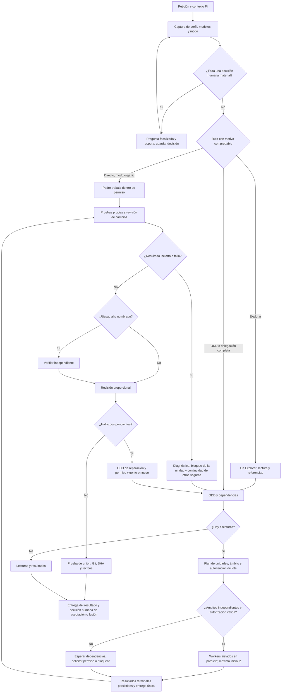

# ASEN — Plan rector completo de implantación del flujo de agentes

**Versión:** 1.0 · **Fecha:** 2026-11-19 · **Estado:** PLANIFICADO Y PENDIENTE DE AUDITORÍA INDEPENDIENTE.
**Repositorio:** asenbanskaliev/ASEN · **PR:** #61, borrador · **Rama:** `feat/flujo-de-agentes-20261115`.
**Objetivo de referencia:** Gentle Shell 4.9.0, commit `ce64a9a708e50c0ca899c8023140e63f29f293e1`. Objetivo propio: misma eficacia **observable** con controles de seguridad de ASEN y más autonomía útil.
**Punto de partida seguro:** D, commit `dcb68a67a5801ee672523206235273ac72e7a7cc`, con CI, arquitectura, Pi y publicación correctos. Los commits posteriores no heredan ese resultado.
**Fuentes:** [18 diferencias verificadas](./flujo-de-agentes-comparativa-actual-4.9.0.md), [matriz anterior de 26 casos](./flujo-de-agentes-equivalencia-operativa-4.9.0.md), [objetivo funcional](./flujo-de-agentes-objetivo.md) y [plan histórico](./flujo-de-agentes.md).
**Decisión principal:** máxima autonomía para planificar, leer, delegar, comprobar, recuperar y volver a intentar **solo acciones seguras**. El usuario no deberá escribir «continúa» repetidamente.

> Este plan no es evidencia de que E1–E4 estén implementadas. Las piezas A–D ya conectadas se deben reutilizar, sin reescribir el motor de agentes.

## 1. Condiciones de diseño no negociables

- **Automatización por defecto:** una petición basta para planificar y avanzar por las etapas autorizadas; las dependencias y eventos terminales despiertan al orquestador cuando haga falta, sin sondeo constante.
- **Modelos de pago normales:** los modelos del perfil elegido, sean gratuitos o de pago, y las alternativas configuradas se pueden usar automáticamente. No pedir una autorización por cada llamada al proveedor. El perfil es la autorización de elección de modelos; **no** concede escritura ni fusión.
- **Proveedores y modelos nuevos:** no inventar sustitutos, ni iniciar un proveedor no configurado, ni aparentar que se conoce su coste. Registrar coste real si está disponible y `unknown` en otro caso.
- **Una autorización por lote de escritura:** objetivo de automatización: una autorización humana **acotada** al lote, con identidad, SHA, rutas, operaciones, dependencias y duración. El anfitrión emite concesiones individuales y no ampliables para cada Worker; si Pi no lo permite sin rebajar controles, conservar temporalmente las confirmaciones por Worker. Cambios fuera del lote requieren nueva autorización.
- **Ningún merge por defecto:** la aceptación de código, el despliegue, la publicación y la fusión siguen siendo decisiones distintas con autorización explícita. Nunca hacer `git reset`, `stash`, sobrescritura, push o merge para resolver un bloqueo automáticamente.
- **Única autoridad:** el motor Pi y `Dispatcher` existentes son los puntos autorizantes; ni mensajes de modelo, ni documentación, ni resúmenes de Explorer amplían permisos.
- **Resultados verificables:** `started` ≠ `settled` ≠ `delivered` ≠ `reviewed` ≠ `accepted`. El historial sobrevive interrupciones y no dispara ejecuciones duplicadas.
- **Dos modos por perfil:** `organic` (normal: el padre puede ejecutar tareas directas permitidas) y `full-delegation` (el padre nunca escribe; Writer autorizado ejecuta todos los cambios). El modo se aplica al próximo turno, no muta agentes en marcha.
- **Sin datos sensibles:** no registrar claves, instrucciones privadas completas ni respuestas de proveedores con secretos. Mantener SHA y recibos de aceptación exactos.

## 2. Mapa de estados objetivo

**Si no se permite actuar:** detener la parte bloqueada y explicar causa, consecuencias y requisito exacto. Otras tareas realmente independientes pueden continuar sin solicitar repetidamente «continúa».

## 3. Matriz completa de los 18 objetivos

| Nº | Situación real de ASEN | Resultado final que debe demostrarse | Fase | Evidencia principal |
| --- | --- | --- | --- | --- |
| **01** Ruta directo/delegar parcialmente guiada por texto | Política observable con motivo; directo si seguro y suficiente | E1B | Prueba Pi de selección |
| **02** Solo perfiles por rol/modelo | `organic` y `full-delegation` por perfil y sesión | E1B | A/B mismo encargo |
| **03** Explorer limitado por lecturas/bytes y coste cero | Un Explorer por presupuesto/contexto, modelo configurado aun si es de pago; resumen acotado | E1A+E1B | Pruebas de presupuesto y coste |
| **04** ODD y ámbito requieren preparación | Unidades de comportamiento completas y dependencias explícitas, sin partición artificial | E1B | Matriz de independencia |
| **05** Supervisor exige preparar hijos | Padre prepara y lanza hasta 2 Writers Pi reales en paralelo | E2A | Tiempos de procesos solapados |
| **06** Ámbitos exactos ya seguros | Propuesta de ampliación verificable; nunca permiso implícito | E2A | Prueba de rutas no admitidas |
| **07** Entrega terminal con diario propio | Única entrega tras estado asentado y despertar sin duplicidad | E2B | Cancelación, reinicio, padre ocupado |
| **08** Continuación tras fallo conservadora | Continuar otras unidades ya autorizadas; jamás repetir escritura incierta | E2B | Pruebas de fallo y dependencia |
| **09** Cadena de modelos y esperas existentes | Usar modelos configurados pagos/gratuitos, alternativas, cuotas y coste observado | E1A+E2B | Fallos 429/red/autenticación |
| **10** Modelo principal requiere tarifa cero | Modelo del perfil con identidad válida, sin cambiar sesiones reanudadas | E1A | Pruebas positiva y de reanudación |
| **11** Riesgo informativo conectado a revisión | Riesgos nombrados obligan a Verifier; casos simples no sobrerrevisan | E3 | Pruebas de seis riesgos |
| **12** Revisión ordinaria Pi existente | Ciclo único sobre candidato congelado, estados y decisiones recuperables | E3 | Revisión + interrupción |
| **13** Dos jueces secuenciales y Fix separado | Dos jueces distintos cuando corresponda, hallazgos visibles, ≤2 rondas y Fix autorizado | E3 | Discrepancia, agotamiento |
| **14** Clarifier y permiso estricto | Preguntas normales con opciones, respuesta y reanudación; no convertir texto en consentimiento | E1B | Pregunta + cancelación |
| **15** SHA, ámbitos y diarios robustos | Conservar garantías y reducir solo bloqueos falsos demostrados | E0+E2 | Pruebas de carrera y Git |
| **16** Comparador sin A/B autenticado | Medir calidad, tiempo, turnos, tokens, coste real cuando exista | E4 | Repeticiones comparables |
| **17** Flujo integrado probado sobre todo con simulación | Demostrar recorrido completo con proveedores Pi reales y dos Workers | E4 | Registros de procesos y resultados |
| **18** Contratos Pi distintos de la referencia | Detectar capacidades reales, degradar de forma segura; no fingir eventos | E0+E2 | Matriz Pi por versión/sistema |

## 4. Plan de implantación — secuencia y entregables

### E0 — Línea base, seguridad y pruebas de ausencia
**Meta:** congelar el último SHA verde, inventario de contratos de Pi y políticas vigentes. Preparar pruebas rojas que fallen **por las funciones que faltan**, no por una diferencia de nombre.
**Intervenir:** `odd/tasks/flujo-de-agentes.md`, pruebas de rutas, `tests/pi-agent-runtime.test.ts`, `src/agents/pi-agent-tools.ts`, `src/runtime/lifecycle/profiles.ts`, CI.
**Salida:** lista de capacidades reales Pi, 18 objetivos y 26 casos comparativos con estado `PASS/FAIL/SKIP/UNKNOWN`; 0 regresiones del CI de D.

### E1A — Modelos configurados, incluidos los de pago
**Meta:** dejar de aplicar la política «solo coste cero» a un modelo **ya elegido en el perfil**, sin ampliar la lista de modelos.
**Intervenir:** `src/runtime/lifecycle/startup-orchestrator-model.ts`, `src/agents/pi-agent-tools.ts`, `src/runtime/lifecycle/plan-dispatcher.ts`, `extensions/asen.ts`, `src/runtime/lifecycle/parent-model-fallback.ts` y pruebas.
**Contrato:** modelo exacto en catálogo y perfil/cadena congelada, disponibilidad confirmada por resultado Pi, precio observado `number` o `unknown`. Ninguna autorización humana repetida para llamadas de un modelo configurado. Las alternativas conservan el máximo de 8 y las esperas 30/2 minutos existentes.
**Pruebas:** tarifa positiva/0/ausente, credencial caducada, 429, modelo externo no configurado, cambio de sesión, reanudación, coste no observable y sustitución sin bucle.
**Salida:** padre, Explorer, Reviewer y Verifier pueden usar modelos configurados independientemente de su precio, sin escribir por ello.

### E1B — Dos modos, decisiones y ODD autónomo
**Meta:** el padre elige, justifica y ejecuta rutas sin depender solo de recomendaciones de texto.
**Intervenir:** `profiles.ts` y migración compatible `asen.runtime-profiles/v1`, `session-profile-binding.ts`, `src/flow/odd-routing.ts`, `src/orchestration/orchestrator.ts`, `request-guidance.ts`, `explorer-budget.ts` y `extensions/asen.ts`.
**Contrato:** en modo normal trabajo directo si es seguro; en completo ninguna edición del padre. Crear unidades completas con dependencias. Explorer solo cuando aporte valor, con resumen `ruta:línea` y una comprobación focalizada.
**Pruebas:** tarea corta/grande cohesionada/dos unidades, perfil cambiado a mitad de sesión, Writer no disponible, contexto incompleto, 2 exploraciones simultáneas, pregunta de bloqueo y cancelación.
**Salida:** la misma petición en modos diferentes produce decisiones y efectos correctos; cada decisión deja motivo auditado.

### E2A — Lanzamiento paralelo real y autorización por lote
**Meta:** no exigir al usuario preparar manualmente dos sesiones hijas. Un solo permiso de lote **acotado** y no reutilizable debe servir para emitir autorizaciones exactas de sus unidades, cuando el anfitrión lo soporte.
**Intervenir:** `src/runtime/agents/parallel-parent-supervisor.ts`, `parallel-worktrees.ts`, `src/runtime/lifecycle/plan-dispatcher.ts`, `src/runtime/agents/task-agent-coordinator.ts`, `src/agents/agent-runtime.ts` y `extensions/asen.ts`.
**Contrato:** unidades con código+pruebas+documentación, SHA inicial, ámbito por hijo, tareas y dependencias inmutables al autorizar. Concurrencia inicial 2; cada Worker tiene identidad y permiso independiente **derivados de autorización de lote real**, nunca de texto generado. Si la API Pi no puede comprobar esa concesión, conservar aprobación por Worker.
**Pruebas:** dos hijos Pi reales con intervalos solapados; rutas coincidentes, conflicto de Git, rechazo de uno, segundo fuera del lote, reintento del lote, identidad cambiada y dependencia pendiente.
**Salida:** dos Writers realmente simultáneos sin escritura cruzada ni confirmaciones redundantes dentro del lote aprobado.

### E2B — Entrega, fallos y continuidad autónoma
**Meta:** trabajo continuo cuando termina un hijo, sin tener que escribir «continúa».
**Intervenir:** `agent-terminal-delivery.ts`, `agent-notification-journal.ts`, `task-agent-reconciler.ts`, `plan-dispatcher.ts`, `model-fallback-policy.ts`, `extensions/asen.ts`.
**Contrato:** estado asentado único, entrega única, recibo durable, despertar si Pi está libre; si padre ocupado, encolar y recuperar al turno correcto. Fallo conocido: otras unidades independientes con permiso vigente pueden continuar; escritura dudosa jamás se repite.
**Pruebas:** fallos antes/después del lanzamiento, timeout, resultado vacío, cancelación, proceso muerto, reinicio, padre ocupado, aviso duplicado y fallback de proveedor.
**Salida:** la ejecución prosigue sola cuando es seguro y explica bloqueos reales con causa verificable.

### E3 — Verificación proporcional y reparación acotada
**Meta:** no revisar en exceso trabajos sencillos y no aceptar cambios arriesgados sin Verifier.
**Intervenir:** `review-assessment-policy.ts`, `ordinary-review-command.ts`, `judgment-day.ts`, `dual-rejudgment.ts`, `review-acceptance.ts`, `parallel-worktree-reconciliation.ts`.
**Contrato:** siempre ejecutar las pruebas del autor; seis categorías de riesgo nombrado elevan a verificación independiente. Dos jueces distintos cuando se solicite, hallazgos congelados, corrección por ODD y permiso vigente o nuevo, máximo de dos rondas de nuevo juicio. Comprobación única de integración de unidades.
**Pruebas:** riesgo bajo/alto, ambos jueces pass con hallazgos, desacuerdo, revisión con diferente SHA, recibo falsificado, presupuesto agotado, intento de tercera ronda.
**Salida:** resultado comprobado y entregado, nunca autocertificado ni fusionado.

### E4 — Ensayos reales y comparación controlada
**Meta:** demostrar equivalencia observable con la referencia, no solo pruebas de contratos.
**Intervenir:** `src/review/agent-flow-ab-comparison.ts`, informes de tareas y CI, pruebas Pi autenticadas.
**Contrato:** tareas corta, exploratoria y multicomponente (2 independientes + 1 dependiente), condiciones repetibles, mismas capacidades/modelos comparables, coste real o `unknown`. Medir éxito funcional, fallos, tiempo, turnos, consumo, número de procesos en solape, revisiones y permisos solicitados.
**Pruebas:** al menos tres repeticiones por escenario cuando el presupuesto y proveedores estén disponibles; incluir cancelaciones y fallos controlados.
**Salida:** informe A/B con datos auditables; no afirmar que es más eficaz si hay diferencia de modelos o evidencias incompletas.

### F — Auditoría independiente final
**Meta:** revisar código conectado, seguridad, legibilidad, fiabilidad, resistencia a fallos, coste, concurrencia y equivalencia.
**Salida:** 0 hallazgos graves abiertos, matriz de 18 puntos con evidencias por SHA, CI completo Linux/macOS/Windows, publicación, Pi, permisos y recepción humana; propuesta de cierre **sin** fusionar automáticamente.

## 5. Automatización y autorización — decisión operativa

| Acción | Comportamiento recomendado |
| --- | --- |
| Investigar, planificar, preparar ODD, consultar Git y ejecutar pruebas permitidas | Automático |
| Usar modelos gratuitos o de pago **configurados** | Automático, con observabilidad de consumo |
| Cambiar al siguiente modelo **configurado** tras error recuperable | Automático dentro de la cadena, respetando pausas |
| Crear y lanzar Writers dentro de un lote de escritura ya autorizado | Automático **solo cuando el anfitrión pueda emitir permisos individuales comprobables** |
| Cambiar archivos fuera del lote, cambiar objetivo o elevar privilegios | Requiere nueva aprobación expresa |
| Repetir una escritura de resultado incierto | Prohibido hasta reconciliación y nueva decisión humana si procede |
| Aceptar un resultado sin recibos o pruebas exigidas | Prohibido |
| Fusionar ramas, publicar versiones o desplegar | Aprobación humana independiente |

**La experiencia objetivo es una aprobación inicial por lote, no un diálogo por cada paso**. Esta capacidad debe implementarse y probarse; todavía no existe de forma equivalente en el supervisor actual.

## 6. Contrato mínimo de pruebas (26 casos) y protección contra vacíos

| Casos | Qué comprobar |
| --- | --- |
| F49-E01–E04 | Modos normal/completo, Writer ausente, perfil nuevo y tarea en marcha |
| F49-E05–E06 | Explorer al superar presupuesto y modelo de pago/0/desconocido ya configurado |
| F49-E07–E09 | Writers con ámbitos disjuntos, dependencias, rechazo y lote incierto |
| F49-E10–E12 | Evento terminal frente a asentado, padre ocupado, aviso antiguo o duplicado |
| F49-E13–E16 | Fallos, fallback configurado, precio no visible y modelo realmente ejecutado |
| F49-E17–E19 | Riesgo bajo/alto, dos jueces y límite de corrección |
| F49-E20–E23 | SHA/árbol, recibo firmado, preguntas, capacidades Pi |
| F49-E24–E26 | CI exacto, concurrencia real, cancelación de hijo o padre |

**Se añaden escenarios nuevos:** C-PAGO-01 (modelo de pago configurado en padre), C-PAGO-02 (Explorer de pago configurado), C-PAGO-03 (alternativa pagada configurada), C-PAGO-04 (precio desconocido ≠ 0), C-PAGO-05 (modelo ajeno al perfil bloqueado), C-LOTE-01 (una aprobación válida para unidades exactas), C-LOTE-02 (ampliación de alcance rechazada), C-LOTE-03 (lote reanudado no repite escrituras), C-LOTE-04 (pérdida de autorización), C-CONT-01 (avance autónomo por evento real) y C-FIN-01 (CI, aceptación y no fusión automáticas).

Para **cada** prueba: guardar precondición, acción, efecto observado, evidencia, SHA, sistema operativo, modelo real/simulado, resultado y condición de bloqueo. Un `SKIP` no es `PASS`.

## 7. Control de cambios y decisiones previas a cada tanda

1. Congelar SHA antes de empezar, revisar CI y comentarios pendientes; dejar constancia de fallos previos.
2. Escribir pruebas que reproduzcan el hueco (RED), conectar el cambio mínimo al punto de entrada Pi, pasar pruebas (GREEN) y comprobar permisos negativos.
3. Aislar archivos por tarea y probar estados concurrentes y cambios de sesión/árbol.
4. Resolver observaciones de revisión, verificar CI, Pi, arquitectura, huella y Release Gate **en el mismo SHA**.
5. Marcar independientemente `IMPLEMENTED`, `RUNTIME_WIRED`, `HOST_SIMULATED`, `LIVE_AUTHENTICATED`, `AB_PARITY`, `CI_EXACT_SHA`, `ACCEPTED`.
6. No empezar una fase dependiente si la anterior tiene un fallo de seguridad o regresión crítica.

**Prioridad de trabajo:** E0 → E1A (modelos) → E1B (modos y decisiones) → E2A (Workers simultáneos) → E2B (continuidad) → E3 (revisiones) → E4 (equivalencia) → F (auditoría).

## 8. Riesgos, incertidumbres y límites del plan

- **Capacidad Pi no verificada:** si no ofrece un permiso derivado de lote o creación segura de hijos, diseñar una adaptación mínima y probarla antes de prometer «un clic». No simular permisos.
- **Perfiles heredados:** conservar el esquema `asen.runtime-profiles/v1` o migrar con compatibilidad y pruebas de lectura/escritura antes de cambiar el formato.
- **Coste:** un modelo configurado de pago se puede usar automáticamente, pero sin información de la factura no puede afirmarse que una operación costó 0 €.
- **Concurrencia:** dos Workers simultáneos son el valor inicial para medir, no una garantía universal; ajustar con resultados sobre conflictos, memoria y latencia.
- **Ajustes de fallbacks:** no ampliar cadenas ni reducir tiempos de espera por conjetura.
- **Seguridad:** las comprobaciones adicionales de ASEN pueden aumentar las confirmaciones frente a Gentle; reducirlas solo si la concesión de lote demuestra iguales o mejores garantías.
- **Comparación:** arquitectura distinta no significa diferencia funcional; exigir evidencia de comportamiento.
- **Integración:** PR #61 sigue en borrador y no se fusionará automáticamente.

## 9. Entregables verificables y definición de terminado

Cada fase debe publicar: contrato de estados y permisos; código mínimo; pruebas positivas/negativas; evidencia de ejecución del punto de entrada real; trazas sin secretos; informe de hallazgos; SHA; enlaces al CI y al control de publicación; lista de bloqueos/pendientes.

**Objetivo final:** ASEN acepta una petición, decide la ruta, trabaja en paralelo cuando conviene, usa automáticamente los modelos configurados, se recupera si puede, verifica el resultado y solicita intervención humana **solo en los límites de autoridad que no pueda cubrir una autorización previa**.

**`globalFull:false` hasta demostrar E4 y F.** El plan no afirma que las fases estén implementadas ni que existan llamadas reales certificadas.
